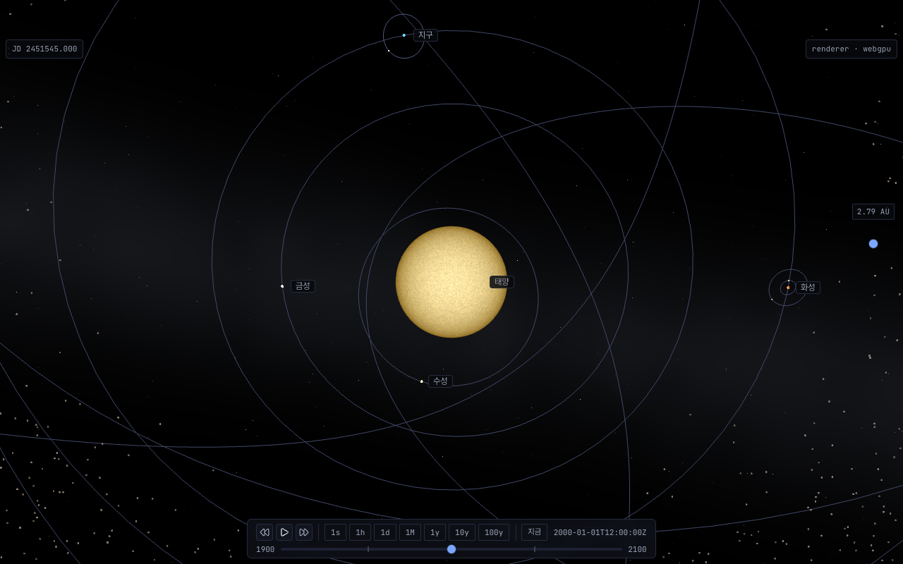
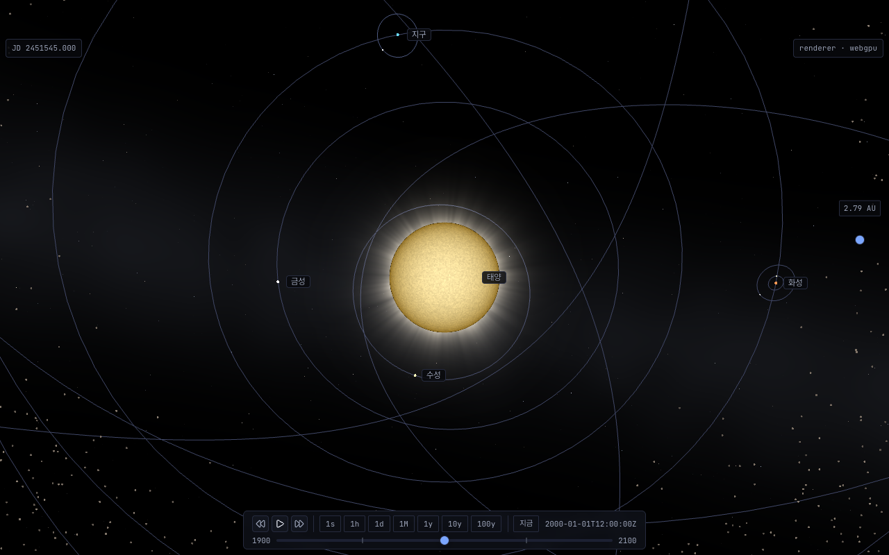
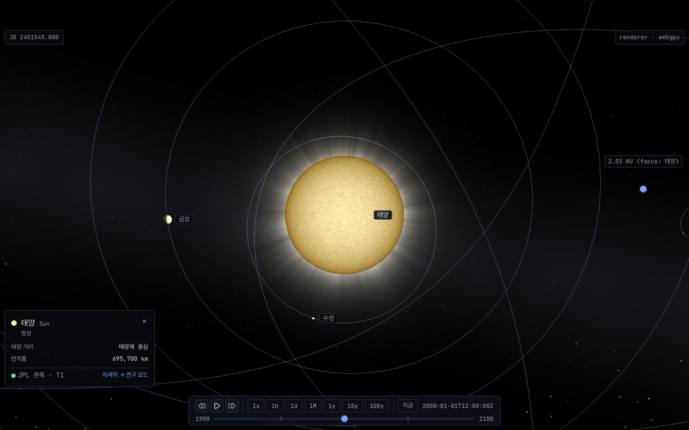

# ADR 20261014-1335 — 태양 코로나 · 홍염: 시선 정렬 고리(annulus) 셰이더 · 코로나 구 뒷면 배치 · 시간 불변

- **상태**: Accepted (cross-validate 2026-10-14) — §교차검증 반영 사항 통합 · 사용자 결정 Q1~Q8 전부 권고안 (2026-10-14)
- **날짜**: 2026-10-14
- **결정자**: architect (이슈 [#1335](https://github.com/coseo12/astro-simulator/issues/1335) · 사용자 선택 2026-10-14 「v0.97.0 혜성 꼬리 · 코마 다음 작업」)
- **관련**:
  - [ADR 20260703-774](20260703-774-sun-emissive-shader.md) §결과·재검토 조건 5 (코로나/플레어 — 별도 레이어로 이월) · 결정 6 (LOD 적용 범위) · 결정 7 (log-depth) · 재검토 조건 3 (시간 변동 — jd 직접 전달 금지 · 결정적 스크린샷 정합)
  - [ADR 20261010-1329](20261010-1329-comet-tail-coma.md) 결정 1 (view 공간 셰이더 메시) · 결정 2 (draw 직전 mesh 위치 기준계) · 결정 3 (`isVisible` 금지 — 교차검증 수용 1) · 결정 4 (소프트웨어 게이트 + `force`) · 결정 5 (토글)
  - [ADR 20261008-1319](20261008-1319-asteroid-belt-gpu.md) 결정 2 (`recordBodyFrame` 기준계 계약) · 결정 8 (bench −10 % 문턱)
  - [ADR 20260927-1265](20260927-1265-runtime-display-toggles.md) 결정 5 (URL ON = 키 삭제 / OFF = `off`) · 결정 7 (토글 표 SSoT)
  - [ADR 20260613-675](20260613-675-glow-pixel-marker.md) (태양 glow marker — LOD low 에서만 발동)
  - [ADR 20260628-756](20260628-756-procedural-planet-surface.md) Amendment 10 (구름 shell 의 host LOD 가시성 추종 — 본 ADR 결정 4 의 선례)
  - [`principles.md`](../architecture/principles.md) §1 Visual Fidelity (§의무 체크리스트 4항목 — 아래 §Visual Fidelity)
- **용어**: [Tier](../glossary.md#tier-t1--t2--t3), Floating Origin, renderScale, bodyScale

> **forensic 변형 판정 — 일반 ADR.** 신규 기능 설계다. 5조건 중 (2) runtime 측정 필수만 해당.

---

## 배경

태양은 #774 의 emissive 절차 셰이더로 **disk 안쪽만** 그린다. ADR 774 가 「코로나/플레어 — disk 밖 효과는 mesh fragment 로 불가, 별도 레이어」 로 미뤘고, 사용자가 v0.97.0 다음 작업으로 골랐다. 설계 전에 화면 기하 · 내행성 배치 · 렌더 비용을 실측했다.

### 실측 (2026-10-14, architect)

환경: 로컬 macOS · `next start` prod 빌드 (develop `4572c11d`) · Playwright headless · 1280×800 DPR 1 · `?speed=0` (J2000). 렌더러 축 3개 — `metal` WebGPU / `metal` + `navigator.gpu` 은닉 init script (**하드웨어 WebGL2** — `rendererKind='webgl2'`, `__isSoftwareRenderer=false`) / `swiftshader` (WebGL2, 소프트웨어 — `__isSoftwareRenderer=true`). 측정 스크립트는 일회성 (커밋 안 함, volt #67 패턴). POC 는 페이지 안에서 `__simCore.scene` 에 메시 · `ShaderMaterial` 을 직접 붙였다 (앱 코드 변경 0).

**1-A. 태양 disk 화면 반경.** 반경 = `(H/2) · tan(α) / tan(fov/2)`, `α = asin(R/d)` (태양이 화면 중앙 — 4 장면 모두 `(640.0, 400.0)` 실측). `R` 은 sun mesh `boundingBox.extendSizeWorld.x` (⚠️ `boundingSphere.radiusWorld` 는 AABB 반대각이라 `√3 R` — 첫 측정에서 이 값을 써 수치가 틀렸고 버렸다).

| 장면 | 카메라 radius | disk 반경 px | d / R |
| --- | ---: | ---: | ---: |
| 기본 (J2000) | 35.00 | 79.26 | 11.978 |
| `?focus=sun` | 25.30 | 109.98 | 8.660 |
| 줌 A (코로나 3R 이 화면 반높이를 넘는 거리) | 19.96 | 140.00 | 6.831 |
| 줌 B (disk 가 화면을 덮는 거리) | 4.53 | 800.00 | 1.549 |

`?focus=sun` 카메라 `lowerRadiusLimit = 3.068` (d/R ≈ 1.05 까지 근접 가능 — 결정 1 의 각도 처리 근거).

**1-B. 수성 궤도는 태양 disk 반경의 2배 안쪽에 있다.** 태양 bodyScale 50 (`body-scale.ts` `SUN_SCALE`) 이라 시각 반경 R_vis = 0.2325 AU. 궤도 요소로 계산한 근일점 / 원일점 거리 ÷ R_vis:

| 천체 | 근일점 / R_vis | 원일점 / R_vis |
| --- | ---: | ---: |
| 수성 | 1.322 | 2.007 |
| 금성 | 3.090 | 3.132 |
| 지구 | 4.229 | 4.373 |

런타임 교차 확인: J2000 수성–태양 거리 `2.006 R` · 수성 mesh 반경 / 태양 R `0.0491` · 지구–태양 상대위치 `(−0.762, 4.160, 0) R`. **장면 z 축이 황도면 법선이다** (지구 z = 0 — 결정 3 의 「적도 집중」 축).

**1-C. LOD — 태양 low 변형은 bodyScale 을 곱하지 않는다.** high/mid 는 `반경 × renderScale × bodyScale(50)`, low (billboard) 는 `bodyScale` 미적용 (#333, `body-mesh-factory.ts` `createBodyBillboard`). 가시성은 `isVisible` 로 전환된다 (`solar-system-scene.ts` LOD 적용부 — high 는 `setEnabled(true)` 유지). 코로나를 bodyScale 반경에 맞추면 low 에서 disk 보다 50배 큰 고리가 남는다 → 결정 4.

**1-D. POC — 시선 정렬 고리 · 코로나 구 뒷면 배치.** 정점 96 분절 × 2 (안쪽 ρ = 1 · 바깥 ρ = 3) 의 고리를 태양 방향 `s` 에 수직인 평면 (카메라에서 `d + 3R`) 에 펼치고, fragment 가 시선 광선과 `s` 의 각도에서 `ρ = 각도 / α` 를 계산해 `ρ < 1` · `ρ > 3` 을 버린다. 세기 = `0.6 · ρ⁻³ · (1 − t)² · (0.6 + 0.8 · fbm(e · 6))` (`t = (ρ−1)/(ρ_out−1)`, `e` = 시선의 `s` 수직 성분 단위벡터 — 세계 좌표). fbm 은 sun 셰이더와 같은 3-옥타브 텍스트. ALPHA_ADD · depth write off · depth test on · 로그 depth. 비교용 **quad** 는 같은 셰이더를 `ρ ≤ 3√2` 정사각형에 그린다 (disk 안쪽도 래스터).

(WebGPU 하드웨어. POC 상수는 형태 확인용이며 최종값이 아니다 — 결정 3.) 전 렌더러 POC 머티리얼 `isReady=true` · 콘솔 에러 0.

**1-E. 렌더 비용.** 같은 페이지에서 `setEnabled` on/off 3회 교차, 3 s rAF 계수 중앙값.

(가) vsync 유지 — 하드웨어는 120 Hz 상한 안의 동률까지만 말한다.

| 셀 | metal WebGPU (on/off) | metal WebGL2 (on/off) | swiftshader (fps off → on) |
| --- | ---: | ---: | --- |
| 기본 · 고리 | 1.001 | 1.000 | 45.8 → 42.5 (0.929) |
| focus · 고리 | 1.001 | 0.999 | 44.9 → 39.5 (0.879) |
| focus · quad | 0.998 | 1.001 | 44.2 → 39.2 (0.886) |
| 줌 A · 고리 | 0.999 | 1.000 | 44.2 → 36.6 (0.829) |
| 줌 A · quad | 1.001 | 0.999 | 44.3 → 37.2 (0.839) |
| 줌 B · 고리 | 0.999 | 1.000 | 44.3 → 45.2 (1.019) |
| 줌 B · quad | 0.999 | 1.001 | 44.8 → 37.1 (0.829) |

(나) vsync 해제 (`--disable-gpu-vsync --disable-frame-rate-limit`) — 하드웨어의 프레임당 증분 (ms, `1000/on − 1000/off`). **rAF 간격 기준이지 GPU 타이머가 아니다**, 1회 실행.

| 렌더러 | 기본 | focus 고리 | focus quad | 줌 A 고리 | 줌 A quad | 줌 B 고리 | 줌 B quad |
| --- | ---: | ---: | ---: | ---: | ---: | ---: | ---: |
| metal WebGPU | +0.004 | +0.075 | +0.064 | +0.144 | +0.123 | −0.003 | +0.038 |
| metal WebGL2 | +0.017 | +0.066 | +0.052 | +0.058 | +0.068 | +0.024 | +0.041 |

읽을 수 있는 것만 적는다: (1) 하드웨어는 vsync 상한 안에서 차이가 없다. (2) 소프트웨어는 코로나 화면 면적이 클수록 떨어진다 (기본 −7 % → 줌 A −17 %). (3) **줌 B (disk 가 화면을 덮음) 에서 고리는 래스터 면적이 0 이라 세 렌더러 모두 증분이 없고, quad 는 있다** (swiftshader 0.829 · WebGPU +0.038 ms · WebGL2 +0.041 ms). 고리 · quad 가 둘 다 보이는 셀의 둘 사이 차이는 1회 실행이라 해석하지 않는다. **알파가 0 에 가까워도 래스터된 면적의 비용은 남는다** (#1329 교훈) — 그래서 면적 자체를 줄이는 고리를 고른다 (결정 1).

## 후보 비교

### 축 1 — 렌더 경로

| 후보 | disk 안쪽 래스터 | 모든 시선 방향 | 비용 (1-E) | 비고 |
| --- | --- | --- | --- | --- |
| **(A) 시선 정렬 고리 + fragment ρ 판정** | 없음 (안쪽 테두리 = disk 실루엣) | ✓ (`s` 수직 평면) | 줌 B 증분 0 | 정점 셰이더가 매 draw 각반경으로 펼친다 |
| (A′) 같은 셰이더, 화면 정렬 quad | 있음 (깊이 판정으로 버려질 뿐) | ✓ | 줌 B swiftshader 0.829 · 하드웨어 +0.04 ms | `focus=sun` 근접 줌에서 비용이 화면 전체로 커진다 — 기각 |
| (B) 태양 동심 구 shell (#1215 구름 shell 형) | 있음 — 앞 반구가 disk 를 덮어 fragment 판정 필요 | ✓ | 미실측 | 구 표면 투영이라 시선 경로 길이 보정 (림에서 두꺼움) 을 따로 셰이딩해야 한다. 이득 없음 — 기각 |
| (C) `GlowLayer` / bloom 후처리 | 해당 없음 (전체 화면 패스) | ✓ | 미실측 (전체 화면 패스 1개 이상) | 모든 emissive (glow marker 포함) 에 번진다 · 이슈 비목표 「bloom 파이프라인 전면 도입」 · 현재 후처리 0건 (`GlowLayer` / `DefaultRenderingPipeline` grep 0) — 기각 |
| (D) `comet-tail.ts` 코마 쿼드 (kind 0) 재사용 | 있음 | ✓ | — | 코마는 머리 중심 원판 · 화면 px 하한 · 근접 페이드 · 활동도 접기가 계약이고, 코로나는 disk 실루엣 구멍 · 뒷면 배치 · 각반경 ρ 가 계약이다. 공유 부분은 「draw 직전 mesh 위치 → uniform」 패턴과 로그 depth SSoT 뿐이라 **모듈 재사용이 아니라 패턴 · SSoT 재사용**으로 둔다 (결정 1 의 재사용 목록) |

### 축 2 — 깊이 배치 (가림 순서)

| 후보 | 수성 (코로나 구 안) | 코로나 구 안의 궤도선 | 코로나 구 밖 앞쪽 천체 (예: `focus=earth` 에서 지구) | 코로나 구 밖 뒤쪽 천체 |
| --- | --- | --- | --- | --- |
| (i) 태양 중심 평면 | 평면이 수성을 가로지르면 수성 위에 경계선 (앞 반은 가리고 뒤 반은 가산) | 앞 절반만 코로나를 가린다 — 한 궤도선이 둘로 나뉜다 | ✓ 가림 | ✓ 가산 |
| **(ii) 코로나 구 뒷면 (`d + ρ_out·R`)** | 항상 코로나 앞 — 경계선 없음 | 전부 코로나 앞 (POC 스크린샷 — 수성 궤도선이 코로나 위로 지난다) | ✓ 가림 | ✓ 가산 |
| (iii) depth test off + disk 안 해석적 discard | 항상 가산 (수성이 빛난다) | 항상 가산 | ✗ **앞쪽 천체 위에 코로나가 더해진다** | ✓ |

(i) · (iii) 은 미실측이다 — 기각 근거는 위 표의 구조 (깊이 판정 결과) 다. (ii) 의 대가: 코로나 구 안에서 **태양 뒤쪽**에 있는 천체 (수성이 태양 너머 ρ 1~2 에 있을 때) 도 코로나 앞에 그려진다. 코로나는 광학적으로 얇아 실제로는 그 천체 위에 빛이 더해진다 — 이 차이는 Visual Fidelity 근사로 받아들인다.

### 축 3 — 시간 변동

| 후보 | 결정성 (ADR 774 재검토 3) | 광과민성 | 추가 계약 |
| --- | --- | --- | --- |
| **(a) 정적 — 시간 uniform 없음** | ✓ 같은 카메라 = 같은 픽셀 | 해당 없음 | 없음 |
| (b) 플레어 · 코로나 흐름 시간 변동 | ✗ 결정적 스크린샷 비교에 시간 축 대책 필요 | `prefers-reduced-motion` 연동 + 토글 정지 의무 (로드맵 횡단 검토) | 시간 uniform 은 jd float32 직접 전달 금지 (#782) — 주기로 접은 소수 시간 · 재생/일시정지 의미 정의 |

### 축 4 — 소프트웨어 렌더

| 후보 | CI 픽셀 가드 영향 | 소프트웨어 사용자 비용 (1-E) | CI 셰이더 컴파일 |
| --- | --- | --- | --- |
| (i) 게이트 없음 | **태양이 보이는 모든 가드의 프레임이 바뀐다** (기본 화면 포함) | 기본 −7 % · focus −12 % · 줌 A −17 % | ✓ |
| **(ii) 소프트웨어 렌더면 미생성 + `?corona=force` 우회** | 0 (#745 · ADR 1319 결정 3 · ADR 1329 결정 4 와 같은 구조) | 0 | `force` 셀에서만 ✓ (Q7) |

## 결정

**결정 1 — 렌더 경로 (A) 시선 정렬 고리.** 태양 1개 = 메시 1개 (`sun-corona`) · GLSL `ShaderMaterial` 1개 (draw call +1). 신규 모듈 `packages/core/src/scene/sun-corona.ts`.

- 정점 속성은 매개변수 `(u, v)` — `u ∈ [0,1]` 둘레 각 · `v ∈ {0, 1}` 안쪽/바깥 테두리. 분절 수는 상수 (POC 96 — 안쪽 테두리가 내접 다각형이라 현의 안쪽 여유는 `1 − cos(π/N)` R, fragment `ρ < 1` 판정이 실루엣을 정확히 자른다).
- 정점 셰이더: `s = normalize(sun − cameraPosition)`, `d = |sun − cameraPosition|`, `α = asin(min(R/d, 1))`, 평면 거리 `L = d + ρ_out · R` (결정 2 — 코로나 구 뒷면), 펼침 반경 `L · tan(min(ρ·α, 각도 상한))`. 각도 상한은 `π/2` 미만의 상수로 `tan` 발산만 막는다 — 카메라가 `lowerRadiusLimit` (d/R ≈ 1.05, 1-A) 까지 와도 NaN 이 없어야 한다 (DoD D7). `s` 에 수직인 기저는 `s` 와 평행하지 않은 보조축의 외적으로 만든다 (POC 와 같은 분기).
- fragment: 시선 광선 `r` 과 `s` 의 각도에서 `ρ = acos(clamp(r·s, −1, 1)) / α` 를 **fragment 마다** 계산한다 (clamp — §교차검증 합의 1) (정점 보간 ρ 는 `tan` 때문에 비선형). `ρ < 1` 또는 `ρ > ρ_out` 이면 `discard`.
- 블렌딩 `ALPHA_ADD` · `disableDepthWrite = true` · depth test on · 로그 depth 는 `LOG_DEPTH_FRAGMENT_WRITE_GLSL` SSoT · `backFaceCulling = false` · `alwaysSelectAsActiveMesh = true` · **`isPickable = false`** (클릭 선택 `body-picking` 에 끼지 않는다) · **`alphaIndex = 0`** — 반투명 중 가장 먼저 그려 뒤이은 반투명 (고리 · 구름 · LOD 교차 페이드) 이 그 위에 합성된다 (Babylon 정렬과 `createHostFamilyTransparentSortCompare` 모두 `alphaIndex` 오름차순이 1순위). ALPHA_ADD 끼리 (혜성 꼬리) 는 순서 무관.
- **재사용 (신규 구현 금지)**: `LOG_DEPTH_FRAGMENT_WRITE_GLSL` (`log-depth.ts`) · `BodyReferenceFrame` + `frameProvider` 패턴 (`belt-particles.ts` · `comet-tail.ts`) · `onBeforeRenderObservable` uniform 갱신 (ADR 1329 결정 2 머리말 — `onBindObservable` 은 다음 draw 반영) · noise 는 sun 셰이더와 **같은 텍스트**의 `hash33/valueNoise/fbm` + JS 미러는 `fbmMirror` (`sun-shader.test.ts` 의 noise 텍스트 동일성 계약에 코로나 GLSL 을 추가한다 — 새 가드가 아니라 기존 테스트 확장) · `cameraPosition` auto-bind (sun 셰이더 선례).

**결정 2 — 기준계: 코로나는 「태양 mesh 가 이 draw 에 쓴 위치」 와 「같은 기록 스케일」 만 읽는다.** `mesh.onBeforeRenderObservable` 에서

- 중심 = `sun host mesh.position` (ADR 1329 결정 2 의 `sunMesh` 와 같은 참조)
- 반경 `R = body.radius × bodyScale('sun') × bodyFrame.scale` — `bodyFrame.scale` 은 ADR 1319 결정 2 의 `recordBodyFrame` 기록값 (신규 기록 지점 0), `bodyScale` 은 장면 옵션 그대로. sun high mesh 의 세계 반경과 같아야 한다 (DoD D4 가 단언).
- `floatingOrigin.originOffset` 은 읽지 않는다 (가드 C 순서상 다음 프레임 값 — ADR 1319 결정 2 와 같은 함정). 시간 위상 (`updateAt`) 에는 아무것도 걸지 않는다 — 일시정지 · tier 전환 · 포커스 이동 · Floating Origin 이동이 다음 draw 에 반영된다.
- 줄무늬 방향 벡터 `e` 는 세계 좌표 방향이라 origin 이동 · 균일 스케일에 불변이다 — 카메라가 태양 주위를 돌면 다른 단면이 보인다 (화면에 붙은 무늬가 아니다).

**결정 3 — 세기 · 형태 · 색 (rendering-only 상수, 최종값은 D-T2 육안).**

- **반경 프로파일** — Baumbach (1937) 의 K-코로나 경험식 형태를 ρ = 1 에서 1 로 정규화한 `f(ρ) = (0.0532 ρ⁻²·⁵ + 1.425 ρ⁻⁷ + 2.565 ρ⁻¹⁷) / 4.0432` 를 쓴다. 이 형태는 매우 가팔라 (`f(1.5) = 0.026` · `f(2) = 0.0051` — 계산값) 그대로는 림의 얇은 띠만 보인다. 표시용 압축 지수 `CORONA_DISPLAY_GAMMA` 하나로 `f^γ` 를 쓴다 (`γ = 0.3` 이면 `f(2)^γ = 0.205` · `f(3)^γ = 0.126` — 계산값). 바깥 테두리에서 0 으로 닫기 위해 `(1 − t)²` (`t = (ρ−1)/(ρ_out−1)`) 를 곱한다 — POC 와 같은 식, 새 임계 아님. 형태를 출처 있는 식에서 가져와 미학 상수를 `γ` · 피크 알파 2개로 줄인다.
- **줄무늬 (스트리머)** — `1 + CORONA_STREAMER_AMPLITUDE · (fbm(e · CORONA_STREAMER_SCALE) − 0.5) · 2` 배. `e` 에만 의존하므로 반경 방향으로 곧은 광선이 된다 (POC 확인). Q1 (c) 채택 시 적도 집중 배율 `mix(1, 1 − |e·ẑ|, CORONA_EQUATORIAL_WEIGHT)` — `ẑ` = 장면 z (황도 북극, 1-B 실측). 태양 자전축과 황도 북극의 7.25° 차이는 무시한다 (데이터 0 유지 — sun 레코드에 자전축 데이터 없음, ADR 774 결정 3).
- **홍염 (Q4 채택 시)** — `ρ ∈ [1, 1 + CORONA_PROMINENCE_HEIGHT]` 띠 안에서 `e` 의 고주파 noise 가 문턱을 넘는 곳만 붉게 (`CORONA_PROMINENCE_RGB`) 더한다. 정적 · 림 고정. 실제 홍염 높이는 기본 화면 disk 79 px (1-A) 기준 수 px 수준이라 높이는 과장한다 (D-T2 에서 값 확정, 거슬리면 상수 0 이 아니라 **항 자체를 삭제**).
- **색** — Q3.

상수는 모두 `sun-corona.ts` 소유 (rendering-only — `solar-system.json` 무변경). 셰이더 식과 같은 JS 미러 (`coronaProfileMirror` 등) 를 두고 단위 테스트가 상수 · 단조성 · 경계값을 가드한다 (sun 셰이더 `sunColorMirror` 선례).

**결정 4 — 가시성 축 2개를 분리한다. 코로나 자신의 observer 안에서 `isVisible` 을 쓰지 않는다.**

1. **LOD 추종 (`isVisible`)** — 매 프레임 프레임 위상 (`runFramePass` 의 LOD 적용부, 구름 shell 이 `cloudLayer.mesh.isVisible = highMesh.isVisible || mid?.isVisible === true` 를 쓰는 바로 그 자리) 에서 `corona.isVisible = sunHigh.isVisible || sunMid?.isVisible === true` 를 쓴다. low (bodyScale 미적용 billboard · glow marker 발동 구간 · tier-c `forceOverride:'low'`) 에서 코로나가 꺼지고, high/mid 로 돌아오면 다시 켜진다. **쓰는 주체가 코로나 메시 밖 (프레임 위상) 이라 재활성 경로가 산다.** ⚠️ ADR 1329 교차검증 수용 1: Babylon 9.19 는 `isVisible = false` 메시를 active mesh 에서 빼고 `onBeforeRenderObservable` 을 그 메시의 `Mesh.render` 안에서만 알린다 — 코로나 자신의 observer 에서 끄면 다시 켤 기회가 사라진다.
2. **표시 토글 (`setEnabled`)** — 결정 6. 다시 켜는 주체는 명령이다.

두 플래그를 하나로 합치지 않는다 (ADR 1329 §교차검증 Claude 고유 1 과 같은 이유).

**결정 5 — 소프트웨어 렌더 게이트 (ii).** web 이 `detectSoftwareRenderer` 결과로 core 옵션 `sunCorona: boolean` 을 넘긴다 (core 는 렌더러를 모른다 — ADR 1265 결정 1). `?corona=force` 로 게이트를 우회해 강제 생성한다 — 게이트만 있으면 CI (소프트웨어 렌더) 가 코로나 GLSL 을 한 번도 컴파일하지 않는다 (ADR 1329 결정 4 · 교차검증 수용 2 와 같은 사각). CI 실행 셀 추가 여부는 Q7.

**결정 6 — 토글 · URL.** 토글 표 (`display-toggles.ts`) 에 1행 — `corona` (라벨 「태양 코로나」, URL `?corona=off`, ON = 키 삭제 — ADR 1265 결정 5). 홍염을 채택하면 같은 토글이 함께 끈다 (Q8). 파서는 `apps/web/src/core/parse-corona-mode.ts` 에 `parse-comet-tails-mode.ts` 와 같은 3함수 (`parseCoronaParam` URL → `{ visible, forced }` · `parseCoronaVisible` 토글 표 역방향 · `resolveCoronaAtLoad` 로드 시 게이트). 가용성 = `!isSoftwareRenderer || ?corona=force` (ADR 1329 Amendment 1 항목 2). 처음 켤 때 지연 생성, 이후 `setEnabled` (ADR 1319 결정 6 수명주기). 장면 dispose 시 메시 · 머티리얼 해제.

**결정 7 — 시간 불변 (축 3 (a)).** 셰이더에 시간 · jd uniform 을 두지 않는다. 플레어 · 흐름은 범위 밖 (재검토 트리거 4). 따라서 광과민성 옵션은 이번 범위에서 **해당 없음**이며, 시간 불변은 DoD D6 으로 단언한다.

**결정 8 — 하드웨어 기본 화면은 바뀐다 (기능 노출). 꺼진 경로는 메시 0.** 기본 켜짐 (Q6) 이면 하드웨어 기본 진입 화면에 코로나가 보인다 — 이것이 기능이다. `?corona=off` (로드) 는 메시를 만들지 않고, 런타임 OFF 는 `setEnabled(false)` 다. 「꺼진 화면 = 현행」 은 같은 페이지 off 프레임 대조로만 단정한다 (DoD D2).

## 결과·재검토 조건

- **기대 효과** — 태양 disk 바깥 ρ ≤ 3 에 광선 구조가 있는 코로나가 보인다. 하드웨어 vsync 상한 안의 동률 (1-E (가)), disk 가 화면을 덮는 근접 줌에서는 래스터 면적 0 (1-E 줌 B). 기준계 · 재활성 결함 클래스 (ADR 1319 1-C · ADR 1329 교차검증 수용 1) 를 구조로 피한다 (결정 2 · 4).
- **받아들인 비용** — GLSL 셰이더 1종 추가 (WebGPU 는 Babylon GLSL→WGSL 변환 의존 — switch 금지, if-else 만). 소프트웨어 렌더 사용자에게는 코로나가 없다. 코로나 구 안 · 태양 뒤쪽 천체가 코로나 앞에 그려진다 (축 2 (ii)). 코로나 구 밖 태양 뒤쪽의 반투명 (예: 태양 너머 토성 고리) 은 `alphaIndex = 0` 때문에 코로나 위에 합성된다 [추정 — 미실측]. LOD high/mid ↔ low 전환 시 코로나가 페이드 없이 켜지고 꺼진다 (disk 실효 지름 8 px 경계 — `LOD_PIXEL_THRESHOLDS`).
- **재검토 트리거**
  1. 하드웨어 A/B (`bench:scene` · 기본 vs `?corona=off`) 에서 어느 셀이든 −10 % 초과 하락 → 결정 1 재검토 (ADR 1319 결정 8 · ADR 1329 트리거 1 과 같은 문턱).
  2. 사용자 육안에서 수성 · 궤도선이 코로나 위에 그려지는 모습 (축 2 (ii)) 이 거슬린다는 보고 → 축 2 재검토 (깊이 페이드 텍스처 도입 여부와 함께).
  3. LOD 전환 시 코로나 점멸이 거슬린다는 보고 → 결정 4 의 1 에 LOD 교차 페이드 알파 추종 추가.
  4. 플레어 · 시간 변동 요구 → 축 3 (b) — 광과민성 (`prefers-reduced-motion` + 토글 정지) · #782 시간 uniform 규약 · 결정적 스크린샷 대책을 한 묶음으로 별도 ADR.
  5. 태양 자전축 데이터가 들어오면 → 결정 3 의 적도 축을 황도 북극에서 자전축으로 교체.
  6. 소프트웨어 렌더가 CI 외 사용자 환경에서 유의미하게 관측되면 → 결정 5 재검토 (ADR 1319 트리거 4 · ADR 1329 트리거 3 과 같은 축).

## 사용자 결정 (2026-10-14 — 전부 권고안)

이슈 [#1335](https://github.com/coseo12/astro-simulator/issues/1335) 설계안 코멘트의 Q1~Q8. 사용자가 아래 권고 열을 그대로 채택했다. Q2 · Q4 는 cross-validate 이견 (ρ_out 2~2.2 · 홍염 미포함) 을 함께 제시한 뒤의 선택이다 — Q4 는 D-T2 에서 거슬리면 홍염 항을 삭제한다는 퇴로를 유지한다.

| # | 항목 | 선택지 | 권고 |
| --- | --- | --- | --- |
| Q1 | 코로나 형태 | (a) 등방 매끈 · (b) 스트리머 등방 · (c) 스트리머 + 적도(황도면) 집중 | (c) — `CORONA_EQUATORIAL_WEIGHT = 0` 이면 (b) 로 돌아간다 |
| Q2 | 바깥 반경 ρ_out | 2 · 3 · 4 (× disk 반경) | 3 — 금성 궤도 (3.09~3.13 R) 밖, 상호작용 천체는 수성뿐 (1-B) |
| Q3 | 색 | (a) 진주빛 백색 (POC `(1.0, 0.95, 0.85)`) · (b) 태양 `colorHint` (#FFE9A8) 와 같은 난색 | (a) — disk 가장자리 주황 (limb darkening) 과 구분된다 |
| Q4 | 홍염 | (a) 포함 — 정적 · 림 고정 · 높이 과장 · (b) 미포함 | (a) — D-T2 에서 거슬리면 항 삭제 |
| Q5 | 플레어 · 시간 변동 | (a) 없음 (정적) · (b) 시간 변동 + 광과민성 옵션 | (a) — 재검토 트리거 4 로 분리 |
| Q6 | 하드웨어 기본 표시 | (a) 켜짐 · (b) 꺼짐 (옵트인) | (a) — 혜성 꼬리 · 띠와 같은 기본 |
| Q7 | 소프트웨어 렌더 · CI | (a) 미생성 + `?corona=force` + **기존** `verify-fps-baseline.mjs` 의 `requiredMeshes` 강제 셀 1개 (새 임계 0) · (b) 미생성 + `force` 만 (CI 셀 없음) · (c) 게이트 없음 | (a) — CI 가 코로나 GLSL 을 컴파일하는 유일한 경로. 신규 가드가 아니라 기존 가드의 셀 추가 (혜성 셀 선례) |
| Q8 | 토글 | (a) 1행 「태양 코로나」 (홍염 포함) · (b) 코로나 · 홍염 2행 | (a) |

## Visual Fidelity — §의무 체크리스트 (principles.md §1)

- [x] **데이터 SSoT 보존** — 코로나 상수는 전부 `sun-corona.ts` rendering-only. `solar-system.json` 변경 0 (적도 축도 데이터 추가 없이 장면 z 축 근사 — 결정 3).
- [x] **rendering 시점 분리** — 물리 엔진은 코로나를 모른다. 코로나는 draw 직전 태양 mesh 위치 · 기록 스케일에서 파생한다 (결정 2).
- [x] **사용자 D-T2 가이드** — 코로나 반경은 시각 과장된 disk (bodyScale 50) 의 배수다. 정보 카드 반지름 (695,700 km) 은 실측값 그대로이며 코로나 크기 문구는 추가하지 않는다 (범위 밖). 반경 · 밝기가 표시 근사임을 PR · CHANGELOG 에 적는다.
- [x] **점유율 baseline** — §1-A 표 (4 장면의 disk 반경 px) 가 baseline 이다.

## 교차검증 반영 사항

cross-validate (agy, 2026-10-14) — 로그 `.claude/logs/cross-validate-architecture-20261014-125211.log`. 판정 「조건부 승인 (High 2 · Medium 3)」. 메인 오케스트레이터가 지적마다 코드 · ADR 본문과 대조해 재분석했다 (맹목 수용 · 기각 금지).

### 합의 (수용)

1. **`acos` 정의역 clamp** (agy 1-3) — fragment 의 `acos(r·s)` 는 `acos(clamp(dot(r, s), -1.0, 1.0))` 로 쓴다. 결정 1 의 fragment 항에 반영 대상 (구현 계약). D7 (`lowerRadiusLimit` 근접 · 픽셀 유한) 이 이를 동적으로 확인한다.
2. **지연 생성 전 null 가드** (agy 2-2) — 결정 4 의 1 (프레임 위상 `isVisible` 쓰기) 은 코로나 메시가 없을 때 (`?corona=off` 로드 · 소프트웨어 미생성) 건너뛴다. D2 · D8 의 「메시 0」 경로에서 콘솔 에러 0 이 이를 확인한다.
3. **고리 채택 근거의 구조화** (agy 4) — 근거를 「줌 B 증분 0」 한 셀에 기대지 않는다: **고리의 래스터 영역은 같은 셰이더 quad 영역의 진부분집합**(disk 안쪽 제외)이라 어느 카메라에서든 고리 fragment 수 ≤ quad fragment 수다. 줌 B 는 차이가 최대가 되는 셀일 뿐이다. 1-E 의 1회 · rAF 기반 하드웨어 수치는 근거로 쓰지 않는다 (본문 「읽을 수 있는 것만」 과 같은 입장).

### 이견 (기각 — 근거)

1. **「근접 시 전 화면 블리드 = 결함」** (agy 1-1, High) — 산술 (`d < ρ_out·R` 이면 모든 시선의 `ρ ≤ π/α < ρ_out`) 은 맞다. 그러나 이는 **카메라가 코로나 구 안에 있을 때 사방이 코로나인 것**이라 결함이 아니라 기하 그대로다. 1-E 줌 A (코로나가 화면 반높이를 넘는 거리) 가 바로 이 영역의 비용 실측 셀이다. 근접 페이드 공식은 새 임계 (`1.05`) 를 만든다 — 도입하지 않는다. 사용자가 D-T2 에서 근접 화면을 거슬려 하면 재검토 트리거로 다룬다.
2. **「tan 상한 근처 긴 삼각형의 래스터 오버헤드」** (agy 1-2) — 화면 밖 정점은 클리핑되고, 비용은 화면 안 fragment 수로 정해진다. 단 이 반론은 **각도 상한을 화면 대각 반시야각보다 크게 둘 때만** 성립한다 — 기본 fov 0.8 rad (`tier-transition.ts:65`) · 1280×800 에서 `atan(tan(0.4) · √(1 + 1.6²)) ≈ 38.6°` (계산값). 상한이 이보다 작으면 화면 안에 코로나의 각진 바깥 끝이 보인다 → 구현 계약: 각도 상한 상수는 이 값보다 크고 `π/2` 보다 작게 두고, 단위 테스트로 그 범위를 단언한다 (D9 에 포함).
3. **「일시정지 중 LOD 미갱신」** (agy 2-1) — 전제가 현행 코드와 다르다. LOD 는 #1205 로 프레임 위상 (`runFramePass`, `solar-system-scene.ts:2532` 정의 · 그 위 주석 `:2514` — 「`timeChanged` 에 바인딩되지 않으므로 일시정지에서도 돈다」) 으로 분리됐고, 결정 4 는 바로 그 자리에 쓴다. D3 이 일시정지 축을 포함한다.
4. **「태양 LOD 교차 페이드 중 코로나가 disk 를 뚫고 비침」** (agy 3-2) — 고리는 `ρ < 1` 을 discard 해 **disk 안쪽에 코로나 fragment 가 하나도 없다** (결정 1). 겹치는 픽셀이 없으므로 그리는 순서와 무관하다. D1 의 「disk 안쪽 픽셀 diff 0」 이 이를 단언한다.
5. **Q2 ρ_out 2.0~2.2 로 축소 권고** — 근거 둘 다 성립하지 않는다: (가) 「수성 전 궤도가 코로나 안 → 가림 오류 상시」 — ρ_out = 2 여도 수성 궤도 1.32~2.01 R (1-B) 은 거의 전부 안쪽이라 축소로 해소되지 않는다. (나) 「ρ > 2 는 밝기 0.5 % 미만」 — 표시 압축 `f^γ` (결정 3, γ = 0.3 이면 `f(2)^γ = 0.205`) 를 빠뜨린 계산이다. ρ_out 자체는 미학 선택이라 사용자 Q2 로 남긴다.
6. **WGSL fbm unroll 레지스터 압박 · 로그 depth 와 early-Z** (agy 누락 요소) — 같은 noise 텍스트 fbm 은 sun 셰이더가 WebGPU 에서 이미 쓰고 있고 (#774 이후), `gl_FragDepth` 쓰기는 로그 depth 를 쓰는 모든 셰이더의 공통 조건이다. 코로나만의 신규 위험이 아니다 — 비용은 D8 이 백엔드별로 잰다.

### 고유 발견 (사용자 결정에 전달)

1. **Q4 홍염 반대** (agy) — 시간 불변 · 림 고정 고주파 noise 의 홍염은 「림에 묻은 정적 노이즈」 로 보일 위험. 본 ADR 의 권고 (a) 는 「D-T2 에서 거슬리면 항 삭제」 로 이미 퇴로가 있으나, 처음부터 (b) 로 가는 선택지를 사용자에게 함께 제시한다.
2. **Q1 적도 집중 가중치를 약하게** (agy) — `CORONA_EQUATORIAL_WEIGHT` 는 D-T2 육안 튜닝 상수다 (결정 3). 「0.3 이하」 같은 상한은 박제하지 않는다 (근거 없는 임계).
3. **태양 뒤 수성의 가림 근사** (agy 3-1) — 본 ADR §받아들인 비용 · 재검토 트리거 2 에 이미 있다. agy 의 「검게 오림」 표현은 틀렸다 (수성은 조명된 불투명 메시로 그려지고, 빠지는 것은 그 픽셀의 코로나 가산뿐). 화면 크기는 수성 반경이 태양 R 의 0.049 배 (1-B) 라 기본 화면 disk 79 px 기준 약 4 px. 레이-구 판정은 셰이더가 다른 메시의 위치를 모르므로 (깊이 텍스처 필요) 이번 범위 밖.

### Claude 편향 셀프 체크 (메인)

- agy 의 High 2건은 둘 다 **산술은 맞고 결론이 틀린** 형태였다 (1-1 은 기하를 결함으로, 3-1 은 이미 박제된 비용을 신규 결함으로). 기각 근거는 코드 위치 (`runFramePass`) · 본문 결정 (discard) 으로 댔고, 「Claude 가 쓴 설계라서」 는 근거로 쓰지 않았다.
- 수용 3건은 모두 구현 계약 · 근거 문장 보강이고 결정 1~8 은 바뀌지 않는다.

### 호출 전 Claude 편향 셀프 체크 (architect)

- **낙관적 일정** — PR 2개 (렌더 + 로드 게이트 · 토글) 로 본다. POC 는 형태 · 비용만 확인했고 홍염 · 적도 집중 · 각도 상한 · 기저 분기 퇴화는 POC 에 없다 → 질문 대상.
- **결합 간과** — 결합 4개를 명시했다: (a) LOD low ↔ bodyScale 미적용 billboard (결정 4), (b) 코로나 구 ↔ 수성 궤도 (축 2 · 1-B), (c) 소프트웨어 게이트 ↔ CI 컴파일 (결정 5 · Q7), (d) 반투명 정렬 ↔ 구름 계열 정렬 함수 (`alphaIndex`, 받아들인 비용).
- **폐기 프레이밍** — 기존 경로를 폐기하지 않는다 (신규 추가).
- **순수주의** — Baumbach 형태 채택이 순수주의 쪽이다 (표시 압축 γ 로 상쇄). 축 2 (ii) 가 「태양 뒤 천체」 가림을 틀리게 그리는 근사를 받아들였다 → 질문 대상.

## Amendment 1 (2026-10-14, PR [#1337](https://github.com/coseo12/astro-simulator/pull/1337) · 사용자 육안 D-T2)

D-T2 에서 사용자가 두 가지를 결정했다. 나머지 결정과 상수 (γ · 피크 · 스트리머 · 적도 가중 · 색 · ρ_out) 는 그대로다. 위 본문은 소급 수정하지 않는다.

1. **결정 3 의 홍염 항을 삭제한다.** 상수를 0 으로 두지 않고 항 자체를 지웠다 — GLSL · 상수 · 미러 · 테스트 · 주석 · CHANGELOG 항목. 결정 3 의 「거슬리면 항 자체를 삭제」 와 사용자 결정 Q4 의 퇴로를 쓴 것이다. 그래서 결정 6 · Q8 의 토글 1행 「태양 코로나」 (홍염 포함) 는 이제 **코로나만** 끈다.
2. **결정 1 에 각도 상한 페이드를 더한다.** 시선–태양 각 θ 가 `상한 − 폭` 에서 상한 (80°) 까지 가는 동안 fragment 가 기여에 `1 − smoothstep(상한 − 폭, 상한, θ)` 를 곱한다. 폭 상수는 1개 (`CORONA_ANGLE_CAP_FADE_RAD` = 20° — 시작각 60°) 이고 `sun-corona.ts` 가 소유한다. 단위 테스트는 두 가지를 단언한다: 시작각이 화면 대각 반시야각 (38.6°, §교차검증 이견 2) 보다 크다는 것, 그리고 상한각에서 기여가 0 이라는 것.
   - 근거 (qa 실측, PR #1337 코멘트 `6161639758`): 수성 근일점 (JD `2451590.25`) 의 수성 포커스에서 시선을 태양 옆으로 돌리면 80° 상한에서 가산량이 계단으로 끊긴다 — θ 79° 구간 평균 `11.07` · `15.86` / 255 → 80° 구간 `0.05` · `0.08`. 카메라가 코로나 구 안에 있을 때 (`3α > 80°`, d/R ≲ 2.2) 만 생기는 계단이다. 이견 2 의 38.6° 논거는 시야축이 태양을 향할 때만 성립했다.
   - 적용 범위 (developer 실측, metal WebGPU · prod 빌드 · 1280×800): 기본 화면 (`?t=2451545`) 과 `?focus=sun&t=2451545` 는 페이드 전후 캔버스 픽셀 diff `0` 이다. 두 화면의 코로나 바깥 테두리 시선각 `3α` 는 `14.4°` · `19.9°` (1-A 의 d/R 로 계산) 로 시작각 60° 보다 작다. 수성 근일점 재현 구도 (카메라 방위 24 지점) 에서 79° → 80° 인접 1° 구간 차는 `7.32 ~ 18.44 / 255` 에서 페이드 뒤 70° ~ 84° 구간 최대 `0.99 ~ 2.96 / 255` 로 줄었다.

## Amendment 2 (2026-10-14, PR [#1337](https://github.com/coseo12/astro-simulator/pull/1337) · 사용자 결정 — 스프린트 계약 재조정)

사용자 결정 Q7 (a) 의 「기존 `verify-fps-baseline` 의 `requiredMeshes` 강제 셀 1개」 를 **존재 · 그려짐 확인 전용 셀**로 바꾼다. 결정 1~8 과 위 본문은 바꾸지 않는다.

- 셀 `corona-forced` (`?corona=force&gpu=a`) 에 `fpsJudged: false` 를 둔다. fps 는 기록하지만 절대 하한 · baseline 회귀 판정에서 빼고, baseline 값도 두지 않는다. 측정 전제 (활성 · 머티리얼 준비 · 가시) 는 그대로 FAIL 이다. CI 가 코로나 GLSL 을 컴파일 · 실행하는 경로 (결정 5 의 목적) 는 유지된다.
- 근거 (gate 판정 경로 실측, CI 진단 run 38529487674 · ubuntu-latest · CPU 4x · 소프트웨어 렌더): 같은 run 의 `?gpu=a&corona=off` 대비 on/off 비 `0.620 ~ 0.644`. 1번 머신 on `25.0 ~ 26.4` (절대 하한 30 미만), 2번 머신 on `31.9`. 앞서 박제했던 baseline `37.5` 는 diag 모드 값이었고, gate 값과 어긋난 원인은 분리하지 않았다.
- 소프트웨어 렌더 사용자에게는 코로나를 만들지 않으므로 (결정 5) 이 셀의 fps 는 사용자 비용이 아니다. 하드웨어 비용은 `bench:scene` 이 감시한다 (재검토 트리거 1 그대로).

## 참고

- `packages/core/src/scene/sun-shader.ts` (noise 텍스트 · `cameraPosition` auto-bind · 로그 depth 선례)
- `packages/core/src/scene/comet-tail.ts` (draw 직전 uniform · `isVisible` 금지 머리말 · `setEnabled` 토글)
- `packages/core/src/scene/solar-system-scene.ts` (`recordBodyFrame` · 구름 shell `isVisible` 추종 · `setCometTailsVisible` · `phase('scene:comet-tails')`)
- `packages/core/src/scene/body-mesh-factory.ts` (`createBodyBillboard` — low 는 bodyScale 미적용)
- `apps/web/src/core/display-toggles.ts` · `apps/web/src/core/parse-comet-tails-mode.ts` (토글 표 · 3함수 파서 선례)
- `scripts/verify-fps-baseline.mjs` (`requiredMeshes` · `COMET_FORCED_QUERY` 강제 셀 선례)
- Baumbach, S. (1937), *Astronomische Nachrichten* 263, 121 — K-코로나 밝기 경험식 (형태만 차용)
