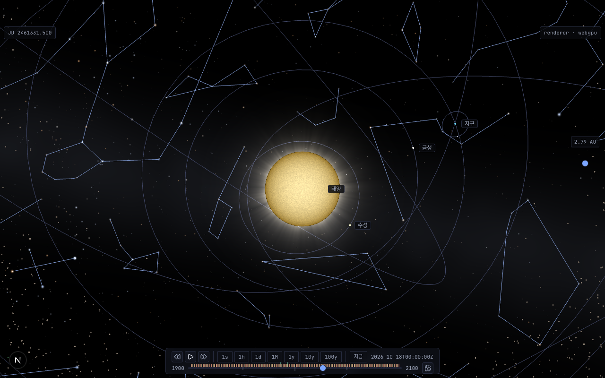

# ADR 20261018-1373 — 실측 별 카탈로그 · 별자리 선 · 이름

- **상태**: Accepted (cross-validate 2026-10-18) — 사용자 결정 Q 표 7개 전부 권고안 (2026-10-18)
- **날짜**: 2026-10-18
- **결정자**: 사용자 (2026-10-18 — Q 표 전부 권고안, 메인 오케스트레이터 경유) · 설계 architect (이슈 [#1373](https://github.com/coseo12/astro-simulator/issues/1373) · 사용자 선택 2026-10-18 「트랙 C — 별자리 선 / 이름 라벨」)
- **관련**:
  - [ADR 20260624-738](20260624-738-procedural-starfield.md) — 절차 별 배경 · 은하수. §비-범위 「실측 star catalog · 별자리 선/이름」을 본 ADR 이 연다. §결정 1 (`infiniteDistance`) · §결정 5 (렌더 그룹 0 · depth write off) · §결정 6 (`isPickable = false`) · §Amendment 2 (소프트웨어 렌더 비활성) 는 그대로 이어 쓴다
  - [ADR 20261018-1366](20261018-1366-scene-handedness.md) — 데이터 (오른손 황도 J2000) → 장면 경계 z 반전. 별 방향은 이 경계를 지나는 새 경로다 (재검토 조건 2)
  - [ADR 20260927-1265](20260927-1265-runtime-display-toggles.md) — 표시 패널 · URL 키 · 가용성 · 받아들인 비용 R1 (그룹 0 순서) · 가드 D8p
  - [ADR 20261015-1341](20261015-1341-trail-ruler.md) — 결정 T10 (기본 꺼짐 행 · `on` 옵트인) 선례
  - [ADR 20261008-1319](20261008-1319-asteroid-belt-gpu.md) — 「N 쿼드 = 4N 정점 + 화면 고정 px」 셰이더 선례 (`belt-particles.ts`)
  - #1293 3D 이름 라벨 (`apps/web/src/lib/label-layout.ts` · `body-labels.tsx`)
  - [`apps/web/public/textures/README.md`](../../apps/web/public/textures/README.md) — 외부 데이터 출처 · 재생성 스크립트 · 무결성 테스트 박제 선례 (#1119)
  - [`principles.md`](../architecture/principles.md) §1 Visual Fidelity
- **용어**: V = 실시 등급 · B−V = 색지수 · HR = Bright Star 번호 · HIP = Hipparcos 번호 · ε = J2000 평균 황도경사 (IAU 2006 `84381.406″`) · 데이터 좌표 / 장면 좌표 = ADR 1366 정의

> **forensic 변형 판정 — 일반 ADR.** 신규 기능 설계다. 5조건 중 (2) runtime 측정 · (4) 옵션 비교만 해당.

---

## 배경

별 배경 (`packages/core/src/scene/starfield.ts`) 은 view direction 셀 해시로 별을 찍는 절차 셰이더다. 별의 위치가 실제 하늘과 대응하지 않아 별자리 선을 얹을 수 없다. 은하수 띠 법선 `MILKY_WAY_NORMAL = [0.2, 0.92, 0.34]` 도 「감상용 임의 방향」 이다 (ADR 738 §결정 3). 이슈 #1373 은 이것을 실측 카탈로그로 바꾸고 별자리 선 · 한국어 이름을 토글로 단다.

외부 데이터 도입은 사용자 승인 사항이다. 아래 실측은 후보를 Q 로 올리기 위한 근거다.

### 실측 (2026-10-18, architect — 앱 코드 변경 0, 페이지 주입 POC)

외부 파일은 1차 배포처에서 받아 세션 scratchpad 에만 두었다. 저장소에는 넣지 않았다.

#### 1-A. 별 카탈로그 후보

| 축 | Yale BSC5 (5판 예비) | HYG v4.4 | Hipparcos (ESA 1997) · Gaia |
| --- | --- | --- | --- |
| 1차 배포처 | CDS `cdsarc.cds.unistra.fr/ftp/V/50/` (`catalog.gz` 573,921 B) · NASA HEASARC `bsc5p` | Codeberg `astronexus/hyg` `data/hyg/CURRENT/hyg_v44.csv.gz` (13,636,362 B · sha256 `00b34989…2197d`) | ESA · CDS I/239 · Gaia Archive |
| 라이선스 | **명시 없음.** CDS 이용 조건: 「과학 맥락에서 자유 사용 · 원저자 인용 필수 · 상업적 이용은 출처별 규칙」. HEASARC 페이지에도 이용 조건 문구 없음. 「퍼블릭 도메인」 문구는 1981년 판 문서에만 있다 (5판 아님) | **CC BY-SA 4.0** (`CURRENT/LICENSE` 원문). v4.0 부터 (그 이전 CC BY-SA 2.5) | 조사 생략 — HYG 가 Hipparcos 를 이미 포함. Gaia 는 밝은 별 (G < 3) 이 포화 · 불완전해 맨눈 별 용도에 부적합 |
| 행 수 | 9,110 (별 9,096) | 119,614 | — |
| V ≤ 6.0 / 6.5 | **5,080 / 8,404** (V ≤ 6.5 는 카탈로그 한계 근처라 불완전) | **5,070 / 8,920** | — |
| B−V 없음 (≤ 6.0 / 6.5) | 53 / 244 | ≤ 6.5 에서 40 | — |
| 위치 정밀도 | RA 0.1 s · Dec 1″ (J2000) | Hipparcos (mas) | — |
| 교차 식별자 | HR · HD · SAO (**HIP 없음**) | HIP (≤ 6.5 중 8,870) · HD · HR · 고유 이름 (`proper`) | — |

저장소 라이선스는 MIT 다 (`LICENSE`). CC BY-SA 4.0 데이터를 넣으면 **파생 데이터 파일만** CC BY-SA 4.0 이 되고 (출처 표기 · 변경 표시 · 같은 라이선스), 코드의 MIT 에는 전파되지 않는다. 다만 저장소가 「코드 MIT + 데이터 1개 CC BY-SA」 혼합이 되므로 데이터 디렉터리에 라이선스를 따로 적어야 한다.

#### 1-B. 데이터 크기 · 포함 방식

| 형식 | V ≤ 6.0 | V ≤ 6.5 |
| --- | ---: | ---: |
| 바이너리 12 B/별 (float32 RA · Dec + int16 V×100 + int16 B−V×1000), HYG 기준 | 60,840 B | 107,040 B |
| JSON `[ra, dec, V, B−V]` (BSC5 기준 실측) | 146,552 B (gzip 55,810) | 242,275 B (gzip 91,149) |

비교: `packages/shared/data/solar-system.json` 64 KB (JS 번들 import) · `apps/web/public/textures/earth-land-mask.png` 27,295 B (런타임 fetch).

#### 1-C. 별자리 선 데이터 후보

| 축 | d3-celestial `constellations.lines.json` | Stellarium `western` (구 modern) |
| --- | --- | --- |
| 배포처 | GitHub `ofrohn/d3-celestial` `data/` (27,136 B) | GitHub `Stellarium/stellarium-skycultures` `western/index.json` (107,520 B) |
| 라이선스 | **BSD-3-Clause** (저장소). 출처 README: 「IAU Constellation page, … some line modifications by me」 | `western/description.md`: 「Text and data: **CC BY-SA**」 (버전 미기재) · 삽화 Free Art License. 저장소 루트에는 `LICENSE-AGPL-3.0.txt` 도 있다 |
| 선 표현 | 좌표 (RA · Dec, GeoJSON MultiLineString) — 카탈로그 무관 | HIP 번호 — HIP 가 있는 카탈로그 필요 (BSC5 는 없음) |
| 규모 | 89 feature (뱀자리 2 조각) · **743 선분** · 정점 757 | 88 별자리 · 680 선분 · 별 691 |
| 이름 · 라벨 위치 | `constellations.json` (50,581 B) 에 **`ko` 89/89** (출처 README: Wikipedia) + 라벨 기준점 좌표 | 이름은 별도 번역 (`po`) |

**정점 ↔ 카탈로그 정합 실측** (d3 정점마다 최근접 별):

| 대상 | 각거리 p50 / p99 / 최대 | 60″ 초과 | 최근접 별이 V > 컷 |
| --- | --- | ---: | --- |
| BSC5 전체 | 0.5″ / 1.6″ / 9.1″ | 0 | V > 6.0: 2개 · 최대 V 6.69 |
| HYG V ≤ 7.0 | 0.2″ / 3.3″ / 16.3″ | 0 | V > 6.5: 2개 |

→ 생성 단계에서 정점을 카탈로그 별 인덱스로 스냅할 수 있다 (선 끝이 그려진 별과 정확히 만난다). 컷보다 어두운 끝점 별 2개는 컷과 무관하게 포함해야 한다.

#### 1-D. 한국어 별자리 이름

- d3-celestial `ko` 는 88개 (+뱀자리 중복) 를 모두 갖지만 출처가 Wikipedia 다. 표준 표기와 다른 항목이 있다 — 예: Her 는 d3 「허큘리스자리」, 한국천문연구원 코스모스 허브 별자리 게시판 표기는 「헤르쿨레스」.
- 한국천문학회 천문학 용어집 원문 목록은 이번 조사에서 1차 출처로 확보하지 못했다. 한국천문연구원 페이지는 「All Rights Reserved」 표기다 — 88개 고유명사 목록 자체는 사실 정보라 표기 대조에 쓰는 데 문제가 없다고 본다 [가정 — 법률 판단 아님].

#### 1-E. 장면 프레임 실측 (변환 경로 검증)

변환: `적도 J2000 (RA, Dec) → R_x(+ε) → 황도 J2000 (데이터) → toScene (z 반전)`. 같은 식으로 계산한 기준 별:

| 별 (HR) | RA / Dec (J2000) | 황경 λ / 황위 β | 장면 방향 |
| --- | --- | --- | --- |
| 시리우스 (2491) | 101.2871° / −16.7161° | 104.0816° / −39.6052° | (−0.18745, 0.74730, 0.63749) |
| 베텔게우스 (2061) | 88.7929° / +7.4069° | 88.7546° / −16.0271° | (0.02089, 0.96090, 0.27609) |
| 북극성 (424) | 37.9529° / +89.2642° | 88.5677° / +66.1015° | (0.01013, 0.40499, −0.91426) |
| 리겔 (1713) | 78.6346° / −8.2017° | 76.8297° / −31.1228° | (0.19505, 0.83354, 0.51687) |
| 베가 (7001) | 279.2346° / +38.7836° | 285.3161° / +61.7328° | (0.12509, −0.45676, −0.88075) |
| 스피카 (5056) | 201.2983° / −11.1614° | 203.8415° / −2.0545° | — |

실행 중 장면 (dev 서버 · develop `c333b22f` · headless Chromium `--use-angle=metal` · WebGPU · `?t=2461331.5&speed=0` = 2026-10-18 00:00 UT) 에서 잰 값:

| 항목 | 장면 | 기대 | 판정 |
| --- | ---: | ---: | --- |
| 지구 메시 local +Y (자전축, #1362) ↔ 북극성 장면 방향 | **0.7354°** | 0.7359° (= 90° − Dec) | 일치. 차이는 지구 기울기 데이터 `23.44°` ↔ ε `23.4393°` (≤ 0.0007°) |
| 지구 → 태양 방향 황경 | 204.2030° | JPL Horizons 기하 (500@399 · 황도 · ICRF) 204.2613° | Δ −0.058° — 별과 무관한 위치 모델 차 (아래) |
| 태양 ↔ 스피카 각거리 | 2.0861° | Horizons 기준 2.0986° | Δ 0.0125° |

- z 반전을 빠뜨리면 북극성 ↔ 자전축 각은 약 132° 로 벌어지고, ε 회전 부호를 틀리면 수십 도 벌어진다 — 이 측정량은 변환 결함을 가른다.
- 태양 황경 Δ −0.058° 는 위치 모델 (#1354 · ADR 1360 §1-D 와 같은 축) 의 값이다. 독립 저정밀 식 (Meeus 25장 → 일반세차 차감) 은 204.2580° 로 Horizons 와 0.003° 안에서 맞는다. 범위 밖 관측으로 기록만 한다.

#### 1-F. 렌더 POC (페이지 주입 · 저장소 코드 변경 0)

`belt-particles.ts` 와 같은 「N 쿼드 = 4N 정점 + clip 공간에서 px 만큼 모서리 벌림」 셰이더로 BSC5 V ≤ 6.5 8,404 개 (33,616 정점, draw 1) 를 주입했다. 별자리 선은 `LinesMesh` 1개 (743 선분). 둘 다 `infiniteDistance = true` · 렌더 그룹 0 · `disableDepthWrite` · 가산 블렌드 (`alphaMode = ALPHA_ADD`) · `alphaIndex` 최저.

- 관측 1 — 별자리 선이 태양 원반 가장자리에서 끊긴다 (불투명 body 가 depth 로 가린다). 코로나 · 궤도선 위로는 지난다.
- 관측 2 — 기본 화면에서 별자리 선이 궤도선과 같은 계열 색 · 굵기라 구분이 어렵고 화면 전체를 가로지른다 (Q-D 근거).
- 관측 3 — 콘솔 에러 0 (WebGPU).

**비용** (같은 페이지 on/off 3회 교차 · `--disable-gpu-vsync --disable-frame-rate-limit` · 3 s rAF 평균 간격):

| 대상 | on − off (ms) |
| --- | --- |
| 별 쿼드 + 선 | +0.147 (첫 회, 셰이더 준비 포함) · +0.038 · +0.021 |
| (비교) 기존 starfield 구 | −0.002 · −0.028 · −0.035 |

headless 프레임 간격이 0.3 ms 대라 이 방법의 잡음 폭 (≈ ±0.04 ms) 이 증분과 같은 크기다. **GPU 비용 판별력이 낮다** — fps DoD 는 실 Chrome 으로 잰다 (D7).

#### 1-G. 기존 가드 · 테스트 영향 (grep 근거)

- **CI 는 별을 그리지 않는다.** `DisplayCapabilities.starfield = !isSoftwareRenderer` (`display-toggles.ts:50`) · ADR 738 §Amendment 2 · `browser-verify-738-starfield.mjs` S6. CI 의 픽셀 · fps 셀 (SwiftShader) 은 starfield 메시가 없어 이번 변경과 무관하다 — 본 설계도 같은 게이트를 쓴다 (결정 R5).
- `packages/core/src/scene/starfield.test.ts` (176 줄) — 격자 밀도 · 임계 · `starColorMirror` · 은하수 법선 상수를 24곳에서 단언. 별 셀 경로 제거 · 법선 교체로 **재작성 대상**.
- `apps/web/scripts/browser-verify-738-starfield.mjs` — S1 (켠 화면이 더 밝다) · S2 (고정 방향 투영 불변, starfield 구 local 정점 사용) 는 구가 남으므로 유효. 하드웨어 전용.
  - **정정 (PR #1375 실측)** — S1 은 유효하지 않았다: launch 를 Metal 로 바꾼 사본에서 develop `30.72 % > 23.79 %` PASS · PR1 `18.49 % > 23.79 %` FAIL (술어가 절차 별 밀도 · 띠 방향에 묶여 있었다). 커밋된 실행 경로 (`withBrowser({})` 소프트웨어 고정 · 워크플로 호출처 0) 에서는 S1 이 발화하지 않으므로 **술어는 고치지 않고 기록만 둔다** (사용자 결정 2026-10-19). 재검토는 스크립트 재검토 조건 1 (CI 하드웨어 GPU 도입) 때.
- `apps/web/scripts/browser-verify-1265-display-panel.mjs` — D8 · D8b · D8p · D9 가 메시 이름 `starfield` 와 `setStarfieldVisible` 을 쓴다. **D8p** 는 「그룹 0 불투명 메시 중 starfield 외는 depth write」 를 단언한다 → 새 메시 (별 쿼드 · 선) 는 반드시 블렌드 (투명 큐) 여야 D8p 를 지킨다.
- `browser-verify-756-surface.mjs:559` · `browser-verify-790-focus-zoom.mjs:30,51` — 로컬 하드웨어에서 「starfield 별 오염」 을 주석으로 다룬다. 로컬 수치가 바뀔 수 있다 (CI 무관).
- 장면 테스트 16개 파일이 `starfield` 옵션 이름을 쓴다 — 옵션 이름은 유지한다.

---

## 후보 비교

### 축 C — 별 카탈로그

| | (a) BSC5 | **(b) HYG v4.4** | (c) 현행 절차 유지 |
| --- | --- | --- | --- |
| 라이선스 명확성 | 명시 없음 (CDS 「과학 맥락」 조건) | CC BY-SA 4.0 명시 | — |
| 의무 | 원저자 인용 | 출처 표기 · 변경 표시 · 파생 데이터 동일 라이선스 | — |
| 선 데이터 결합 | 좌표 스냅만 (HIP 없음) | 좌표 스냅 · HIP (Stellarium) 둘 다 | 불가 |
| 정밀도 | 1″ | mas | — |
| 미래 확장 (별 이름 라벨) | 이름 필드 비정형 (`Name` = Bayer · Flamsteed) | `proper` (IAU 고유명) | — |

### 축 L — 별자리 선

| | **(a) d3-celestial** | (b) Stellarium western |
| --- | --- | --- |
| 라이선스 | BSD-3 (허용적, 고지 유지) | CC BY-SA (버전 미기재) |
| 결합 | 좌표 → 카탈로그 스냅 (실측 최대 16.3″) | HIP (HYG 필요) |
| 이름 · 라벨 위치 | 같은 저장소에 `ko` + 기준점 | 별도 |
| 선 형태 | IAU 차트 (Sky & Telescope) 기반 + 저자 수정 | Stellarium 기본 |

### 축 R — 별 렌더 방식

| | **(a) 쿼드 메시 + ShaderMaterial** | (b) `PointsCloudSystem` | (c) 구 셰이더가 데이터 텍스처 조회 | (d) 카탈로그를 큐브맵에 굽기 |
| --- | --- | --- | --- | --- |
| WebGPU | 동작 (POC · `belt-particles.ts` 선례) | `pointSize` 무효 (ADR 738 실측) | 동작 | 동작 |
| 비용 | 정점 4N · 작은 쿼드 fill | — | 화면 전 fragment 가 이웃 셀 루프 | 2048²×6 ≈ 100 MB |
| 선명도 | 화면 고정 px (줌 무관) | — | 화면 고정 px | 텍셀 0.044° — 확대 시 흐림 |
| 구현 | 선례 재사용 | — | 셀 인덱스 구축 · 셰이더 복잡 | 굽기 패스 |

### 축 M — 은하수 띠

| | **(a) 구 셰이더의 별 셀 경로 제거 + 법선을 실제 은하 북극으로** | (b) 별 셀 제거 · 법선 현행 유지 | (c) 은하수 제거 |
| --- | --- | --- | --- |
| 실제 하늘과 정합 | 은하수가 실제 은하면에 놓인다 (실별 밀집대와 겹침) | 임의 방향 — 실별 밀집대와 어긋남 | — |
| 비용 | 상수 1개 + 별 셀 경로 삭제 (fragment 비용 감소) | 같음 | 구 1개 삭제 |

은하 북극 J2000 (RA 192.85948° · Dec +27.12825°) 의 장면 방향 = `(−0.86767, −0.00035, −0.49715)`.

---

## 결정 (사용자 결정 2026-10-18 — Q 표 전부 권고안)

### 데이터

1. **D1 카탈로그** — HYG v4.4 · V ≤ 6.5 (8,920개) + 별자리 선 끝점 별 (컷 밖 2개) 를 쓴다 (Q-C · Q-M). 위치는 J2000 (고유운동 · 세차 미적용 — 장면이 J2000 황도 고정 분점이라 지구 자전축과 같은 틀).
2. **D2 저장** — 바이너리 `apps/web/public/data/stars/star-catalog.bin`, **리틀 엔디언 · `DataView` 로 읽는다**. 헤더 8 B = 매직 `char[4]` `"STC1"` + 별 수 `uint32`. 레코드 12 B = offset 0 `float32` RA° · 4 `float32` Dec° · 8 `int16` V×100 · 10 `int16` B−V×1000 (결측 `−32768`). 로더는 `byteLength === 8 + 12 · count` 를 확인하고 어긋나면 별을 만들지 않는다 (경고 1회). 런타임 fetch — JS 번들 증가 0. 원천 좌표계 (적도) 그대로 둔다. 변환은 코드 (순수 함수) 가 한다 — 데이터 파일이 1차 출처와 행 단위로 대조 가능해야 하기 때문이다.
3. **D3 별자리** — `apps/web/public/data/stars/constellations.json`: IAU 약어 · 한국어 이름 · 라벨 기준점 (RA · Dec) · 선분 (별 인덱스 쌍). d3-celestial 선 정점을 생성 단계에서 카탈로그 최근접 별에 스냅 (허용 60″, 실측 최대 16.3″ — 넘으면 생성 실패).
   - **인덱스 고정**: 생성 스크립트는 PR1 부터 선 데이터를 함께 읽어 끝점 별을 포함하고 정렬 순서를 고정한다. PR2 는 같은 스크립트로 `constellations.json` 을 더하며 `star-catalog.bin` 은 `--check` 로 바이트 동일해야 한다.
   - **런타임 결합**: 선 정점은 이미 로드된 카탈로그 버퍼에서 인덱스로 읽는다 (좌표를 JSON 에 중복 저장하지 않는다 — 선 끝이 그려진 별과 정확히 만나는 근거). 별자리를 켰는데 카탈로그가 아직 없으면 두 파일이 모두 도착한 뒤 만든다. 인덱스가 `count` 이상이면 그 별자리를 건너뛰고 경고한다.
   - **뱀자리**: d3 의 두 조각 (머리 · 꼬리) 은 선을 모두 그리고 라벨은 1개 (머리 쪽 기준점) 만 둔다 — 이름 88개.
4. **D4 생성 · 박제** — `scripts/generate-star-catalog.mjs` (네트워크는 개발자 실행 시점만, `--check` 바이트 대조) · `apps/web/public/data/stars/README.md` (출처 URL · 커밋/버전 · 취득일 · sha256 · 라이선스 원문 인용 · 컷 · 형식) · 무결성 단위 테스트 (네트워크 무관). 선례는 `textures/README.md` (#1119). 데이터 디렉터리 라이선스: 카탈로그 파생 파일 CC BY-SA 4.0 · 별자리 파일 BSD-3 고지.
5. **D5 이름** — d3 `ko` 를 출발점으로, 한국천문연구원 · 한국천문학회 표기와 대조한 차이 표를 PR2 에 싣고 사용자가 확정한다 (Q-N).

### 좌표

6. **D6 변환** — 순수 함수 `equatorialJ2000ToEcliptic(raDeg, decDeg)` (데이터 공간, `R_x(+ε)`, ε = `84381.406″` 를 `packages/shared/src/constants/astronomy.ts` 새 상수로) → 장면은 기존 `toScene` (ADR 1366 결정 1). 메시 정점 쓰기 지점에서만 반전한다.
7. **D7 무한 원거리** — 별 · 선 메시 모두 `infiniteDistance = true` (ADR 738 §결정 1 그대로). 카메라 위치를 따라가고 회전만 반영한다. 시차 0 · Floating Origin · tier · 줌 무관. 반지름은 starfield 구 안쪽 (`< 500`).

### 렌더

8. **R1 별** — 신규 `packages/core/src/scene/star-catalog.ts`: 쿼드 메시 1개 + GLSL ShaderMaterial (축 R (a)). 지름은 CSS px × DPR (물리 px). `uPxToClip` 은 draw 직전 (`onBeforeRenderObservable`) 에 매번 렌더 버퍼 크기에서 다시 계산한다 — 리사이즈 · DPR 변화 대응 (`belt-particles.ts` 와 같다. 줌은 카메라 반경이라 FOV 는 고정). 블렌드 가산 · `disableDepthWrite` · depth test 유지 · 렌더 그룹 0 · `alphaIndex` 최저 (투명 큐 맨 앞) · `isPickable = false` · `alwaysSelectAsActiveMesh`.
9. **R2 등급 → 크기 · 밝기** — 상대 플럭스 `f = 10^(−0.4 (V − 6.5))` 의 로그에 선형: 반지름 `r = clamp(r0 + r1 · log2 f, rMin, rMax)` · 밝기 `I = clamp(i0 + i1 · log2 f, iMin, 1)`. 상수는 rendering-only SSoT, 최종값은 사용자 육안 승인 (D-T2). 반짝임 없음.
10. **R3 B−V → 색** — 순수 함수 `bvToRgb(bv)`: Ballesteros (2012) 식으로 유효 온도 → 흑체 근사 RGB → 백색과 혼합해 채도를 낮춘다. 흑체 RGB 는 D65 상관 색온도 6504 K 흑체 색으로 채널별 나눠 백색을 맞춘다 (PR #1375 실측 — 맞춤 없이는 6,000 – 7,000 K 에서 G < min(R, B) 최대 0.013 으로 마젠타 단언 FAIL). ADR 738 §결정 4 의 「보라 · 마젠타 금지」 를 단위 테스트로 잇는다. B−V 결측은 백색.
11. **R4 은하수** — 구 셰이더에서 별 셀 경로를 지우고 띠만 남긴다. 법선을 은하 북극 장면 방향으로 바꾼다 (축 M (a)). 절차 별은 남기지 않는다 — 실제 하늘에 없는 별이 별자리 옆에 찍히면 이슈 목표 1 과 충돌한다.
12. **R5 소프트웨어 렌더** — 별 · 선 · 이름 모두 starfield 와 같은 게이트 (`!isSoftwareRenderer`). 소프트웨어 렌더에서는 파일을 fetch 하지 않는다. `force` 류 강제 플래그는 만들지 않는다 (방향 DoD 는 단위 + 하드웨어 실측으로 닫는다).
13. **R6 별자리 선** — `LinesMesh` 1개 (`ruler-line.ts` 패턴, 정점 1,486). `alpha < 1` (투명 큐 → D8p 대상 밖) · `infiniteDistance` · `alphaIndex` 최저 + 1 · `isPickable = false`. 색은 궤도선 (청회색) 과 다른 계열 — 최종값 D-T2.
   - **그리기 순서**: 은하수 구 (그룹 0 불투명 큐 · depth write off) → body · 궤도선 (불투명 · depth write) → 별 쿼드 (투명 큐 맨 앞) → 별자리 선 → 그 밖의 투명 메시. `alphaIndex` 값은 이름 붙은 상수 (`STAR_CATALOG_ALPHA_INDEX` · `CONSTELLATION_LINES_ALPHA_INDEX`) 로 둔다.

### 이름 라벨

14. **N1** — 기존 DOM 오버레이 · 디클러터 (`label-layout.ts`) 를 확장한다. kind `constellation` 을 **가장 낮은 우선순위** 로 추가하고, 반지름 0 · 기준점 중앙 정렬로 놓는다. 한 번의 배치 패스에서 body 라벨이 먼저 놓이므로 겹침 쌍 0 (#1293 규칙 4) 이 그대로 성립한다. 기준점이 더 가까운 body 원반 안이면 숨긴다 (규칙 1b 재사용).
15. **N2** — core 에 pull API `getConstellationScreenInfo()` (기준점 방향 → 화면 CSS px · 카메라 앞 · 화면 안) 를 둔다. `getBodyScreenInfo` 와 같은 프레임 정합.
16. **N3** — 별자리 라벨은 클릭 · 포커스 대상이 아니다 (`pointer-events: none`, Tab 순서 밖). 별자리에 「포커스」 개념이 없다.
17. **N4** — 별자리 라벨은 body 라벨보다 작고 흐리게 (스타일은 D-T2).

### 토글 · URL

18. **T1** — `display-toggles.ts` 에 행 1개: id `constellations` · URL 키 `?constellations=` · 라벨 「별자리」 · **기본 꺼짐, `on` 옵트인** (`trails` 선례 T10) · 가용성 `starfield` 와 같음 · 비활성 사유 문구 신설. 신규 파서 `parse-constellations-mode.ts`. core 명령 `setConstellationsVisible`.
19. **T2** — 선과 이름은 같은 토글이다. 이름은 추가로 `?labels=` 가 켜져 있어야 보인다 (Q-L 권고 (a)).
20. **T3** — `?stars=` 의 의미 (별 + 은하수) 와 기본값 (켬) 은 유지한다. `setStarfieldVisible` 이 구 · 별 쿼드를 함께 켜고 끈다. 별자리 토글은 `?stars=` 와 독립이다.
21. **T4** — 지연 생성 · 이후 `setEnabled` (ADR 1265 §결정 3 수명 계약). 별 쿼드는 카탈로그 fetch 완료 뒤 생성되며, 그 전에는 은하수만 보인다.
   - **비동기 계약**: fetch 는 장면당 1회. 응답이 왔을 때 장면이 dispose 됐으면 아무것도 만들지 않는다. 메시를 만든 직후 그 시점의 최신 의도 (`starfieldVisible` · `constellationsVisible`) 로 `setEnabled` 를 정한다 — fetch 중에 끈 토글이 응답 도착으로 다시 켜지지 않는다. fetch 실패는 `console.warn` 1회 + 은하수만 유지 (재시도 없음, 콘솔 에러 0 계약 유지).

### 모바일

22. 지름 · 글자 크기는 CSS px 기준이라 DPR 과 무관하게 같은 크기로 보인다. 375 폭에서는 디클러터가 별자리 라벨을 먼저 숨긴다 (최저 우선순위). 터치는 라벨이 포인터를 받지 않아 캔버스 드래그를 막지 않는다.

### PR 분할

| PR | 범위 | 화면 변화 |
| --- | --- | --- |
| **PR1 — 카탈로그 교체** | D1 · D2 · D4 (별 파일) · D6 · D7 · R1 ~ R5 · About 모달 출처 · `starfield.test.ts` 재작성 | 별 배경이 실제 하늘로 바뀐다. `?stars=off` · 소프트웨어 렌더 화면은 develop 과 바이트 동일 |
| **PR2 — 별자리 선 · 이름** | D3 · D4 (별자리 파일) · D5 · R6 · N1 ~ N4 · T1 · T2 · About 출처 | 기본 꺼짐 — URL 없는 화면은 PR1 과 바이트 동일 |

---

## 사용자 결정 (Q 표 — 2026-10-18 전부 권고안)

사용자가 아래 권고 열을 그대로 채택했다. Q-N 의 이름 대조표는 PR2 에서 사용자가 확정한다.

| Q | 항목 | 선택지 | 권고 | 결정 (일자) |
| --- | --- | --- | --- | --- |
| C | 별 카탈로그 출처 | (a) Yale BSC5 — 라이선스 명시 없음 (CDS 「과학 맥락 자유 사용 · 인용 필수」) (b) **HYG v4.4 — CC BY-SA 4.0** (파생 데이터 파일 1개가 CC BY-SA, 코드 MIT 무영향) (c) 도입 안 함 | **(b)** — 라이선스가 명시돼 있다. BSC5 는 「퍼블릭 도메인」 확인이 안 됐다 (1-A) | **(b)** (2026-10-18) |
| M | 등급 컷 | (a) V ≤ 6.0 (5,070개 · 61 KB) (b) **V ≤ 6.5 (8,920개 · 107 KB)** | **(b)** — 맨눈 한계. 크기 · 비용 차이가 작다 (1-B · 1-F) | **(b)** (2026-10-18) |
| L-src | 별자리 선 출처 | (a) **d3-celestial (BSD-3)** (b) Stellarium western (CC BY-SA) | **(a)** — 허용적 라이선스 · 이름 · 라벨 기준점 동봉 (1-C) | **(a)** (2026-10-18) |
| N | 한국어 이름 표준 | (a) **d3 `ko` 출발 + 한국천문연구원 · 천문학회 표기 대조 차이 표를 PR2 에서 사용자 확정** (b) d3 `ko` 그대로 | **(a)** — 「허큘리스 / 헤르쿨레스」 같은 차이가 실제로 있다 (1-D) | **(a)** (2026-10-18) |
| D | 별자리 기본 표시 | (a) **꺼짐 · `?constellations=on`** (b) 켜짐 · `?constellations=off` | **(a)** — 기본 화면에서 궤도선과 겹쳐 읽기 어렵다 (1-F 관측 2) | **(a)** (2026-10-18) |
| L | 이름 ↔ `?labels=` | (a) **이름은 별자리 ∧ 라벨 둘 다 켜졌을 때** (b) 별자리 토글만 따름 | **(a)** — 「라벨 끄기 = 화면 글자 정리」 기대와 맞다 | **(a)** (2026-10-18) |
| G | 은하수 | (a) **실제 은하면으로 정렬 · 절차 별 제거** (b) 현 방향 유지 · 절차 별 제거 (c) 은하수 제거 | **(a)** (축 M) | **(a)** (2026-10-18) |

---

## 완료 기준 (DoD — 측정 가능)

| ID | 기준 | 방법 · 결함판 판별 근거 |
| --- | --- | --- |
| D1 | **변환 순수 함수** — §1-E 표 5개 별의 λ · β 가 표 값과 `≤ 0.001°`. 적도 북극 → `(0, sin ε, cos ε)`. 장면 방향은 `toScene` 을 거친다 | 단위. ε 부호 반전 · z 반전 누락은 수십 도 차로 FAIL |
| D2 | **장면 방향 (런타임)** — (i) 지구 자전축 ↔ 북극성 장면 방향 `0.736° ± 0.01°` (ii) 별 메시의 시리우스 · 베텔게우스 · 북극성 · 리겔 · 베가 정점 방향 ↔ 순수 함수 `≤ 1e-4°` (iii) 그 5개 별의 화면 밝기 중심 ↔ 투영 위치 `≤ 1.5 px` (iv) 2026-10-18 00:00 UT 태양 ↔ 스피카 각거리 `2.099° ± 0.1°` | 실브라우저 (WebGPU · WebGL2 하드웨어). POC 실측 (i) 0.7354° · (iv) 2.0861°. (iv) 허용폭은 위치 모델 차 0.058° (1-E) 를 포함 |
| D3 | **데이터 무결성** — 별 수 `8,920 + 끝점` · 파일 크기 `8 + 12N` · 5개 기준 별 행 값 · sha256 고정 · 선분 743 · 모든 인덱스 `< N` · 이름 88개 비어 있지 않음 | 단위 (네트워크 무관). `--check` 로 재생성 바이트 동일 |
| D4 | **색 · 크기 매핑** — `bvToRgb` 가 B−V 증가에 따라 B/R 단조 감소 · 보라/마젠타 부재 (ADR 738 단언 승계) · 채널 `[0,1]`. 크기 · 밝기 V 에 단조 · 상하한 고정 | 단위 |
| D5 | **불변** — PR1: `?stars=off` · 소프트웨어 렌더 기본 화면이 develop 과 같은 프레임 바이트 동일. PR2: URL 없는 화면 ↔ PR1 바이트 동일 (하드웨어 · 소프트웨어). 런타임으로 끈 화면 ↔ `?constellations` 없는 로드 full frame 0 (1265 D8 방식) | 실브라우저. 기존 `verify:738-starfield` · `verify:1265-display-panel` (SWIFTSHADER=1 / BROWSER_VERIFY_GPU=metal) 통과 |
| D6 | **가림 · 겹침** — 행성 원반 뒤 별 · 선은 그려지지 않는다 (예: 태양 원반 안 별 픽셀 증분 0). body 라벨 ↔ 별자리 라벨 겹침 쌍 0 (1280 · 375) | 실브라우저 + `label-layout` 단위 |
| D7 | **비용** — 실 Chrome (WebGPU · WebGL2) 기본 · focus 셀, 1335 §1-E 방법: vsync 유지 on/off fps 비 `≥ 0.98`, vsync 해제 프레임당 증분 `≤ +0.3 ms` (별 + 선 + 이름 켬). CI `fps-baseline-guard` 는 게이트로 무변화 | 실 Chrome. POC (headless) 는 판별력 낮음 (1-F) |
| D8 | 공통 — 콘솔 에러 0 · 실브라우저 3단계 (정적 · 토글/URL · 흐름) · 375 모바일 · 사용자 육안 승인 (오리온 · 북두칠성 · 남십자 · 은하수) | 실 Chrome |

신규 가드 · 하네스는 만들지 않는다 (기능 우선 방침). 런타임 측정 (D2 · D5 · D6 · D7) 은 PR 코멘트에 실행 로그로 박제한다.

---

## 영향 범위

- 신규: `packages/core/src/scene/star-catalog.ts` · 변환 · 색 순수 함수 (`packages/core/src/coords/` 또는 `scene/`) · `scripts/generate-star-catalog.mjs` · `apps/web/public/data/stars/` (데이터 2 · README · 라이선스 고지) · `apps/web/src/core/parse-constellations-mode.ts` · 무결성 테스트.
- 변경: `starfield.ts` (별 셀 경로 삭제 · 법선) · `solar-system-scene.ts` (`setStarfieldVisible` 이 별 쿼드 포함 · 신규 setter · pull API · 옵션 `starCatalogBaseUrl`) · `packages/shared` (ε 상수 · `CoreCommand`) · `display-toggles.ts` · `label-layout.ts` · `body-labels.tsx` (또는 별자리 라벨 컴포넌트) · `sim-canvas.tsx` · About 모달.
- 기존 테스트 · 가드: §1-G.

## Visual Fidelity (principles §1 의무 체크리스트)

- [x] **데이터 SSoT 보존** — 카탈로그는 1차 출처 값 (적도 J2000) 을 그대로 담는다. 장면 변환 · 크기 · 색 과장은 렌더 시점 함수다.
- [x] **rendering 시점 분리** — 등급 → 크기 · 밝기 · 채도 감소는 rendering-only 상수 (R2 · R3).
- [x] **사용자 가이드** — About 모달에 출처 · 「별 크기와 밝기는 등급을 시각화한 값」 을 적는다.
- [x] **비율 baseline** — §1-B (크기) · §1-E (방향 기준값) · §1-F (POC 비용).

## 결과 · 재검토 조건

- **기대 효과** — 별 배경이 실제 하늘이 되고, 지구 자전축이 북극성을 가리키며, 별자리 선 · 이름을 켜고 끌 수 있다.
- **재검토 트리거**
  1. 시뮬레이션 시각 범위가 J2000 ± 수백 년을 넘어 세차 (50″/년) · 고유운동이 눈에 띄면 (예: 지구 축 세차 모델링) 별 위치를 날짜 분점으로 옮길지 다시 정한다.
  2. 장면에 데이터 방향을 쓰는 새 경로 (별 이름 라벨 · 성운 등) 는 D6 변환과 `toScene` 을 거친다 (ADR 1366 재검토 조건 2).
  3. 소프트웨어 렌더에서 별을 보여 달라는 요구 → 쿼드는 fill 비용이 작으므로 게이트를 구 (은하수) 와 분리할지 재측정.
  4. 별 이름 (시리우스 등) 라벨 요구 → HYG `proper` 사용 · 우선순위 별도 결정.
  5. 은하수를 실측 데이터 (예: 윤곽 카탈로그) 로 바꾸자는 요구 → 별도 ADR.

## 비-범위

- 별 이름 라벨 · 별 클릭 · 별자리 경계선 · 별자리 그림 (삽화) · 성운 · 은하 (DSO) · 세차 · 고유운동 · 대기 (지평선 · 소광) · 반짝임 · 신규 픽셀 가드 · 비교 하네스.
- 태양 황경 위치 모델 차 0.058° (1-E) — 관측 기록만.

## 구현 인계

- 시작 지점: PR1 — `generate-star-catalog.mjs` 로 데이터 · README 를 먼저 만들고 무결성 테스트 → 변환 · 색 순수 함수 (D1 · D4) → `star-catalog.ts` → `starfield.ts` 별 셀 삭제 · 법선 → 장면 배선 · `setStarfieldVisible`.
- 쿼드 셰이더의 출발점은 `belt-particles.ts` (`uPxToClip` · `clip.xy += corner · r · uPxToClip · clip.w`) 다. 이 셰이더는 로그 depth 를 쓰지만 별은 쓰지 않는다 (starfield 와 같은 표준 depth — body 가 쓴 로그 depth 보다 항상 뒤라 가려진다. POC 관측 1).
- 측정 함정: (1) headless 기본은 SwiftShader 라 별이 없다 — `--use-angle=metal` 또는 실 Chrome 으로 잰다 (2) ArcRotate 카메라는 타깃 (태양) 을 향하므로 특정 별을 화면 중앙에 두면 태양이 가린다 — 방위를 비켜서 잰다 (3) headless rAF 간격은 GPU 비용을 판별하지 못한다 (1-F).
- 생성 스크립트는 원천 파일의 sha256 을 상수로 갖고 다운로드 직후 대조한다 (불일치 시 중단 — 원천 변조 · 버전 변경을 조용히 흡수하지 않는다).
- 라이선스 고지: About 모달 · `public/data/stars/README.md` 에 HYG (CC BY-SA 4.0, astronexus) · d3-celestial (BSD-3, Olaf Frohn) 을 적는다. 고지 문구는 각 원문 라이선스를 인용한다.

## 교차검증 반영 사항

cross-validate (agy, `architecture` 유형) 1회 실행 — **outcome `applied` (exit 0, 외부 모델 응답 55초)**, `plan_bypass: false`. #1363 의 무응답은 이번에는 재현되지 않았다. 아래는 Claude 재분석 결과다.

### 합의 (본문에 반영)

1. **PR 간 인덱스 고정 · 런타임 결합** — `constellations.json` 이 카탈로그 인덱스를 참조하므로 PR1 생성 단계에서 끝점 별 · 정렬을 고정해야 한다. → D3 하위 항목 (인덱스 고정 · 런타임 결합).
2. **비동기 fetch 수명** — dispose 후 도착 · fetch 중 토글 · 실패 처리가 빠져 있었다. → T4 하위 항목 (비동기 계약).
3. **바이너리 형식 명세** — 헤더 레이아웃 · 엔디언 · 필드 오프셋. → D2.
4. **뱀자리 89 feature ↔ 이름 88** — DoD D3 와 원천이 어긋나 있었다. → D3 하위 항목 (라벨 1개).
5. **런타임 경계 검사** — `byteLength` · 인덱스 범위. → D2 · D3.
6. **원천 sha256 대조** — 생성 스크립트에 상수로. → 구현 인계.
7. **`uPxToClip` 갱신 시점 · 그리기 순서 한 줄 · `alphaIndex` 상수** → R1 · R6.

### 이견 수용

- 헤더 안 (`version: uint16` · `count: uint16`) 대신 매직 4 B + `count: uint32` 로 정했다. 별 수 8,922 는 `uint16` 에 들어가지만, 등급 컷을 올리는 재검토 (예: V ≤ 8 → 수만 개) 에서 형식을 바꾸지 않으려는 것이다. 버전은 매직 문자열 (`STC1`) 에 넣었다.

### Claude 재분석으로 기각

- **별자리 선의 near-plane 클리핑 아티팩트** — 정점이 모두 카메라에서 같은 거리 R 에 있고 (`infiniteDistance`), 가장 긴 선분이 25.65° (용골자리) 라 선분 위 점과 카메라의 최소 거리는 `R · cos(12.8°) = 0.975 R` 이다. near plane (`minZ = 0.01`) 과는 자릿수가 다르다. 한 끝이 카메라 뒤인 경우는 GPU 의 clip 공간 클리핑이 처리한다 (가산 블렌드 · 표준 투영 — 커스텀 투영 없음). 설계 변경은 하지 않는다. 다만 D8 (흐름) 의 카메라 회전 확인에서 함께 본다 — 비용이 0 이다.

### 고유 발견 (후속 분리)

- 없음. 위 항목은 모두 본 ADR 범위 안에서 반영했다.

### Claude 편향 셀프 체크 (호출 전)

- 셀프 체크 결과를 호출 프롬프트에 질문으로 넣지는 못했다 — `architecture` 유형은 고정 프롬프트 (6개 기준) 를 쓴다.
- 낙관적 일정 — **판정 보류**. PR1 에 생성 스크립트 · 무결성 테스트 · 셰이더 · 은하수 · 테스트 재작성이 몰린다. 리뷰에서 PR1 이 과대하면 「데이터 + 무결성」 과 「렌더」 로 다시 나눈다.
- 결합 간과 — **미통과**. PR1 ↔ PR2 인덱스 결합 · 비동기 fetch 레이스를 외부가 찾았다 (합의 1 · 2).
- 폐기 프레이밍 — 절차 별 제거 (R4) 는 「실제 하늘에 없는 별」 이라는 이슈 목표 충돌로 근거를 댔다. 통과.
- 순수주의 — 데이터 파일을 원천 적도 좌표로 두는 결정 (D2) 은 변환 비용 (8,922회 · 초기화 1회) 이 무시할 만해 순수주의 비용이 없다. 통과.
