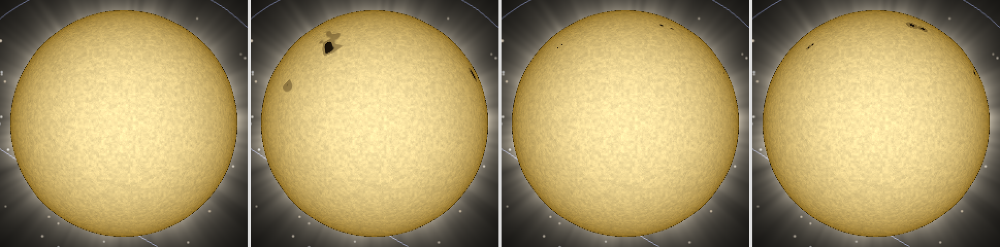
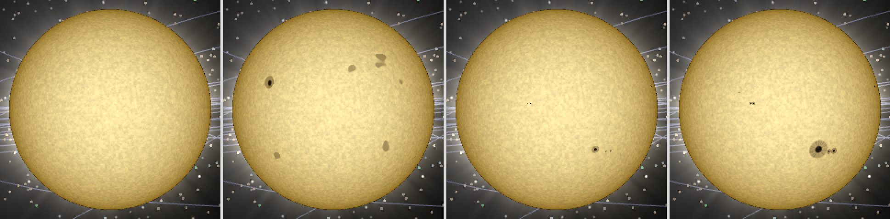
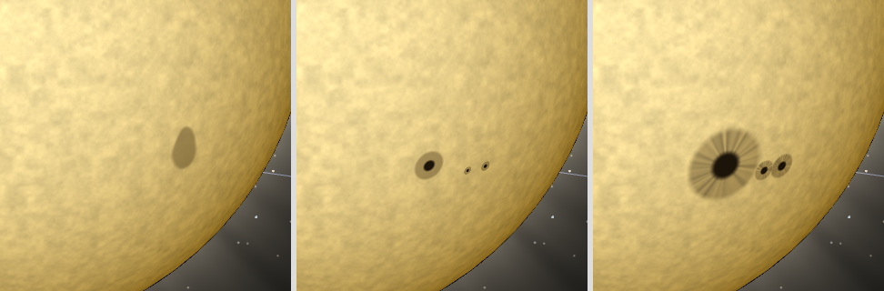

# ADR 20261025-1412 — 태양 흑점: CPU 해석적 흑점 목록 · 차등 자전 · 11년 주기 · 실효 주파수 감쇠

- **상태**: Accepted (cross-validate 2026-10-25) — §교차검증 반영 사항 통합 · 사용자 결정 Q1~Q9 전부 권고안 · 시안 C 승인 (2026-10-25)
- **날짜**: 2026-10-25
- **결정자**: architect (이슈 [#1412](https://github.com/coseo12/astro-simulator/issues/1412) · 사용자 선택 2026-10-25)
- **관련**:
  - [ADR 20260703-774](20260703-774-sun-emissive-shader.md) 결정 2 (흑점 후속 이월) · 결정 3 (painted-on · sun 자전 데이터 부재) · 결정 6 (high/mid 셰이더 공유, low 제외) · §결과·재검토 조건 2 (흑점 — 「DoD 1/2 측정 기준과의 분리 방법 선행 설계」) · 재검토 조건 3 (시간 uniform — jd 직접 전달 금지) · 재검토 조건 4 (차등 자전 — 셰이더 내 위도별 경도 offset 검토)
  - [ADR 20261014-1335](20261014-1335-sun-corona.md) 결정 5 (소프트웨어 렌더 게이트) · 결정 6 (토글) · 결정 7 (시간 불변 — 광과민성 해당 없음) · 재검토 트리거 1 (하드웨어 A/B −10 %)
  - [ADR 20260927-1265](20260927-1265-runtime-display-toggles.md) 결정 5 · 7 (URL 어휘 · 토글 표 SSoT)
  - [로드맵 `roadmap-track-ab.md`](../phases/roadmap-track-ab.md) §후보 「sunspot (흑점)」 행 · 착수 시 횡단 검토 (시간 변동 emissive 효과의 광과민성 감쇠 옵션)
  - [`principles.md`](../architecture/principles.md) §1 Visual Fidelity
- **용어**: [Tier](../glossary.md#tier-t1--t2--t3), LOD, bodyScale

> **forensic 변형 판정 — 일반 ADR.** 신규 기능 설계다. 5조건 중 (2) runtime 측정 필수만 해당.

---

## 배경

태양 셰이더 (#774) 는 granulation · limb darkening · 색온도만 그린다. ADR 774 는 흑점을 「저주파 어두운 패치가 granulation 과 혼동되어 DoD 측정 기준 (엔트로피 / 휘도 프로파일) 을 오염시킨다」 는 이유로 미뤘고, 예상 구현을 「저주파 fbm threshold 패치 (상수 2개 + fragment ~5줄)」 로 적었다. 사용자가 2026-10-25 다음 작업으로 골랐다.

### 기존 코드 (grep, 2026-10-25 develop `3abc9f3b`)

- `sunspot|흑점|umbra|penumbra` 는 이벤트 (`eclipse-*`, 일식 그림자 umbra) 와 문서에만 있다. **태양 표면 흑점 코드는 0** 이다.
- 태양 자전도 없다. `solar-system.json` 의 sun 레코드에 `rotationPeriodHours` 가 없어 `computeRotationState` 가 `null` 을 내고 sun mesh 회전은 identity 다 (ADR 774 결정 3).
- 셰이더 uniform 배열 선례: `ring-shader.ts` 가 `uniform float arcCenters[N]` + `setFloats` + 상수 상한 `for` 루프를 WebGPU · WebGL2 양쪽에서 쓴다.

### 실측 (2026-10-25, architect)

환경: 로컬 macOS · `next dev` (develop `3abc9f3b`, `@astro-simulator/shared` · `core` dist 재빌드 후) · Playwright `channel: chrome` `headless: false` (실 GPU) · 1280×800 DPR 1. 측정 스크립트 · POC 는 일회성이며 커밋하지 않는다 (volt #67). POC 는 페이지 안에서 sun high · mid 의 `ShaderMaterial` 을, 현행 fragment 문자열에 흑점 코드를 주입한 사본으로 교체했다 (앱 코드 변경 0).

**1-A. 기본 `focus=sun` 카메라는 태양 북극 쪽에서 내려다본다.** 카메라 `alpha = −π/2` · `beta = 1.2566` (72°) · upVector `(0,1,0)` — 태양에서 본 카메라 방향 `(0, 0.309, −0.951)` (장면 좌표). 장면 z 축은 황도 법선의 반대 부호다 (#1366 `S_z`). IAU 태양 자전축 (아래 1-B) 과의 내적이 **`0.9339`** → 관측자의 일면 위도 (heliographic latitude) 가 **약 +69°** 다. 그래서 흑점대 (±5~35°) 는 disk 중심이 아니라 **화면 위쪽 가장자리 근처**에 보이고, 남반구 흑점대는 대부분 limb 너머다 (Q7). focus 없는 기본 화면 (`?t=2456748.5&speed=0`) · 774 가드 쿼리 (`?gpu=a&focus=sun&lod=auto`) 모두 같은 `alpha` · `beta` 다.

**1-B. 태양 자전축 변환 검산.** IAU 자전축 (α₀ = 286.13°, δ₀ = 63.87° — Archinal et al. 2018) 을 J2000 황도 (ε = 23.4392911°) 로 돌리면 황도 법선과의 각이 **7.252°**, 태양 적도의 황도 승교점 경도가 **75.76°** 다. Carrington 요소 (i = 7.25°, Ω = 75.76°) 와 일치한다 — 좌표 변환 · 부호를 이 두 값으로 검산했다.

**1-C. 시안 3종.** 시각 `?t=2456748.5&speed=0` (2014-04-01 — 사이클 24 극대 2014/04, Hathaway 2015 Table 1). 흑점 목록은 아래 결정 2 의 생성기 POC 가 낸 17개 (같은 목록을 B · C 가 공유). 카메라 4종: 기본 focus (disk 반경 **109.98 px**) · 기본 근접 (radius 8, disk **371.2 px**) · 적도 정면 (upVector = 태양 자전축, `beta = π/2`) focus · 근접.

| 시안 | 표현 | 크기 | 반영 필라멘트 |
| --- | --- | --- | --- |
| A | 저주파 fbm threshold (ADR 774 예상안) + 위도대 마스크 (4~8° · 30~36° smoothstep), 정적 | fbm 배율 3 · 문턱 0.70 | 없음 |
| B | 해석적 흑점 목록 (결정 1) | 실제 크기 ×1 | 없음 |
| C | 해석적 흑점 목록 (결정 1) | ×2.5 | 대비 0.35 |

공통: 본영 · 반영 색 = 결정 4 의 Planck 유도값, 본영 반경 = 반영 반경 × `1/√5.5`.

(WebGPU 하드웨어. 전 시안 `isReady = true` · 콘솔 에러 0. 하드웨어 WebGL2 (`navigator.gpu` 은닉 + `?gpu=a`) 에서도 A · C 모두 `isReady = true` · 콘솔 에러 0.)

**1-D. granulation 과의 분리 — 링 정규화 휘도비.** 판정량: 픽셀 Rec.709 휘도 ÷ 같은 반경 링 (폭 2 px) 의 중앙값. limb darkening 은 링 정규화로 지워진다. 표본: disk 중심에서 `0.9R` 이내 전 픽셀.

| 장면 (disk px) | 현행 최소비 | A `<0.8` px · 성분 | B `<0.8` px · 성분 | C `<0.8` px · 성분 | 시안 최소비 (A/B/C) |
| --- | ---: | --- | --- | --- | --- |
| 기본 focus (109.98) | **0.905** | 313 · 3 | 2 · 2 | 14 · 1 | 0.108 / 0.109 / 0.109 |
| 적도 정면 focus (109.98) | **0.906** | 351 · 7 | 54 · 5 | 327 · 3 | 0.109 / 0.110 / 0.108 |
| 적도 정면 근접 (371.2) | **0.899** | 4,633 · 7 | 832 · 6 | 4,942 · 4 | 0.110 / 0.108 / 0.108 |

읽을 수 있는 것: (1) 현행 (granulation 만) 은 세 장면 모두 링 중앙값의 **0.899 배 아래로 내려가지 않는다**. granulation 변조 진폭 `GRANULATION_CONTRAST = 0.12` 의 이론 하한 (1 − 0.12 = 0.88) 위다. (2) 본영은 링 중앙값의 약 0.11 배다. 즉 **흑점과 granulation 은 휘도비로 겹치지 않는다** — ADR 774 의 「혼동」 우려는 대비 진폭이 갈라 놓는다. (3) 실제 크기 (B) 는 기본 focus 에서 `<0.8` 픽셀이 2 개뿐이다 (Q2).

**1-E. 렌더 비용.** 같은 페이지에서 현행 ↔ 시안 C (흑점 32 개 — POC 당시 상한을 꽉 채움, 필라멘트 포함. 확정 상한 48 은 결정 1) 3회 교차, 3 s rAF 계수 중앙값. ⚠️ 1회 실행이다.

| 렌더러 | focus (disk 110 px) | 근접 (371 px) | 화면 채움 (radius 3.4) |
| --- | --- | --- | --- |
| 하드웨어 WebGPU, vsync 유지 (60 Hz) | 60.1 → 60.0 (0.999) | 60.1 → 60.0 (0.999) | 60.1 → 60.0 (0.999) |
| 하드웨어 WebGPU, vsync 해제 — 프레임당 증분 | +0.091 ms | +0.467 ms | +0.858 ms |
| swiftshader (headless, `?gpu=a` 강제) | 74.8 → 52.3 (0.699) | 79.3 → 21.1 (0.266) | 73.1 → 12.6 (0.172) |

swiftshader 는 `?gpu=a` 없이는 tier C 라 sun high mesh 가 보이지 않는다 (`isVisible = false` — LOD `forceOverride: 'low'`, billboard). 즉 **CI fps 셀 (기본 tier) 은 태양 셰이더를 그리지 않는다** (실측: `?focus=sun` · 기본 화면 모두 high `isVisible = false`).

**1-F. 결정성.** 같은 URL (`?focus=sun&t=2456748.5&speed=0`) 을 새 컨텍스트로 2회 로드 → 시안 C 주입 → 캔버스 전체 비교: **차이 픽셀 0 / 1,024,000**.

**1-G. 생성기 POC 통계** (Node, 1900-01-01 ~ 2100-01-01 을 7.3 일 간격 10,007 표본). 활성 흑점 수 중앙값 11 · p90 22 · 최대 36 (POC 당시 상한 32 를 넘은 표본 0.2 % — 0.5 일 간격 재측정은 1-H). |위도| p5 3.8° · 중앙값 13.7° · p95 24.6° · p99 28.4° · 최대 39.7°. **5~35° 안 비율 92.08 %**. 같은 jd 2회 호출 결과 동일 (`JSON.stringify` 일치). 2008-12 (사이클 24 극소) 흑점 0 개.

**1-H. cross-validate 후속 실측 (2026-10-25, architect — 같은 환경).**

- **일시정지 중 프레임 갱신.** `?t=2456748.5&speed=0` 에서 2 s 동안 `onBeforeRenderObservable` **120 회** · `timeChanged` **0 회**. 렌더 루프는 `engine.runRenderLoop` 상시 루프이고 (`simulation-core.ts` — 유휴 스킵 · on-demand 분기 없음), 그 루프가 매 프레임 `runFramePass` → `scene.render()` 순으로 부른다 (ADR 1205 결정 3). 즉 `Δjd = 0` 이어도 프레임 위상은 돈다.
- **LOD 전환 disk 크기.** 비포커스 기본 화면에서 카메라 radius 를 늘리며 sun 변형 가시성을 읽었다: radius 35 → disk 반경 79.26 px · high / 100 → 27.66 px · mid / 200 → 13.82 px · mid / **400 → 6.91 px · low**. 경계는 `LOD_PIXEL_THRESHOLDS.mid = 8` (화면 반경 px). 그 반경에서 ×2.5 흑점의 최대 각반경 (`2.5 × √(2·10⁻⁶ × 930)` = 0.108 R) 은 **0.86 px** 이고, 흑점 신생 크기 분포 중앙값 (POC 60 MSH) 은 0.22 px 다. 즉 low 전환에서 흑점이 사라지는 것은 서브픽셀이라 육안에 무관하다. `focus` 대상은 LOD 가 `high` 로 고정이라 이 전환이 없다.
- **상한 컷오프 효과.** 생성기 비상한 활성 수를 1900~2100 을 0.5 일 간격 146,098 표본으로 셌다: **최대 38** (jd 2439995.5) · 32 초과 225 표본 · **40 초과 0 표본**. 32 초과 구간 45 개 창을 0.05 일 간격으로 재생해 「생성이 아니라 상한 진입으로 나타난 흑점」 의 진입 순간 면적을 쟀다:

  | 정렬 기준 | 상한 진입 (회) | 진입 시 면적 최대 (MSH) | ×2.5 · focus disk 110 px 에서 반경 |
  | --- | ---: | ---: | ---: |
  | 현재 면적 | 238 | 17.4 | 1.62 px |
  | `A_max` (최대 면적) | 190 | 45.6 | 2.63 px |

  `A_max` 순이 팝인을 줄인다는 가설은 **반증**됐다 — 큰 흑점이 죽으며 비운 자리에 이미 자란 다음 순위가 들어오기 때문이다. 상한을 **48** 로 올리면 1900~2100 에서 상한이 한 번도 걸리지 않는다 (최대 38) → 결정 1.
- **uniform 레이아웃.** 같은 흑점 목록 · 같은 셰이더 본문에서 `uniform vec4 spots[48]` + `setArray4` 와 `uniform float spotX/Y/Z/R[48]` + `setFloats` 를 WebGPU · 하드웨어 WebGL2 양쪽에서 그렸다: 두 레이아웃의 캔버스 **차이 0 픽셀** (두 백엔드 모두), 흑점 없는 셰이더 대비 131 픽셀 차이 (흑점이 실제로 그려짐), `isReady = true` · 콘솔 에러 0. 이 기계의 WebGL2 `MAX_FRAGMENT_UNIFORM_VECTORS` = 1024 → 결정 1.

### 물리 근거 (출처)

| 항목 | 값 | 출처 |
| --- | --- | --- |
| 흑점대 중심 위도 | 사이클 시작 약 28° → 끝 약 7°. `λ̄(t) = 28° exp[−(t − t₀)/90]` (t 월) | Hathaway 2015, *Living Rev. Sol. Phys.* 12:4, §4.10 Eq. 8 |
| 흑점대 폭 (RMS) | `σλ(A) = 1.5° + 3.8° [1 − exp(−A/400)]` (A μHem) | 같은 문헌 §4.10 Eq. 9 |
| 고위도 | 큰 사이클일수록 35° 이상 군이 많다 | 같은 문헌 §4.10 |
| 사이클 모양 | `F(t) = A((t−t₀)/b)³ / [exp((t−t₀)/b)² − c]`, 평균 사이클 A=195 · b=56 월 · c=0.8 · t₀=극소 전 4 월 | 같은 문헌 §4.5 Eq. 6 (Hathaway et al. 1994) |
| 평균 주기 | 사이클 1~22 평균 131.7 월 | 같은 문헌 §4.3 |
| 극소 시각 (13개월 평균) | 1890/03 · 1902/01 · 1913/07 · 1923/08 · 1933/09 · 1944/02 · 1954/04 · 1964/10 · 1976/03 · 1986/09 · 1996/05 · 2008/12 | 같은 문헌 Table 2 (⚠️ ar5iv 텍스트 추출 전사 — PR1 에서 원문 PDF 대조 의무) |
| 사이클 25 극소 | 2019/12 | NASA · NOAA Solar Cycle 25 Prediction Panel 발표 (2020-09-15) |
| Joy 의 법칙 | 백색광 흑점 기울기 위도 10° 당 약 2.5° (선행 흑점이 적도 쪽) | Hathaway 2015 §4.13 (Howard 1991b · Sivaraman et al. 1999 인용) |
| 본영 · 반영 휘도 | 조용한 광구 대비 본영 약 20 % · 반영 약 75 % (파장 적분) | Solanki, Inhester & Schüssler 2006, *Rep. Prog. Phys.* 69:563, §6.1 |
| 반영 / 본영 면적 | 반영 면적이 본영의 약 4~5 배 | 같은 문헌 §6.1 |
| 크기 | 지름 60,000 km 이상은 드물고 3,000 km 미만도 드물다. 크기 분포 lognormal | 같은 문헌 §6.2 |
| 수명 | 작은 흑점 수 시간, 가장 큰 흑점 수 개월. 수명은 최대 면적에 선형 | 같은 문헌 §6.2 |
| 흑점 자전 (항성) | `ω(φ) = 14.522 − 2.840 sin²φ` deg/day (Howard et al. 1984, 전 흑점) — 적도 항성 주기 24.79 일 · 30° 26.06 일 | Lößnitz et al. 2025, *A&A* 703 A187, 부록 표 (Howard et al. 1984 재인용) |
| 태양 자전축 | α₀ = 286.13° · δ₀ = 63.87° (ICRF) | Archinal et al. 2018, *Celest. Mech. Dyn. Astron.* 130:22 (IAU WGCCRE) — 1-B 로 검산 |
| 태양 유효온도 | 5772 K | IAU 2015 Resolution B3 (nominal) |
| 광과민성 | 1 초에 3 회를 넘는 섬광 금지 | WCAG 2.2 SC 2.3.1 (Three Flashes or Below Threshold) |

---

## 후보 비교

### 축 1 — 표현 (Q1)

| 후보 | 시각 (1-C) | granulation 과 구분 (1-D) | 물리 반영 | 시간 축과의 결합 |
| --- | --- | --- | --- | --- |
| (a) 저주파 fbm threshold (ADR 774 예상안) | 반영만 있는 불규칙 덩어리 · 본영은 문턱 안쪽에 우연히 생김 · 흑점군 구조 없음 (1-C 시안 A) | ✓ 휘도비로 분리 (최소비 0.11) | 위도대는 마스크로만. 반영/본영 비 · 크기 분포 · 양극 군 · Joy · 수명 전부 없음 | 정적만 자연스럽다. 차등 자전을 셰이더 경도 offset 으로 넣으면 패턴이 죽지 않아 **전단 (shear) 이 시간에 비례해 무한히 쌓인다** — 수년 재생 뒤 줄무늬. 생성 · 소멸 · 11년 주기 표현 불가 |
| **(b) 해석적 흑점 목록 (CPU 생성 → uniform 배열)** | 원형 본영 + 반영 · 양극 흑점군 · 근접에서 반영 필라멘트 (시안 B · C) | ✓ (최소비 0.11) | 위도 · 폭 · 사이클 모양 · 수명 · 크기 · 반영/본영 비 · Joy · 차등 자전을 **출처 식 그대로** | ✓ 흑점마다 CPU float64 로 위치를 계산 — jd 를 셰이더에 넘기지 않는다 (#782 규약). 생성 · 소멸 · 사이클이 jd 순수 함수 |
| (c) 실제 관측 데이터 (특정 날짜 흑점 지도 / RGO · USAF-NOAA 군 목록) | 해당 날짜에는 가장 정확 | ✓ | 최상 (관측 그 자체) | 스크러버 1900~2100 중 미래 (현재~2100) 는 데이터가 없다. 일별 군 목록을 담으면 데이터 파일 · 적재 파이프라인이 새로 필요하다. 특정 1일 지도는 시간 축과 모순 (다른 날짜에도 같은 흑점) |

### 축 2 — 시간 (Q3 · Q4)

| 후보 | 결정성 · URL 재현 | 시간 재생 시 | 광과민성 | 비용 |
| --- | --- | --- | --- | --- |
| (i) 정적 (painted-on) | ✓ | 흑점이 붙박이 — 1 d/s 재생에서 다른 천체는 움직이는데 흑점만 고정 | 해당 없음 | 최소 |
| (ii) 자전만 (고정 목록) | ✓ | 흑점이 영원히 같은 자리에서 돈다 | 필요 | 작음 |
| **(iii) 차등 자전 + 생성 · 소멸 + 11년 주기** | ✓ jd 순수 함수 (1-F · 1-G) | 날짜를 바꾸면 그날의 흑점 · 사이클 위상이 보인다 | 필요 (결정 3) | CPU: 1 프레임당 최근 수명 상한 (약 95 일) 의 일별 해시 생성 — 흑점 수십 개 |

11년 주기 시각 기준 (Q4): (α) **실제 극소 표 (1890~2019, 위 출처) + 그 뒤 평균 주기 131.7 월 외삽** / (β) 2008/12 기준 평균 주기 단일 사인 (실제 극소와 최대 수년 어긋남) / (γ) 주기 없음 (상시 일정 활동).

### 축 3 — 소프트웨어 렌더 (Q9)

| 후보 | 소프트웨어 사용자 비용 (1-E, `?gpu=a` 일 때만 해당) | CI 픽셀 가드 |
| --- | --- | --- |
| 게이트 없음 | focus 0.699 · 근접 0.266 · 채움 0.172 | 774 가드 (`?gpu=a`, swiftshader) 의 태양 프레임에 흑점이 들어간다 |
| **게이트 (`isSoftwareRenderer` 이면 흑점 수 0)** | 루프가 첫 반복에서 빠진다 | 0 (ADR 1335 결정 5 · 1329 결정 4 와 같은 구조) |

---

## 결정 (사용자 Q1~Q9 확정 — 2026-10-25)

**결정 1 — 표현: CPU 해석적 흑점 목록 + fragment 원판 판정 (축 1 (b)).**

- 신규 모듈 `packages/core/src/scene/sunspots.ts` 가 `jd → 흑점 목록` 순수 함수를 소유한다. 출력 원소: 장면 좌표 단위벡터 중심 · 반영 각반경.
- **상한 `SUNSPOT_MAX = 48`.** 1-H 실측에서 1900~2100 의 비상한 최대가 38 이라 이 구간에서 상한은 걸리지 않는다. 단위 테스트가 같은 표본 (0.5 일 간격) 에서 「최대 활성 수 ≤ `SUNSPOT_MAX`」 를 단언한다 — 생성기 파라미터를 바꿔 이 단언이 깨지면 상한을 다시 정한다. 그래도 넘치는 경우 (구간 밖 jd) 의 절단 순서는 **현재 면적 큰 순** (1-H — `A_max` 순보다 진입 팝인이 작다), 동률은 흑점 id 사전순.
- 셰이더 (`sun-shader.ts`) 는 **`uniform vec4 spots[48]`** (`xyz` = 중심 단위벡터, `w` = 반영 각반경) + `spotCount` 를 `setArray4` 로 받아, 상수 상한 루프 + `if (float(i) >= spotCount) break;` 로 판정한다 (switch 금지 · if-else 만). 원판 판정은 단위구 위 현 거리 `length(p − c)` 다.
  - **레이아웃 근거** (엔진 제약이 아니다 — 두 방식 모두 동작한다, 1-H): (1) 흑점 1 개 = vec4 1 개라 중심과 반경이 한 원소에 묶이고 업로드 호출이 4 회 → 1 회다. (2) uniform 슬롯 수가 원소 수 (48) 로 고정된다. `float[48] × 4` 는 GLSL ES 패킹 규칙상 열 단위로 묶일 수 있지만 드라이버가 원소마다 vec4 슬롯을 쓰면 192 슬롯이 되고, OpenGL ES 3.0 이 보장하는 최소 `MAX_FRAGMENT_UNIFORM_VECTORS` 는 224 다 (이 기계 1024 — 저사양 기기의 실제 할당은 미실측). vec4 쪽은 그 불확실성이 없다. ring-shader 의 `float[]` 선례는 배열이 작아 이 문제가 없었다.
- 본영 반경 = 반영 반경 × `1/√5.5` (반영 면적 4~5 배 → 전체 5~6 배의 중간). 테두리는 반경 비례 smoothstep (POC: 반영 0.8~1.0, 본영 0.6~1.0).
- 각반경 (물리) = `√(2·10⁻⁶ · A)` (A 는 반구 백만분율 MSH — 작은 각 근사). 930 MSH → 지름 0.0862 R (= 60,000 km, 출처 상한) 으로 검산.
- **×2.5 를 곱하는 자리는 각반경이다**: `spots[i].w = SUNSPOT_SIZE_EXAGGERATION (2.5) × √(2·10⁻⁶ · A(t))`. 면적으로는 6.25 배다. 수명 (`∝ A_max`) · 정렬 · 상한 판정은 **물리 면적** `A` 로 하고, 배율은 uniform 기록 직전에만 곱한다 (시안 C 와 같은 자리 — POC `rs = r × exag`). 최대 반경 0.108 R 에서 현 거리와 호 거리의 상대 차는 `1 − 2sin(θ/2)/θ` = 0.05 % 다.
- 카메라 반대쪽 반구 흑점의 CPU 컬링은 PR1 에서 하지 않는다. 컬링은 카메라의 함수라 시각 바인딩 (`updateAt`) 에서 쓸 수 없고 프레임 위상 기록이 필요해진다. 재검토 트리거 1 의 첫 처방으로 둔다 (픽셀 불변 · 루프 반복만 준다).

**결정 2 — 시간: 차등 자전 + 생성 · 소멸 + 11년 주기, jd 순수 함수 (축 2 (iii) · (α)).**

- 흑점 발생: 하루 단위 슬롯마다 결정적 해시로 그날 신생 흑점군을 만든다. 신생률 = `군/일 at 극대` × 사이클 모양 `F` (Eq. 6, 최대값 1 로 정규화). 사이클은 극소 표 + 131.7 월 외삽이고, 앞 사이클 꼬리와 다음 사이클 머리가 겹치는 극소 부근에는 두 사이클의 흑점이 함께 난다 (저위도 · 고위도).
- 위도 = 사이클별 `λ̄(t)` (Eq. 8) + `σλ` (Eq. 9) 정규분포, 반구 무작위. 크기 = lognormal (지름 3,000~60,000 km 범위로 자름). 수명 ∝ 최대 면적. 면적은 수명 앞 10 % 동안 커지고 나머지 동안 선형으로 준다 (팝 인 · 팝 아웃 없음).
- 흑점군: 최대 면적이 일정 이상이면 선행 (서쪽, 60 %) · 후행 (40 %) 양극 쌍. 선행 흑점이 적도 쪽이고 기울기 = 위도 × 0.25 (Joy, 백색광).
- 경도: `λ(jd) = λ_birth + ω(φ)·(jd − jd_birth)` — `ω` 는 Howard et al. 1984 식. 기준계는 태양 적도의 황도 승교점 방향 · 자전축 (IAU) 의 오른손 계를 데이터 (오른손 황도) 좌표에서 만든 뒤 마지막에 장면 `S_z` 를 적용한다 (#1366). 장면 좌표에서 외적을 하지 않는다 (거울상 함정).
- **jd 는 셰이더로 가지 않는다.** CPU float64 로 위치를 낸 단위벡터만 넘긴다 (#782 규약 · ADR 774 재검토 조건 3).
- 갱신 위상: 흑점 목록은 jd 의 함수라 `updateAt` (시각 변경 시) 에서 쓴다. 결정 3 의 감쇠 값은 시각이 멈춰도 갱신돼야 하므로 **기존 프레임 위상 `runFramePass`** 안에서 쓴다 (#1204 · #1205 교훈 — `updateAt` 은 시각 변경 바인딩). 일시정지 중에도 프레임 위상이 매 프레임 돈다 (1-H).
- **수명주기**: 새 옵저버를 등록하지 않는다. 감쇠는 `runFramePass` (해제는 `sim-canvas` 언마운트의 `setFramePassHandler(null)` 이 이미 한다), 흑점 목록은 `updateAt` 이 쓰고, 기록 대상은 sun high · mid 의 기존 `ShaderMaterial` 이라 머티리얼 dispose 와 함께 사라진다. 런타임 OFF 는 `spotCount = 0` 기록이다.
- **결정성 계약 (해시 · 시드)**: 일 슬롯 index `d = floor(jd − J2000_JD)`, 슬롯 난수열은 **mulberry32** 에 시드 `(Math.imul(d, 0x9E3779B1) ^ SUNSPOT_SEED_SALT) >>> 0`. 슬롯 안 난수 소비 순서 (개수 → 사이클 선택 → 생성 시각 → 크기 → 반구 → 위도 → 경도 → 양극 여부) 는 코드 주석이 정본이고, 단위 테스트가 고정 jd 의 첫 흑점 (위도 · 경도 · 반경) 을 골든 값으로 단언한다. `jd` 는 장면 시계 JD (자전과 같은 축 — ADR 1370 §결정 P) 다.
- **시그니처 · 입력 방어**:
  - 순수 생성기 `generateHeliographicSunspots(jd, out: HeliographicSpots): number` — 태양면 좌표 (위도 · 경도 · 물리 각반경 · 면적 · id) 만 낸다.
  - 변환기 `heliographicToScene(latDeg, lonDeg, out: number[], offset: number): void` — 데이터 (오른손 황도) 좌표에서 기저를 만들고 마지막에 `S_z`.
  - 기록기 `writeSunspotUniforms(jd, out: number[] /* 4 × SUNSPOT_MAX */): number` — 위 둘을 묶어 `vec4` 배열과 개수를 낸다.
  - 출력 버퍼 · 후보 scratch 는 호출자 소유 · 모듈 재사용이라 **호출당 할당 0** (재생 중 매 프레임 호출 — GC 회피).
  - `!Number.isFinite(jd)` 또는 `|jd − J2000_JD| > 1e7` 일 → **흑점 0 개** (`d` 를 int32 안에 두어 `Math.imul` 시드가 일대일이고, `d++` 슬롯 루프가 float 정밀도에서 멈추지 않게 한다). 그 안에서는 극소 표 앞뒤를 평균 주기로 외삽하고, 사이클 index 는 산술 (`floor`) 로 구해 반복이 없다. 슬롯 루프는 수명 상한으로 고정된 횟수다.
  - 생성기와 변환기를 나누는 이유: 재검토 트리거 3 (관측 데이터) 은 생성기만, 트리거 4 (지구 시점) 는 장면 쪽만 바꾸게 한다.
- 태양 mesh 자전은 도입하지 않는다 (`rotationPeriodHours` 데이터 0 유지 — ADR 774 결정 3). granulation 은 painted-on 정적 그대로이고 흑점만 움직인다. 실제 granule 수명은 약 10 분이라 (ADR 774 결정 3) 정적 granulation 위로 흑점이 지나가는 것은 기존 근사의 연장이다.

**결정 3 — 광과민성: 실효 자전 주파수 감쇠 (Q5).**

- 실효 주파수 `f = |Δjd| / Δt_실시간 [일/s] × ω(0) / 360 [Hz]` — 시간 재생 · 스크러버 드래그 · 점프를 같은 식으로 잡는다. `f` 는 흑점이 한 자리를 지나 다시 오는 빈도이고, 생성 · 소멸 깜빡임도 같은 비율로 빨라진다.
- 목표 가시도는 **지속 조건**으로 바꾼다: `f > SUNSPOT_MAX_FLICKER_HZ (3)` 가 연속 `1/(2·3) s` 이상 이어지면 0, `f ≤ 3` 이 같은 시간 이어지면 1. 그 사이에는 직전 목표를 유지한다. 날짜 점프 · 탭 복귀처럼 **한 프레임만 튀는 Δjd** 는 지속 시간을 채우지 못해 무시된다 (EMA 는 새 시상수가 필요해 쓰지 않는다 — 지속 시간도 같은 3 Hz 에서 나온다).
- 실제 값은 목표를 향해 **초당 최대 `2 × 3` 의 변화율**로만 움직인다. 목표가 바뀌려면 지속 시간을 채워야 하므로 켜짐↔꺼짐 1 왕복은 1/3 s 이상 걸린다 — 1 초에 3 회 이하. 셰이더에는 `spotVisibility` (0~1) 로 들어가 흑점 인자를 `mix(1, spotFactor, spotVisibility)` 한다.
- `Δt_실시간` 은 프레임 위상 안의 `performance.now()` 차이, `Δjd` 는 직전 프레임에 기록한 jd 와의 차다. 역재생은 `|Δjd|` 라 같다. 일시정지 (`Δjd = 0`) 에서는 `f = 0` 이라 지속 시간 뒤 가시도가 1 로 돌아온다 — 프레임 위상이 일시정지 중에도 돈다 (1-H).
- 프리셋 대조 (계산): `1M` (2,592,000 s/s = 30 일/s) → **1.21 Hz** (보임) · `1y` (31,557,600 s/s) → **14.73 Hz** (감춤). 두 프리셋 사이 어느 문턱을 골라도 프리셋 동작은 같다 — 3 은 WCAG 수치를 그대로 쓴 것이다.
- `prefers-reduced-motion` 은 연동하지 않는다 (Q5 결정). 흑점 이동은 사용자가 고른 시간 재생의 일부이고, 앱의 캔버스 동작 어디에도 reduced-motion 분기가 없다 (`globals.css` 의 CSS 애니메이션 단축만 있다). 깜빡임은 위 감쇠가 막고, 끄는 길은 결정 5 의 토글이다.

**결정 4 — 색 · 합성 순서 (Q8).**

- 합성: `col = baseColor × granulation′ × spotFactor × limb`. 흑점도 limb darkening 을 받는다. `granulation′ = mix(granulation, 1, max(본영, 반영 × 0.7))` — 본영에는 granulation 이 없다.
- 본영 · 반영 채널 인자는 **출처 휘도에서 유도**한다: 파장 적분 휘도비 20 % · 75 % → Stefan–Boltzmann 으로 `T = 5772 K × 비^¼` (본영 3860 K · 반영 5371 K) → Planck 비 `B(λ, T)/B(λ, 5772 K)` 를 R 610 · G 550 · B 465 nm 에서 계산. POC 값: 본영 `(0.130, 0.105, 0.070)` · 반영 `(0.734, 0.711, 0.669)`. 대표 파장 3개는 렌더 선택이다 (상수 SSoT 주석에 명시).
- 반영 필라멘트 (시안 C — 대비 0.35 승인): 흑점 중심 기준 **방위각만의** valueNoise (반경 방향으로 늘어진 줄무늬) 로 반영 인자를 `1 ± 대비` 변조한다.
  - **접선 기저는 태양 자전축에 고정한다**: `t = normalize(cross(sunAxis, c))` (동서), `b = cross(c, t)` (남북), 방위 `u = normalize(vec2(dot(dv, t), dot(dv, b)))`, `dv = p − c`. 흑점이 자전축 둘레로 돌면 `t` · `b` 도 같이 돌므로 무늬가 흑점에 붙어 다닌다. `sunAxis` 는 장면 좌표 상수 uniform 1 개 (`vec3`) 를 더한다.
  - 노이즈 시드는 흑점마다 변하지 않는 값인 `dot(c, sunAxis)` (= sin 위도, 흑점 수명 동안 상수) 에서 만든다. 배열 index 는 정렬로 바뀔 수 있어 쓰지 않는다.
  - ⚠️ POC (시안 C) 는 `normalize(dv − dot(dv, c)·c)·9 + c·17` 을 노이즈 입력으로 썼다 — `c` 가 움직이면 무늬가 흐른다. 구현은 위 기저로 바꾼다 (정지 화면의 시안 승인은 유지 — 같은 줄무늬 형태).
  - 특이점: `|cross(sunAxis, c)| = cos(위도)`. 흑점 위도는 D3 이 `< 45°` 로 묶으므로 `≥ 0.707` 이라 셰이더 안 별도 분기를 두지 않는다. 단위 테스트가 생성기 전 표본에서 `cos(위도) ≥ 0.707` 을 단언한다.
- 코로나 (#1335) 는 disk 밖 고리 메시라 흑점과 겹치지 않는다. glow marker · LOD low (billboard) 에는 흑점이 없다 (ADR 774 결정 6 그대로) — 그 전환 거리에서 흑점은 서브픽셀이다 (1-H).
- 일식 장면 · 투어 (#1360 · #1390): 달이 태양을 가리는 것은 깊이 판정이고 sun 셰이더는 `gl_FragDepth` 로그 depth 를 그대로 쓴다. sun 셰이더에는 일식 분기가 없고 (`sun-shader.ts` 에 `eclipse` 0 건), 일식 그림자 uniform 은 행성 셰이더 쪽이다. 흑점은 가려지지 않은 태양 부분에 그대로 보인다 — 충돌 없음.

**결정 5 — 보이는 조건 · 토글 (Q6 · Q9).**

| 조건 | 흑점 |
| --- | --- |
| LOD high / mid (셰이더 공유) | 있음 |
| LOD low · tier C (`forceOverride: 'low'`) | 없음 (billboard — 코드 0) |
| `?surface=off` | 없음 (셰이더 자체가 없다) |
| 소프트웨어 렌더 (`isSoftwareRenderer`) | 없음 (`spotCount = 0`) |
| `?sunspots=off` (로드) · 표시 패널 끔 (런타임) | 없음 |

- URL: `?sunspots=off` 옵트아웃 (ADR 1265 결정 5 어휘 — ON = 키 삭제). 파서 `parse-sunspots-mode.ts` 는 `parse-corona-mode.ts` 의 `off` 부분만 따른다 (`force` 없음 — CI 강제 셀을 만들지 않는다, 신규 가드 0).
- 표시 패널 행은 PR2 (Q6). 가용성 = `surfaceDetail && !isSoftwareRenderer`.

**결정 6 — 기존 가드와의 분리 (ADR 774 재검토 조건 2 의 「분리 방법」).**

- `browser-verify-774-sun.mjs` 의 두 쿼리 (`?gpu=a&focus=sun&lod=auto` · `…&surface=off`) 에 `&sunspots=off` 를 붙인다. 774 가드는 granulation · limb · 색온도를 재는 가드이고 흑점은 그 판정량의 대상이 아니다. 기본 재생 (1 d/s) 에서 흑점 위치는 로드 시간에 따라 달라지므로, 붙이지 않으면 판정 입력이 실행마다 달라진다.
- CI 는 swiftshader 라 결정 5 의 소프트웨어 게이트로 이미 흑점 0 이다 — 위 변경은 로컬 실 GPU 실행 (HEADFUL 기본) 과 CI 의 판정 입력을 같게 만든다. 신규 가드 · 신규 임계 0.
- 기본 진입 화면 (하드웨어) 은 바뀐다 — 이것이 기능이다.

**결정 7 — 상수 SSoT.** rendering-only 상수는 `sun-shader.ts` (색 · 반경비 · 필라멘트 · 배율) 와 `sunspots.ts` (출처 계수 · 극소 표 · 신생률 · 크기 분포 · 감쇠 주파수) 가 소유한다. 출처 계수는 주석에 문헌 · 식 번호를 단다. `solar-system.json` 변경 0.

---

## 사용자 결정 (2026-10-25 — 전부 권고안 · 시안 C 승인)

사용자가 Q1~Q9 를 모두 권고안으로 정했고 **시안 C (해석적 목록 · ×2.5 · 필라멘트 대비 0.35) 를 승인**했다. Q7 은 적도 정면 시안 (위 1-C 두 번째 · 세 번째 그림) 을 본 뒤 기본 focus 시점 유지로 정했다.

| Q | 질문 | 선택지 | 결정 (= 권고) | 근거 |
| --- | --- | --- | --- | --- |
| Q1 | 표현 | (a) fbm threshold · (b) 해석적 목록 · (c) 관측 데이터 | **(b)** | 1-C 시안 A 는 흑점군 구조가 없고, (a) 는 시간 축과 결합하면 전단이 쌓인다. (c) 는 미래 구간 데이터가 없다 |
| Q2 | 크기 배율 | ×1 (실제) · ×2.5 · 기타 (육안 지정) | **×2.5** | 1-D: ×1 은 기본 focus 에서 `<0.8` 픽셀 2 개. ×2.5 는 14 개 · 적도 정면 327 개. 반지름 정보 카드는 실측값 그대로 (Visual Fidelity) |
| Q3 | 시간 축 | (i) 정적 · (ii) 자전만 · (iii) 차등 자전 + 생성 · 소멸 + 주기 | **(iii)** | 1 d/s 기본 재생에서 다른 천체와 같이 움직인다. 1-F · 1-G 로 jd 순수 함수 확인 |
| Q4 | 11년 주기 기준 | (α) 실제 극소 표 + 외삽 · (β) 평균 주기 사인 · (γ) 없음 | **(α)** | 표 13 행. 과거 날짜에서 실제 사이클 위상 (2008-12 흑점 0 개 등) |
| Q5 | 광과민성 | 실효 주파수 감쇠 (WCAG 3 Hz) + 토글 · 위 + reduced-motion 연동 · 토글만 | **감쇠 + 토글** | 결정 3 |
| Q6 | 표시 패널 토글 | PR2 로 추가 · URL 만 | **PR2 로 추가** | 코로나 (#1335 PR2) 선례 |
| Q7 | 기본 focus 시점 | 그대로 (태양 북극 쪽, 흑점이 위쪽 가장자리) · 태양 포커스 카메라 각 변경 | **그대로** | 1-A. 카메라 각 변경은 태양을 보는 모든 가드 · 투어에 번진다. 적도 정면은 사용자가 카메라를 돌리면 된다. 「지구에서 본 태양」 시점은 별도 후보 |
| Q8 | 반영 필라멘트 | 포함 · 미포함 | **포함** | 근접 화면 (1-C 세 번째 그림) 에서만 보이고 비용은 1-E 측정에 포함됨 |
| Q9 | 소프트웨어 렌더 | 게이트 (흑점 0) · 게이트 없음 | **게이트** | 1-E swiftshader 0.699~0.172 |

---

## DoD (측정 가능 — 실 GPU 브라우저, 신규 가드 0)

검증 방식은 사용자 방침 (기능 우선 · 검증 경량) 을 따른다: 단위 테스트 + 리뷰 1회 + 실브라우저 + 사용자 육안 승인. 아래 브라우저 측정은 일회성 스크립트로 하고 결과를 PR 본문에 적는다.

| # | 기준 | 측정 |
| --- | --- | --- |
| D1 | 사용자 육안 승인 (Q1 · Q2 · Q8 시안 기준) | 실 Chrome 스크린샷 — 기본 focus · 근접 · 적도 정면 |
| D2 | granulation 과 구분: 흑점 끔 프레임은 링 정규화 휘도비 `< 0.8` 픽셀 **0 개**, 켬 프레임은 **1 개 이상의 연결 성분**이 있고 최소비 **`< 0.5`** | 1-D 방법 그대로. `?focus=sun&t=2456748.5&speed=0` + 적도 정면 카메라. 기준값 근거: 1-D 현행 최소 0.899~0.906 · 본영 0.108~0.110 |
| D3 | 위도 분포: 1900-01-01~2100-01-01 7.3 일 간격 표본에서 \|위도\| 5~35° 비율 **≥ 90 %** · 최대 **< 45°** (= 필라멘트 기저 `cos(위도) ≥ 0.707`). 같은 구간 0.5 일 간격에서 최대 활성 수 **≤ `SUNSPOT_MAX` (48)** | `sunspots.test.ts` (POC 실측 92.08 % · 39.7° · 최대 활성 38. 구현 후 같은 표본으로 재측정해 PR 본문에 적는다) |
| D4 | 차등 자전: 적도 흑점 하루 경도 증분 14.522° · 위도 30° 13.812° (항성계), 회전 감기 = 자전축 기준 순행 | `sunspots.test.ts` |
| D5 | 결정성: 같은 jd → 같은 목록 (단위) · 같은 URL 2회 로드 → 캔버스 차이 0 픽셀 | 단위 + 브라우저 (1-F 방법) |
| D6 | 광과민성: `1M` 프리셋 가시도 1 · `1y` 프리셋 0 · 가시도 변화율 ≤ 6 /s · 한 프레임 Δjd 급등 (점프) 에 가시도 불변 · 지속 시간 `1/6 s` 를 채운 뒤에만 목표 전환 · 일시정지 후 가시도 1 복귀 | `sunspots.test.ts` (가시도 함수) + 실브라우저 프리셋 전환 관찰 |
| D7 | 기존 가드 무회귀: `verify:774-sun` (로컬 실 GPU · CI) PASS 이고 판정값 (`edge/center` · B/R · 엔트로피) 이 같은 기계의 develop 실행과 같다 · `shader-pixel-guard` · `fps-baseline-guard` · r1 PASS | CI + 로컬 1회 |
| D8 | fps: 실 Chrome vsync 유지에서 흑점 켬/끔 동률 | 1-E 방법. 하드웨어 A/B −10 % 는 재검토 트리거 (ADR 1335 트리거 1 과 같은 문턱) |
| D9 | 콘솔 에러 0 · WebGPU · 하드웨어 WebGL2 양쪽 `isReady` | 실브라우저 |
| D10 | 단위: 미러 결정성 · 본영/반영 인자 유도식 · 상수 SSoT · GLSL 정적 계약 (switch 부재 · 루프 상수 상한 · `gl_FragDepth` 유지 · `vec4 spots[48]`) · 좌표 변환 (자전축 경사 7.252° · 승교점 75.76°) · 해시 골든 값 (고정 jd 의 첫 흑점) · 비유한 / 범위 밖 jd → 0 개 · 필라멘트 기저가 흑점 이동에 따라 같이 도는지 (`t` 가 `c` 와 함께 회전) | `sun-shader.test.ts` · `sunspots.test.ts` |

---

## PR1 구현 인계

- **Hathaway 2015 Table 2 극소 날짜를 원문 (Living Rev. Sol. Phys. 12:4 PDF) 과 대조**한다. 본 ADR 의 값은 ar5iv 텍스트 추출을 옮긴 것이다. 대조 결과를 PR 본문에 적는다.
- 생성기 (태양면 좌표) · 변환기 (태양면 → 장면) · 기록기를 함수로 나눈다 (결정 2 시그니처).
- 필라멘트는 POC 식을 쓰지 않고 결정 4 의 자전축 고정 기저로 쓴다.
- 해시 골든 값 테스트를 생성기와 같은 PR 에 넣는다 (결정성 계약).
- 감쇠는 `runFramePass` 안에서, 흑점 목록은 `updateAt` 에서 쓴다. 새 옵저버를 만들지 않는다.
- POC 스크립트는 참고용이다 (커밋 금지 — scratchpad `1412/`).

## Concrete Prediction (구현 후 `git diff --stat` 로 재현)

**PR1 — 렌더 경로 + `?sunspots=off`**

- 신규: `packages/core/src/scene/sunspots.ts` · `packages/core/src/scene/sunspots.test.ts` · `apps/web/src/core/parse-sunspots-mode.ts` · `apps/web/src/core/parse-sunspots-mode.test.ts`
- 변경: `packages/core/src/scene/sun-shader.ts` (uniform · fragment 루프 · 미러 · 상수) · `packages/core/src/scene/sun-shader.test.ts` · `packages/core/src/scene/solar-system-scene.ts` (장면 옵션 `sunspots` · `updateAt` 의 목록 기록 · 프레임 위상 감쇠 · `setSunspotsVisible`) · `packages/core/src/scene/index.ts` (export) · `apps/web/src/components/sim-canvas.tsx` (옵션 전달 · 소프트웨어 게이트) · `apps/web/scripts/browser-verify-774-sun.mjs` (쿼리 2곳 `&sunspots=off`) · `CHANGELOG.md`
- 변경 없음 (예측): `body-mesh-factory.ts` (sun 셰이더 팩토리 호출부 그대로) · `solar-system.json` · `self-rotation.ts` · `sun-corona.ts` · `procedural-planet-shader.ts` (noise 텍스트 공유 — 흑점은 기존 `valueNoise` 만 호출)

**PR2 — 표시 패널 토글 (Q6 채택 시)**: #1335 PR2 (`d48003fb`) 와 같은 파일 집합 — `display-toggles.ts`(+test) · `sim-store.ts` · `use-display-toggle.ts`(+test) · `display-panel.tsx`(+test) · `simulation-core.ts`(+test) · `packages/shared/src/events/core-events.ts` · `browser-verify-1265-display-panel.mjs` · `CHANGELOG.md`.

예측 초과 = 흑점이 LOD · 메시 팩토리 · 자전 레이어를 침범 (재검토).

---

## Visual Fidelity — §의무 체크리스트 (principles.md §1)

- [x] **데이터 SSoT 보존** — 흑점 상수는 전부 `sun-shader.ts` · `sunspots.ts` rendering-only. `solar-system.json` 변경 0 (태양 자전 데이터도 추가하지 않는다).
- [x] **rendering 시점 분리** — 물리 엔진은 흑점을 모른다. 흑점은 jd 에서 CPU 로 파생한 uniform 이다.
- [x] **사용자 D-T2 가이드** — 크기 배율 (Q2) 은 표시 근사다. 정보 카드 반지름 (695,700 km) 은 그대로이고 흑점 크기 문구는 추가하지 않는다. 배율 · 신생률이 표시 근사임을 PR · CHANGELOG 에 적는다.
- [x] **점유율 baseline** — 1-A (시점) · 1-C (disk 반경 109.98 / 371.2 px) · 1-D (장면별 `<0.8` 픽셀 수) 가 baseline 이다.

---

## 결과 · 재검토 조건

- **기대 결과** — 하드웨어 렌더에서 태양 표면에 본영 · 반영 흑점이 위도대에 나타나고, 날짜 · 재생에 따라 차등 자전 · 생성 · 소멸 · 사이클이 보인다. 빠른 재생 (`1y` 이상) · 빠른 스크러빙에서는 흑점이 사라진다.
- **받아들인 비용** — (1) 기본 focus 시점에서는 흑점이 위쪽 가장자리에 단축되어 보인다 (1-A). (2) 흑점 위치 · 크기 · 개수는 통계 모델이다 — 특정 날짜의 실제 흑점과 같지 않다 (사이클 위상만 실제 극소 표를 따른다). (3) granulation 은 정적이라 흑점만 움직인다. (4) 소프트웨어 렌더 사용자에게는 흑점이 없다. (5) 2020 년 이후 사이클은 평균 주기 외삽이다. (6) 하드웨어 화면 채움 근접에서 프레임당 약 +0.86 ms (흑점 32 개 · 1회 측정 — 1-E). 상한은 48 이지만 1900~2100 활성 수 최대는 38 이다 (1-H).
- **재검토 트리거**
  1. 하드웨어 A/B (`bench:scene` · 흑점 켬 vs `?sunspots=off`) 에서 어느 셀이든 −10 % 초과 하락 → 결정 1 재검토 (첫 처방: 카메라 반대 반구 컬링, 다음: 상한 · 필라멘트).
  2. 사용자 육안에서 원거리 (작은 disk) 재생 중 흑점 반짝임 (서브픽셀 앨리어싱) 보고 → disk 화면 반경 기반 페이드 검토.
  3. 「특정 날짜의 실제 흑점」 요구 → 축 1 (c) 별도 ADR (데이터 출처 · 크기 · 미래 구간 처리).
  4. 「지구에서 본 태양」 시점 요구 → Q7 재론 (별도 이슈).
  5. 사이클 25 이후 실제 극소가 확정되면 극소 표에 행을 더한다 (데이터 행 추가 — 코드 변경 0 예측).
  6. 렌더 루프에 유휴 프레임 스킵 · on-demand 렌더가 도입되면 → 결정 3 의 일시정지 복원 경로 재검토 (현재는 상시 루프 — 1-H).

---

## 교차검증 반영 사항

agy 1회 (2026-10-25, outcome `applied` · exit 0 — 로그 `.claude/logs/cross-validate-architecture-20261025-194215.log`). 메인이 재분석해 판정했고, architect 가 실측으로 확인한 뒤 본문에 반영했다.

### 합의 (수용 — 본문 반영)

1. **일시정지 중 감쇠 복원 경로** (agy 1) — 1-H 실측: 상시 렌더 루프, 일시정지 2 s 에 프레임 120 · `timeChanged` 0. 감쇠를 `runFramePass` 에 둔다 (결정 2 · 3). 앞으로 on-demand 렌더가 들어오면 재검토 (트리거 6).
2. **옵저버 해제 수명주기** (agy 1) — 새 옵저버 0 개로 해소 (결정 2 수명주기).
3. **필라멘트 기저 고정** (agy 2-1) — `cross(sunAxis, c)` 기저로 결정 (결정 4). 극 특이점은 위도 상한 (D3 `< 45°`) 으로 `|cross| ≥ 0.707` 이라 분기 없음.
4. **×2.5 곱 위치** (agy 2-3) — 각반경 (면적 6.25 배). 수명 · 정렬은 물리 면적 (결정 1).
5. **시그니처 · 재사용 버퍼** (agy 3) — 호출당 할당 0 (결정 2).
6. **해시 · 시드 명세** (agy 3) — mulberry32 · `Math.imul(d, 0x9E3779B1) ^ salt` · 골든 값 테스트 (결정 2).
7. **비유한 · 범위 밖 jd 방어** (agy 5) — `!Number.isFinite(jd)` · `|jd − J2000| > 1e7` 일 → 0 개 (결정 2).
8. **생성기 · 변환기 분리** (agy 4) — 재검토 트리거 3 · 4 대비 (결정 2 · PR1 인계).
9. **LOD low 전환 시 흑점 소멸이 육안에 무관한지** (agy 6-2) — 1-H 실측: 전환 disk 반경 8 px, 최대 흑점 0.86 px.
10. **일식 장면 결합** (agy 6-3) — 깊이 판정 · sun 셰이더 일식 분기 0 건 → 충돌 없음 (결정 4).

### 이견 수용

1. **uniform 레이아웃** (agy 3) — 원안 `float[32] × 4` (ring-shader 선례) → **`vec4 spots[48]` + `setArray4`**. agy 는 엔진 제약 여부를 물었고, 1-H 실측으로 두 방식 모두 두 백엔드에서 같은 픽셀을 낸다 (엔진 제약 아님). 원소 묶음 · 업로드 횟수 · 슬롯 수 불확실성 제거로 vec4 를 고른다 (결정 1).
2. **단일 프레임 급등** (agy 6-1) — 원안 「목표 = 매 프레임 `f ≤ 3`」 → **지속 조건 `1/(2·3) s`**. agy 가 낸 두 안 중 최소 지속 윈도우를 고르고 EMA 는 기각했다 (아래).

### Claude 재분석으로 기각 · 보류한 외부 모델 제안

1. **상한 컷오프를 `A_max` 순으로** (agy 2-2) — **실측으로 기각**. 1-H: 진입 순간 면적 최대가 현재 면적 순 17.4 MSH → `A_max` 순 45.6 MSH 로 **오히려 커진다**. 큰 흑점이 소멸하며 비운 자리에 이미 자란 다음 순위가 들어오기 때문이다. 우려 (팝인) 자체는 수용해 **상한을 48 로 올려 1900~2100 에서 컷오프가 걸리지 않게** 했다 (최대 38). 넘치는 경우의 순서는 현재 면적 순을 유지한다.
2. **EMA** (agy 6-1) — 새 시상수가 필요하다. 지속 윈도우는 같은 3 Hz 에서 나와 새 상수가 없다.
3. **「향후 on-demand 렌더가 도입되면 갇힌다」** (agy 1) — 현재 구조에서는 성립하지 않는다 (1-H). 재검토 트리거 6 으로 보류.
4. **현 거리 구면 왜곡** (agy 2-3) — 영향 없음. 최대 반경 0.108 R 에서 상대 차 0.05 % (결정 1). 공식 변경 없음.

### 고유 발견 (후속 분리)

- 후속 이슈 0 건. agy 지적은 전부 본 ADR 범위 안에서 처리했다.
- 재분석 중 Claude 쪽 추가 발견 3 건 (본문 반영):
  - (a) POC 필라멘트 입력에 `c` 를 직접 더해 흑점이 움직이면 무늬가 흐른다 — 기저 고정만으로는 부족해 입력도 바꾼다 (결정 4 ⚠️).
  - (b) `|jd|` 가 매우 크면 `d++` 슬롯 루프가 float 정밀도에서 멈출 수 있다 → 범위 가드 (결정 2).
  - (c) 노이즈 시드에 배열 index 를 쓰면 정렬 변화로 무늬가 바뀐다 → `dot(c, sunAxis)` (결정 4).

### Claude 편향 셀프 체크 결과

- **낙관적 일정** — agy: 토글을 PR2 로 뺐으므로 PR1 범위가 적정하다. 유지.
- **결합 간과** — agy 가 놓친 결합 3 개를 냈다 (일시정지 프레임 · LOD 전환 · 일식). 셋 다 실측 또는 코드 근거로 무해 확인 · 반영. 이 축은 미통과였다가 보강으로 해소.
- **폐기 프레이밍** — agy: (a) 기각이 타당하다 (본영/반영 구조 · 양극 군 미재현). 유지.
- **순수주의** — agy: 출처 식은 CPU 산술 몇 줄이라 과잉이 아니다. 유지.

### 호출 전 Claude 편향 셀프 체크 (architect)

- **낙관적 일정** — PR1 은 신규 2 모듈 + 셰이더 + 장면 배선이다. 상수 육안 튜닝 (Q2 · Q8 · 신생률) 이 D-T2 라운드를 늘릴 수 있다 — 질문 축: 「PR1 범위가 1 PR 로 적정한가」.
- **결합 간과** — 명시한 결합: (a) `updateAt` 시각 바인딩 ↔ 감쇠의 프레임 위상 (결정 2), (b) 장면 `S_z` 거울 ↔ 자전 감기 방향 (결정 2), (c) 소프트웨어 게이트 ↔ 774 CI 판정 입력 (결정 6), (d) 기본 카메라 시점 ↔ 흑점 위치 (1-A). 질문 축: 「놓친 결합이 있는가 (투어 · 북마크 · 이벤트 마커)」.
- **폐기 프레이밍** — ADR 774 예상안 (a) 를 기각한다. 근거는 시안 · 시간 축 결합 (전단) 이다. 질문 축: 「(a) 를 정적 범위로 한정하면 여전히 나은가」.
- **순수주의** — 출처 식을 그대로 쓰는 쪽으로 기울었다 (사이클 모양 · Spörer 식). 질문 축: 「단순 근사로 충분한데 과잉 충실도인가」.

---

## 참고

- Hathaway, D. H. 2015, *The Solar Cycle*, Living Rev. Sol. Phys. 12, 4 — arXiv:1502.07020
- Solanki, S. K., Inhester, B., Schüssler, M. 2006, *The solar magnetic field*, Rep. Prog. Phys. 69, 563 — arXiv:1008.0771
- Lößnitz, E. J. et al. 2025, *Differential rotation of solar α sunspots and implications for stellar light curves*, A&A 703, A187 — arXiv:2508.08196 (Howard, Gilman & Gilman 1984 계수 재인용)
- Archinal, B. A. et al. 2018, *Report of the IAU Working Group on Cartographic Coordinates and Rotational Elements: 2015*, Celest. Mech. Dyn. Astron. 130, 22
- IAU 2015 Resolution B3 (nominal solar values)
- WCAG 2.2 SC 2.3.1 Three Flashes or Below Threshold
- `packages/core/src/scene/sun-shader.ts` · `ring-shader.ts` (uniform 배열 선례) · `self-rotation.ts` (#1366 `S_z`) · `apps/web/scripts/browser-verify-774-sun.mjs`

---

## Amendment 1 — 실효 주파수를 `1/6 s` 창으로 잰다 (PR1 리뷰 B1 · B2, 2026-10-25)

> 원문 소급 편집 0. 결정 3 의 약속 (「스크러버 드래그 · 점프를 같은 식으로 잡는다」 · §결과 「빠른 스크러빙에서는 흑점이 사라진다」 · D6 「한 프레임 Δjd 급등에 가시도 불변」) 을 지키도록 판정 방식만 바꾼다. 상수는 그대로다 (3 Hz · `1/(2·3) s` · `2·3 /s`). 새 상수 0.

### 반증된 것 (PR1 첫 판본, head `165c7926`)

결정 3 을 「프레임마다 `f = |Δjd|/Δt` 를 재고, 같은 판정이 `1/6 s` 이어지면 목표 전환」 으로 구현했다. 두 결함이 나왔다.

- **스크러버가 감쇠되지 않았다.** 로컬 실측 (macOS · Apple M1 Pro · Chrome 155 · WebGPU · 60 Hz, `runFramePass` · `updateAt` 을 감싸 프레임별 jd 를 기록):

  | 입력 | 포인터 이벤트 /s | jd 가 움직인 프레임 : 멈춘 프레임 | 움직인 프레임의 f (p50) | 1 초 창 안 jd 변화 최대 | 연속으로 움직인 최장 구간 | 최소 가시도 |
  | --- | ---: | ---: | ---: | ---: | ---: | ---: |
  | 드래그 (16 ms 간격 이동) | 22.3 | 49 : 115 | 1,146 Hz | 30 | 29.5 ms | 1 |
  | 느린 드래그 (약 30 px/s) | 14.5 | 17 : 153 | 539 Hz | 9 | 32.3 ms | 1 |
  | 키보드 20 Hz 반복 | — | 29 : 117 | 787 Hz | 17 | 23.3 ms | 1 |
  | 연속 드래그 (프레임마다 이벤트) | 39.9 | 72 : 38 | 892 Hz | 61 | 1,104.7 ms | 0 |
  | `1y` 재생 (대조) | — | 94 : 37 | 14.73 Hz | 61 | 1,566.6 ms | 0 |

  원인: 스크러버 입력은 프레임보다 드물게 오고 (14~22 회/s), 이벤트 한 번이 0.25 년 (Radix 썸 양자화) 이상의 점프를 만든다. 점프 프레임의 f 는 수백 Hz 지만 사이사이 jd 가 멈춘 프레임의 f = 0 이 연속 구간을 끊어 `1/6 s` 를 채우지 못했다. 이벤트가 매 프레임 올 때만 감쇠됐다.
  점프 하나가 흑점 무늬를 한 번 바꾸므로 (밝음↔어두움 전이 1 회), 1 초 창 안 jd 변화 9~30 회는 WCAG 2.3.1 의 「섬광 = 반대 방향 전이 한 쌍」 기준으로 4.5~15 쌍이다 — 3 쌍을 넘는다 (흑점 면적이 작아 면적 기준에 드는지는 따지지 않았다).
- **긴 프레임 하나가 지속 조건을 혼자 채웠다** (리뷰 B2). 판정 구간을 직전 표본 시각부터 세어서, `1/6 s` 이상 걸린 점프 프레임 하나로 가시도가 1 → 0 이 됐다 (리뷰어 probe: 점프 프레임 170 ms 이상에서 0).

### 결정 (Amendment)

- **판정량**: 직전 `W = 1/(2·3) s` 창의 실효 주파수 — 기준 표본은 `now − W` 이전의 가장 최근 표본 (없으면 가장 오래된 표본), `f = |jd_now − jd_ref| / (t_now − t_ref) × ω(0)/360`. 재생은 창 평균 = 순간값이라 동작이 같다. jd 가 멈춘 프레임이 섞인 입력은 창 안에서 묶인다.
- **연속 구간의 시작** = 그 판정이 처음 나온 표본 시각 (직전 표본으로 소급하지 않음). 창 경계와 지속 조건은 같은 식 `now − t ≥ W` 로 비교한다.
- 결과로 성립하는 성질:
  - 단발 점프는 점프 표본이 창 안에 있는 동안만 「빠름」 이고, 그 기간이 `W` 보다 짧아 목표가 바뀌지 않는다. 점프 프레임 길이와 무관하다 (단위 테스트: 16.7 · 100 · 170 · 200 · 250 · 500 · 2000 ms).
  - 점프 둘이 `W` 안에 이어지면 「빠름」 이 `W` 를 넘어 감쇠한다. 점프 열의 문턱은 1 초 약 6 회 (= 섬광 3 쌍) 다. 단위 테스트는 간격 150 ms 감쇠 · 200 ms 불변을 단언한다. 그 사이 (프레임 10~11 개 간격) 는 프레임 양자화가 정한다.
  - 일시정지 복귀는 창 비움 `W` + 지속 `W` + 상승 `1/6 s` 다 (종전 지속 `W` + 상승).
  - 같은 프레임의 2회 호출은 같은 jd 표본을 더할 뿐이라 판정이 바뀌지 않는다 (ADR 1205 Amendment 1 재판정의 근거).
- 구현: `sunspots.ts` `stepSunspotVisibility` · `SunspotVisibilityState` (표본 이력 링 버퍼 64 칸 — 약 380 fps 까지 창을 덮는다. 더 빠르면 창이 짧아지는데, 단발 점프는 여전히 무시된다).

### 실측 (Amendment 적용 후)

같은 환경 · 같은 측정 스크립트 (기록 구간 = 입력 + 그 뒤 0.6 s). 「0 도달」 은 기록 시작부터 가시도가 처음 0 이 된 시각이다.

| 입력 | 1 초 창 안 jd 변화 최대 | 최소 가시도 | 0 도달 | 기록 끝 가시도 |
| --- | ---: | ---: | ---: | ---: |
| 드래그 (16 ms 간격 이동) | 31 | 0 | 382 ms | 1 |
| 느린 드래그 (약 30 px/s) | 8 | 0 | 476 ms | 1 |
| 키보드 20 Hz 반복 | 17 | 0 | 340 ms | 1 |
| 연속 드래그 (프레임마다 이벤트) | 61 | 0 | 386 ms | 1 |
| 키보드 4 Hz 반복 (문턱 아래) | 4 | 1 | — | 1 |
| 날짜 입력 점프 1 회 | 1 | 1 | — | 1 |
| `1y` 재생 | 61 | 0 | 417 ms | 1 |

`1M` 재생 2 s 는 가시도 1 유지, `1y` 재생 뒤 일시정지는 468 ms 에 1 로 돌아왔다. 위 표의 `1y` 행 「0 도달」 은 프리셋 클릭 · 재생 버튼 처리 시간을 포함한다.

### Amendment 1 교차검증 — 실패 (외부 모델 hang), Claude 단독 분석으로 대체

메인 오케스트레이터가 `cross_validate.sh architecture` 를 1회 실행했다 (2026-10-25 13:44 UTC, 입력 head `1b9fccd3`). `agy` 가 `--print-timeout 300s` 를 넘겨 8시간 넘게 응답하지 않아 중단했다 ([#1363](https://github.com/coseo12/astro-simulator/issues/1363) 과 같은 증상). 규약에 따라 경량 모델 폴백은 하지 않았다. 따라서 외부 모델 축의 합의 · 이견은 비어 있다.

Claude 단독 분석 (근거: PR [#1414](https://github.com/coseo12/astro-simulator/pull/1414) 리뷰 변이 표, 위 실측 표):

1. **결정 3 의 약속을 상수 변경 없이 복원한다.** 판정량만 「프레임 순간값」 에서 「직전 `W` 창 평균」 으로 바꿨다. 재생 입력에서는 두 값이 같으므로 사용자 결정 Q5 (3 Hz 초과 시 감쇠) 의 의미는 그대로다. 스크러버 · 키보드 반복이 새로 감쇠 대상이 된 것은 결정 3 · §결과가 처음부터 약속한 범위다.
2. **문턱의 정합.** 점프 열의 감쇠 문턱은 1 초 약 6 회 (= 반대 방향 전이 3 쌍) 다. WCAG 2.3.1 의 「1 초 3 섬광 이하 허용」 경계와 같은 쪽에 있다. 문턱 바로 아래 (4 Hz 반복) 에서 흑점이 유지되는 것은 허용 범위 안이다.
3. **남는 위험.**
   - 프레임 10~11 개 간격의 점프 열은 프레임 양자화가 결과를 정하므로 단언하지 않는다.
   - 링 버퍼 64 칸은 약 380 fps 를 넘으면 창이 짧아진다. 이 경우에도 단발 점프는 무시된다.
   - 둘 다 사용자 영향은 섬광 기준 아래 또는 그 경계다.
4. **편향 셀프 체크.** 이 Amendment 의 독립 검증은 리뷰 1회 (변이 표) 와 developer 실측뿐이다. 외부 모델 축은 비어 있다.
