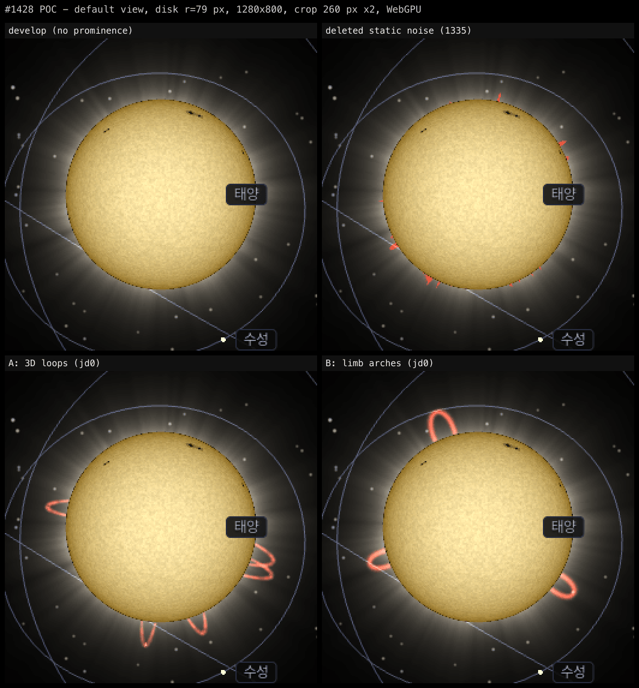
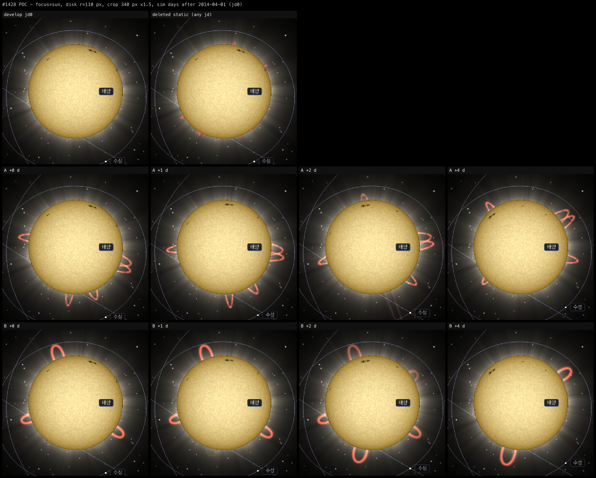
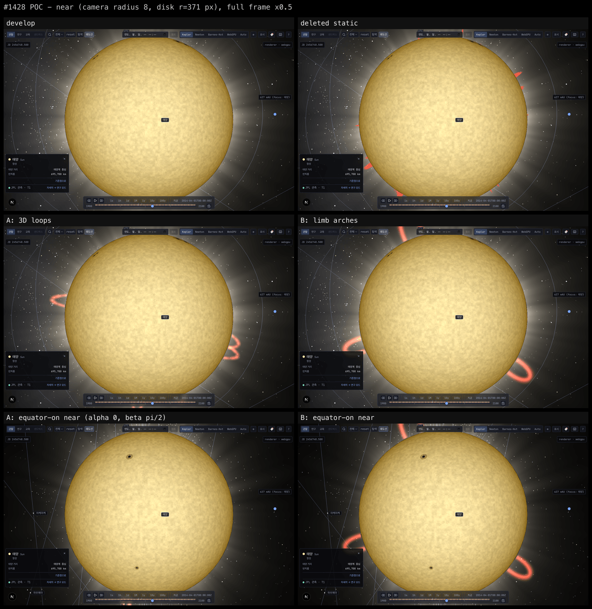
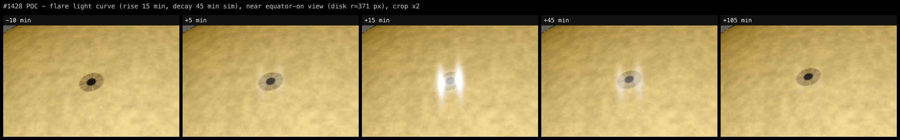
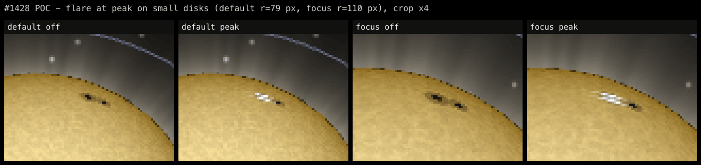

# ADR 20261107-1428 — 태양 플레어 · 홍염: 태양면 고정 3D 루프 메시 · 흑점 군 플레어 · jd 결정적 시간 · 효과별 실효 주파수 감쇠

- **상태**: Accepted (cross-validate 2026-11-07) — §교차검증 반영 사항 통합 · 사용자 결정 Q1~Q9 전부 권고안 (2026-11-07)
- **날짜**: 2026-11-07
- **결정자**: architect (이슈 [#1428](https://github.com/coseo12/astro-simulator/issues/1428))
- **관련**:
  - [ADR 20261014-1335](20261014-1335-sun-corona.md) 결정 1 (시선 정렬 고리 · ρ 판정) · 결정 4 (가시성 축 2개) · 결정 5 (소프트웨어 게이트) · 결정 7 (시간 불변) · 재검토 트리거 4 (본 ADR 이 그 「별도 ADR」) · **Amendment 1 (정적 · 림 고정 홍염 삭제)**
  - [ADR 20261025-1412](20261025-1412-sunspots.md) 결정 2 (jd 순수 함수 · mulberry32 · `updateAt` / `runFramePass` 분리) · 결정 3 (실효 주파수 감쇠) · 결정 5 (토글) · 결정 6 (774 가드 분리) · **Amendment 1 (`1/6 s` 창 판정)**
  - [ADR 20260703-774](20260703-774-sun-emissive-shader.md) 재검토 조건 3 (시간 변동 — jd 직접 전달 금지 · 결정적 스크린샷)
  - [ADR 20260907-1205](20260907-1205-frame-phase-vs-time-phase.md) 결정 2 (프레임 위상 멤버십 3조건) · Amendment 1
  - [ADR 20260927-1265](20260927-1265-runtime-display-toggles.md) 결정 5 · 7 (URL 어휘 · 토글 표 SSoT)
  - #1422 (PR #1425) — `LOG_DEPTH_VERTEX_Z_GLSL` 적용 기준
  - [로드맵 `roadmap-track-ab.md`](../phases/roadmap-track-ab.md) §후보 「플레어 · 홍염 (시간 변동)」 · 착수 시 횡단 검토
  - [`principles.md`](../architecture/principles.md) §1 Visual Fidelity
- **용어**: [Tier](../glossary.md#tier-t1--t2--t3), LOD, bodyScale, ρ (각반경 비 — ADR 1335 결정 1)

> **forensic 변형 판정 — 일반 ADR.** 신규 기능 설계다. 5조건 중 (2) runtime 측정 필수만 해당.

---

## 배경

정적 코로나 (#1335, v0.98.0) 와 흑점 (#1412, v0.107.0) 다음 트랙 A 후보다. ADR 1335 는 시간 변동을 재검토 트리거 4 로 미뤘고, 같은 ADR Amendment 1 은 **정적 · 림 고정 홍염을 사용자 육안 (D-T2) 에서 「림에 묻은 정적 노이즈」 로 보여 항 자체를 삭제**했다. 이번 설계의 첫 질문은 「같은 실패를 반복하지 않는 형태가 무엇이고, 그것이 화면에서 실제로 다르게 보이는가」 다.

### 삭제된 홍염 (ADR 1335 Amendment 1) 의 형태

코로나 fragment 안의 항이었다 (커밋 `a21e92cf` → `bb2bf7bd` 에서 삭제). `ρ ∈ [1, 1.1]` 띠에서 `fbm(e · 14)` 가 문턱 0.64 (단위 구 위 분포 상위 약 13 %) 를 넘는 곳만 적색으로 섞었다. 즉 **높이 0.1 R · 고주파 noise 문턱 · 시간 불변 · 카메라 방향 `e` 에 붙은 무늬**였다.

### 실측 (2026-11-07, architect)

환경: 로컬 macOS · Apple M1 Pro · Chrome 157.0.8103.38 · `next dev` (develop `b29f40a6`, `@astro-simulator/shared` · `core` dist 재빌드) · Playwright `channel: chrome` `headless: false` · 1280×800 DPR 1 · `?t=2456748.5&speed=0` (2014-04-01, 사이클 24 극대 — ADR 1412 시안과 같은 시각). 렌더러: WebGPU (기본) · 하드웨어 WebGL2 (`navigator.gpu` 은닉 + `?gpu=a`). 측정 스크립트 · POC 는 일회성이며 커밋하지 않는다 (volt #67). **앱 코드 변경 0** — 페이지 안에서 셰이더 텍스트에 define 블록을 주입하고 메시를 붙였다.

**1-A. 시안 3종 + 대조군.**

| 시안 | 경로 | 형태 | 시간 변화 |
| --- | --- | --- | --- |
| 삭제안 (대조군) | 코로나 fragment | 위 「삭제된 홍염」 을 상수 그대로 재현 | 없음 |
| **A — 태양면 고정 3D 루프** | 신규 메시 1개 (리본 · ALPHA_ADD · depth test on) | 발자국 2개를 태양면 위도 · 경도에 둔 아치. 높이 0.20~0.32 R · 리본 반폭 0.035 R · H-α 적색 `(1.0, 0.32, 0.22)` · fragment 가 `ρ < 1` (disk 안쪽) 을 버려 **림 밖 부분만** 보인다 | 차등 자전 (흑점과 같은 `ω(φ)`) · 수명 envelope (상승 · 소멸) · 분출 (높이 ×3.2 + 소멸) |
| B — 림 고정 2D 아치 | 코로나 fragment | `(위치각, ρ)` 공간의 반타원 아치 5개. 위치각은 코로나 `e` 와 같은 세계 기저 | 수명 envelope 만 (자전 없음) |

POC 홍염 목록은 실제 생성기가 아니다 — 기본 카메라의 림 경도 근처에 6개를 둔 고정 목록이다 (림 위에 보이는 모습을 확인하려는 배치). 플레어 시안은 sun 셰이더 fragment 의 국소 백색 혼합 (흑점 위치 · 반경 0.06 R · 2-리본 + 중심 핵) 이고, 광도 곡선은 상승 15 분 (smoothstep) · 지수 감쇠 45 분 (sim 시간) 이다.

**1-B. 화면에서 무엇이 보이는가 — on/off 프레임 diff (채널 차 > 2) 의 연결 성분 (8-이웃).** 「최대 높이」 = diff 픽셀의 (화면 중심 거리 − disk 반경) 최댓값.

| 장면 (disk 반경) | 삭제안 성분 수 · 중앙값 · 최대 높이 | A 성분 수 · 중앙값 · 최대 높이 | B 성분 수 · 중앙값 · 최대 높이 |
| --- | --- | --- | --- |
| 기본 (79.3 px) | 17 · 5 px · 7.6 px | 4 · 185 px · 23.3 px | 3 · 382 px · 27.0 px |
| `?focus=sun` (110.0 px) | 18 · 7 px · 11.1 px | 4 · 358 px · 32.0 px | 3 · 734 px · 37.7 px |

읽을 수 있는 것: 삭제안은 **작은 조각이 림 전체에 흩어진다** (기본 화면 17 개, 중앙값 5 px, 높이 7.6 px = 높이 상수 0.1 R × 79 px). A · B 는 **수가 적고 큰 구조**다 (기본 화면 3~4 개, 중앙값 185~382 px, 높이 23~27 px). 「노이즈」 로 읽힌 원인이 크기 · 개수 · 형태였다면 A · B 는 그 축에서 다르다. 이것은 시안의 판정량이지 육안 판정이 아니다 — 최종 판정은 사용자 D-T2 다 (Q1).

**1-C. A 와 B 를 가르는 것 — 카메라 · 시간에 대한 반응.** 근접 시안 (위 세 번째 그림) 의 아래 행은 카메라를 적도 정면 (`alpha 0 · beta π/2`) 으로 돌린 같은 jd 다. B 의 아치는 같은 화면 자리에 그대로 남고 (diff 22,024 px — 기본 근접 22,038 px 와 같은 크기), A 의 루프는 다른 림이 보이므로 대부분 사라진다 (2,469 px — POC 목록이 기본 카메라 림에 맞춘 배치라서다). **B 는 카메라에 붙은 무늬라는 점에서 삭제안과 같은 계열이다** — 카메라를 돌려도, 날짜를 바꿔도 같은 자리의 림에 있다. A 는 흑점과 같은 태양면 좌표에 있어 자전으로 림을 넘어오고 넘어간다 (시간 경과 그림 A 행). focus 시간 경과에서 A 의 diff 는 +0 · +1 · +2 · +4 일에 1,819 · 2,005 · 2,837 · 1,773 px, 최대 높이 32.0 · 34.0 · 100.0 · 36.1 px (+2 일은 분출 루프) 다.

**1-D. 기본 카메라는 활동대를 림 근처에 둔다 [계산].** ADR 1412 1-A: 기본 · focus 카메라의 일면 위도는 약 +69° 다. 그러면 태양면 점의 시선 각 θ 는 `cos θ = sin 69° sin φ + cos 69° cos φ cos Δλ` 이고, 위도 ±15° 에서 θ 는 각각 54°~96° · 84°~126° 범위에 있다. 높이 h 인 루프 꼭대기가 disk 밖으로 투영되는 조건은 `sin θ > 1/(1+h)` 이고 h = 0.25 이면 θ ∈ (53.1°, 126.9°) 다. 즉 **기본 시점에서 ±15° 활동대의 h ≥ 0.25 루프는 자전 위상과 무관하게 꼭대기가 림 밖에 있다.** 시안 A 가 기본 화면에서 4 성분으로 보인 것과 같은 방향이다. 실제 생성기의 표본 비율은 PR1 측정 (DoD D2).

**1-E. 플레어 크기.** 같은 jd (τ = 15 분, 피크) 에서 플레어 on/off diff:

| 장면 | disk 반경 | diff px |
| --- | ---: | ---: |
| 기본 | 79.3 | 62 |
| `?focus=sun` | 110.0 | 111 |
| 근접 (기본 시점, 흑점이 위쪽 림 근처) | 371.2 | 545 |
| 근접 적도 정면 | 371.2 | 3,620 |

근접 적도 정면 광도 곡선 (같은 jd off 대비): τ = −10 · +5 · +15 · +45 · +105 분 → 곡선값 0 · 0.26 · 1 · 0.51 · 0.14, diff 0 · 2,440 · 3,620 · 3,026 · 1,901 px.

**기본 화면에서 플레어는 수 px 의 흰 점이다** (62 px — 흑점 반영 위를 덮는 크기). 기본 · focus 시점은 흑점대를 위쪽 가장자리 근처에서 비스듬히 본다 (ADR 1412 1-A — 일면 위도 +69° 에서 위도 φ 흑점의 μ 는 `cos(69° − φ)` 이하 [계산], POC 플레어 자리 (위도 11.6° 흑점) 의 μ 는 0.47) 라 플레어도 단축된다. 플레어가 「보이는」 장면은 근접 · 적도 정면이다.

**1-F. 결정성.** 같은 페이지에서 A + 플레어를 켠 채 jd +2 일 캡처 → +4 일로 이동 → +2 일로 복귀 캡처: 캔버스 차이 **0 픽셀 / 1,024,000**. (시안이 jd 순수 함수라 당연한 결과다. 로드 2회 비교는 PR1 DoD D3.)

**1-G. 렌더 비용 (1회 실행).** 근접 (disk 371 px), A + 플레어 피크 on ↔ off 3회 교차, 3 s rAF 계수: on `60.05 · 60.00 · 60.06` · off `60.03 · 59.98 · 60.05` fps (WebGPU, vsync 60 Hz). vsync 상한 안의 동률만 말한다. A 의 래스터 면적 (diff px) 은 기본 972 · focus 1,819 · 근접 12,434 px (각각 캔버스의 0.09 % · 0.18 % · 1.2 %) 이다.

**1-H. 백엔드.** 하드웨어 WebGL2 에서 같은 시안을 그렸다: 기본 · focus · 근접 diff 가 WebGPU 와 같은 크기 (A 963 · 1,809 · 12,420 px / B 1,220 · 2,357 · 22,037 px / 플레어 62 · 112 · 542 px), 콘솔 에러 0. WebGPU 도 콘솔 에러 0.

---

## 후보 비교

### 축 1 — 홍염 표현 (Q1)

| 후보 | 기본 화면 (1-B) | 카메라 · 시간 반응 (1-C) | 삭제안과의 차이 | 비용 · 경로 |
| --- | --- | --- | --- | --- |
| **(A) 태양면 고정 3D 루프 메시** | 4 성분 · 높이 23.3 px | 자전으로 림을 넘나든다 · 카메라를 돌리면 다른 림의 루프가 보인다 · 디스크 뒤 부분은 깊이로 가려진다 | 크기 · 개수 · 형태 · 시간 · 3D 위치 전부 | 메시 +1 (draw call +1) · 셰이더 1종 |
| (B) 림 고정 2D 아치 (코로나 fragment) | 3 성분 · 높이 27.0 px | 카메라에 붙은 자리 · 자전 없음 | 크기 · 개수 · 형태 · 수명 | draw call +0 · 코로나 셰이더 변경 (`?corona=off` 가 홍염도 끈다) |
| (C) 홍염 없음 (플레어만) | — | — | — | — |

B 는 싸지만 「림에 붙은 무늬」 라는 삭제안의 성질 (카메라 · 날짜와 무관한 자리) 을 그대로 가진다. 흑점은 이미 태양면 좌표로 돌고 있어 (ADR 1412 결정 2), 같은 태양 위에서 홍염만 화면에 붙어 있으면 둘이 어긋난다.

### 축 2 — 플레어 표현 (Q2)

| 후보 | 기본 화면 (1-E) | 근접 | 위치 근거 | 비용 |
| --- | --- | --- | --- | --- |
| **(F1) sun 셰이더 국소 백색 (흑점 군 위치)** | 62 px — 수 px 의 흰 점 | 2-리본 + 핵이 보인다 (3,620 px) | 흑점 생성기의 군 위치 — 플레어는 활동 영역에서 난다 | fragment 상수 상한 루프 (≤ 4) · draw call +0 |
| (F2) F1 + 화면 px 하한 광륜 (기본 화면에서도 보이게) | 하한만큼 커진다 [미실측] | F1 과 같음 | 같음 | 별도 sprite 메시 또는 후처리 — 이슈 비목표에 가까운 「번지는 섬광」 |
| (F3) 플레어 없음 | — | — | — | — |

### 축 3 — 시간축 (Q3)

| 후보 | 같은 jd = 같은 화면 | 일시정지 | 배속 | #782 · 가드 |
| --- | --- | --- | --- | --- |
| **(T1) sim jd 결정적 — CPU float64 가 형태 · 세기를 계산해 uniform · 정점으로 넘긴다** | ✓ (1-F) | 그 jd 의 모습으로 멈춘다 | 빠를수록 섬광이 잦아진다 → 효과별 감쇠 (축 4) | 셰이더에 시간 uniform 0 — #782 규약 그대로. `?t=…&speed=0` 스크린샷 결정적 |
| (T2) 실시간 (`performance.now`) | ✗ — 이슈 DoD 「같은 jd 에서 같은 화면」 위반 | 멈춰도 움직인다 | 배속과 무관한 일정 리듬 | 감은 소수 시간 uniform 필요 (ADR 774 재검토 3) · 모든 픽셀 가드에 off 필요 |
| (T3) 혼합 (이벤트는 jd, 가닥 흐름 등 연출은 실시간) | ✗ (연출 부분) | 연출만 움직인다 | — | T2 의 가드 비용을 그대로 진다 |

### 축 4 — 광과민성 감쇠의 판정량 (Q4)

흑점 감쇠 (ADR 1412 결정 3 · Amendment 1) 는 `f = |Δjd|/Δt × c` 를 `1/6 s` 창으로 재고 3 Hz 초과가 `1/6 s` 이어지면 가시도를 0 으로, 변화율 6 /s 로 움직인다. 흑점의 `c` 는 자전 주파수 `ω(0)/360 = 0.04034 /일` 이다. 이 상태기계는 `c` 하나만 바꾸면 다른 효과에 쓸 수 있다. **효과마다 「가장 빠른 밝기 전이 시간 T」 에서 `c = 1/(2T)` 를 쓴다** — 지속 시간 T 의 전이 1 회는 주파수 `1/(2T)` 진동의 반주기와 같고, 이것이 흑점 감쇠의 지속 창 `1/(2·3) s` 와 같은 관계다.

| 효과 | T (sim) | `c` [/일] | 근거 |
| --- | --- | ---: | --- |
| 흑점 (기존) | — (자전 주기 기준) | 0.04034 | ADR 1412 결정 3 — 변경 없음 |
| 홍염 | 0.5 일 (생성 · 소멸 · 분출 envelope 의 최소 전이 — 설계 상수) | 1 | 결정 3 |
| 플레어 | 15 분 (상승) | 48 | 결정 4 |

프리셋별 실효 주파수 `f = c × 배속[일/s]` [계산]. ≤ 3 Hz 면 보임, 초과면 감쇠:

| 프리셋 | 배속 [일/s] | 흑점 | 홍염 | 플레어 |
| --- | ---: | ---: | ---: | ---: |
| `1s` | 1.157e-5 | 4.7e-7 Hz · 보임 | 1.2e-5 Hz · 보임 | 5.6e-4 Hz · 보임 |
| `1h` | 0.04167 | 0.0017 Hz · 보임 | 0.042 Hz · 보임 | **2.0 Hz · 보임** |
| `1d` (기본) | 1 | 0.040 Hz · 보임 | **1.0 Hz · 보임** | **48 Hz · 감쇠** |
| `1M` | 30 | **1.21 Hz · 보임** | **30 Hz · 감쇠** | 1,440 Hz · 감쇠 |
| `1y` | 365.25 | **14.7 Hz · 감쇠** | 365 Hz · 감쇠 | 감쇠 |
| `10y` · `100y` | 3,652.5 · 36,525 | 감쇠 | 감쇠 | 감쇠 |

경계 배속 [계산]: 홍염 3 일/s, 플레어 0.0625 일/s (= 1.5 h/s). 즉 **기본 재생 `1d` 에서 홍염은 움직이며 보이고 플레어는 숨는다.** 플레어는 일시정지 · `1s` · `1h` 와 스크러버 단발 점프에서 보인다.

---

## 결정 (사용자 Q1~Q9 확정 — 2026-11-07)

**결정 1 — 홍염: 태양면 고정 3D 루프 메시 (축 1 (A)).** 신규 모듈 `packages/core/src/scene/sun-prominences.ts` 가 생성기 · 기하 · 메시를 소유한다. 홍염 전체 = 메시 1개 · GLSL `ShaderMaterial` 1개 (draw call +1).

- **생성기 (jd 순수 함수)**: `generateProminences(jd, out): number` — 흑점 생성기 (ADR 1412 결정 2) 와 같은 구조. 일 슬롯 `d = floor(jd − J2000)` 마다 mulberry32, 시드 `(Math.imul(d, 0x9E3779B1) ^ PROMINENCE_SEED_SALT) >>> 0` (salt 는 흑점과 다른 값). 신생률은 흑점 생성기의 사이클 모양 (`cycleShape` · 극소 표 + 외삽) 을 재사용한다 — 극대에 많고 극소에 적다. 위도는 흑점과 같은 활동대 분포, 경도는 `λ(jd) = λ_birth + ω(φ)(jd − jd_birth)` (`sunspotOmegaDegPerDay` 재사용), 태양면 → 장면 변환은 `heliographicToScene` 재사용 (거울상 함정 — ADR 1412 결정 2). **진입부 계약**: 함수 첫 문장에서 `!Number.isFinite(jd)` 또는 `|jd − J2000| > 범위` 이면 0 개를 반환한다 — 슬롯 루프 · 시드 연산 · 출력 버퍼 쓰기보다 앞 (흑점 생성기와 같은 위치 · 같은 범위 상수). **슬롯 lookback 은 흑점 생성기 규약을 재사용한다**: 흑점은 `[today − SLOT_LOOKBACK_DAYS, today]` 를 순회하고 (`SLOT_LOOKBACK_DAYS = ⌈최장 수명⌉ + 2`), 슬롯의 난수 소비를 생존 판정 전에 끝내 같은 개체가 자정 경계를 넘어 이어진다. 홍염은 같은 구조로 `PROMINENCE_SLOT_LOOKBACK_DAYS = ⌈PROMINENCE_LIFE_MAX_DAYS⌉ + 2` 를 둔다 (§교차검증 합의 3). 흑점 목록과는 **독립**이다 (Q9 — 흑점 군에 붙이면 흑점 수명이 홍염 수명을 정한다).
- **형태 상수 (rendering-only, 출발값 = POC · 최종값 D-T2)**: 최대 높이 0.20~0.32 R · 발자국 간격 8~14° · 기울기 · 수명 · 분출 확률. 생성 · 소멸 · 분출 envelope 의 전이 시간은 **0.5 일 이상**으로 묶는다 (`PROMINENCE_MIN_TRANSITION_DAYS` — 결정 3 의 `c` 가 이 값에서 나온다). 상한 `PROMINENCE_MAX` 개 · 루프당 분절 상수 (POC 40).
- **정점 버퍼 — 고정 크기 1 회 할당 (§교차검증 합의 2)**: 메시 생성 시 `PROMINENCE_MAX × (분절 + 1) × 2` 정점의 `updatable` 버퍼와 고정 인덱스 버퍼를 1 회 만들고, 이후 `updateAt` 은 정점 데이터만 제자리 갱신한다 (재할당 · 인덱스 변경 0). 활성 수 `N < PROMINENCE_MAX` 이면 남는 슬롯은 **밝기 0 + 모든 정점을 같은 점 (곡선점 0) 으로 퇴화**시킨다 — 면적 0 삼각형이라 fragment 가 없다. `subMesh.indexCount` 조작은 쓰지 않는다 (상태 하나를 줄인다).
- **기하 갱신 위상**: 루프 곡선 점 (태양 중심 기준 · R 단위) 은 jd 의 함수라 `updateAt` 에서 쓴다 — 시각이 바뀔 때만 정점 버퍼를 갱신하고, 일시정지 중에는 갱신 0.
- **지연 생성 직후 동기화 (§교차검증 합의 6)**: `setFlaresVisible(true)` 가 메시를 처음 만들면 같은 호출 안에서 (a) 마지막으로 기록된 장면 시계 jd (`currentClockJd`) 로 기하를 1 회 기록하고 (b) LOD 가시성을 1 회 맞춘다. 일시정지 중에는 `updateAt` 이 돌지 않으므로 (a) 가 없으면 빈 메시가 남는다. (b) 는 코로나 `setSunCoronaVisible` 의 `syncSunCoronaLodVisibility` 선례, (a) 는 흑점 `setSunspotsVisible` 의 「켜기 = 현재 시각 즉시 기록」 선례다.
- **카메라 정렬은 정점 셰이더가 한다**: 정점 속성 = 곡선 점 · 접선 · 리본 측 (±1) · 밝기. 정점 셰이더가 `P = 태양 중심 + R · 곡선점`, 측 방향 `cross(접선, P − cameraPosition)` 으로 리본을 펼친다. 카메라만 움직이는 프레임에 CPU 갱신이 없다 (POC 는 CPU 에서 펼쳤다 — 구현은 이 항을 따른다).
  - **평행 특이점 가드 (§교차검증 합의 1)**: 루프 다리가 시선과 나란하면 외적이 영벡터가 되고 `normalize(vec3(0))` 은 NaN 이다 (기하상 실제로 생긴다 — 림 근처 다리가 시선 방향으로 뻗는 구도). 접선 `t` · 시선 `v` 를 먼저 정규화한 뒤 `side = cross(t, v)`, `dot(side, side) < ε` 이면 `side = cross(radial, v)` (`radial = normalize(P − 태양 중심)`) 로 바꾸고, 마지막에 `side * inversesqrt(max(dot(side, side), ε_min))` 로 정규화한다. 둘 다 퇴화하면 폭 0 리본이 되어 NaN 대신 아무것도 그리지 않는다. ε 은 모듈 상수, JS 미러가 단위 테스트에서 평행 입력 → 유한값을 단언한다 (D9).
- **fragment**: 코로나와 같은 각반경 판정으로 `ρ < 1` (disk 안쪽) 을 앞뒤 관계없이 버린다. `ρ ≥ 1` 인 시선은 태양 구와 만나지 않으므로 그 fragment 를 태양이 가릴 수 없다 — **홍염의 가시 영역은 태양 깊이에 의존하지 않는다** (`?surface=off` 에서도 같은 판정, §교차검증 이견 1). 그래서 **림 밖 부분만** 보이고, 다른 천체 (달 · 수성) 가 앞에 있으면 그 천체의 깊이가 가린다. 리본 단면 `exp(−2.5 v²)` · 림 경계 `smoothstep(1, 1.015, ρ)` · 색 H-α 적색 (출발값 `(1.0, 0.32, 0.22)` — 삭제안과 같은 색). `acos` 정의역 clamp (ADR 1335 §교차검증 합의 1).
- **머티리얼**: ALPHA_ADD · `disableDepthWrite` · depth test on · 로그 depth `LOG_DEPTH_FRAGMENT_WRITE_GLSL` · `backFaceCulling = false` · `alwaysSelectAsActiveMesh` · `isPickable = false` · `alphaIndex = 0` (코로나와 같은 값 — 가산끼리는 순서 무관). switch 금지 (WGSL 변환).
- **기준계 (ADR 1335 결정 2 그대로)**: draw 직전 `onBeforeRenderObservable` 에서 중심 = 태양 host mesh.position, 반경 = `body.radius × bodyScale('sun') × bodyFrame.scale`. `floatingOrigin.originOffset` 은 읽지 않는다.
- **가시성 축 2개 (ADR 1335 결정 4 그대로)**: LOD 추종 `isVisible` 은 프레임 위상의 LOD 적용부 (코로나가 쓰는 같은 자리) 가 `sunHigh.isVisible || sunMid.isVisible` 로 쓴다. 표시 토글은 `setEnabled`. 자기 observer 안에서 `isVisible` 을 쓰지 않는다.
- **재사용 (신규 구현 금지)**: `heliographicToScene` · `sunspotOmegaDegPerDay` · `cycleShape` (흑점) · `LOG_DEPTH_FRAGMENT_WRITE_GLSL` · 코로나의 각반경 · ρ 식 (상수가 아니라 식이 같다 — JS 미러는 `coronaAngularRadius` 재사용) · `BodyReferenceFrame` + `frameProvider` 패턴.

**결정 2 — #1422 vertex clip z 보정: 측정 후 적용 (조건부).** 홍염 fragment 는 `gl_FragDepth` 를 쓰므로 `LOG_DEPTH_VERTEX_Z_GLSL` 의 사용 전제 (log-depth.ts 「fragment 가 `gl_FragDepth` 를 쓰는 셰이더에만」) 를 충족한다 — 적용해도 depth 값은 바뀌지 않고 clip 통과 여부만 바뀐다. 적용 기준은 `log-depth-glsl.test.ts` 의 SSoT 「WebGL2 노출이 실측된 셰이더만」 을 따른다: PR1 이 #1425 노출 술어 (대상 메시만 남긴 장면, 보정 on/off 프레임 비교 · 위성 focus → 태양) 로 1 회 측정해 **노출 > 0 이면 적용 + `SHADERS` 목록 추가, 0 이면 미적용** (코로나 · 혜성 꼬리 · 벨트 선례). 정점이 태양 표면 근처라 sun-shader (노출 1,537 px) 와 같은 깊이대이고 코로나 (평면이 `d + 3R`, 노출 0) 와는 다르다 — 결과를 예측해 박제하지 않는다. 플레어는 sun-shader 안이라 기존 보정을 그대로 받는다 (대상 아님).

**결정 3 — 시간: jd 결정적 (축 3 (T1)), 효과별 실효 주파수 감쇠 (축 4).**

- 셰이더에 시간 · jd uniform 을 두지 않는다. 홍염 기하 · 밝기와 플레어 세기는 CPU float64 에서 계산한 결과만 넘긴다 (#782 규약 · ADR 774 재검토 조건 3).
- **감쇠 상태기계 일반화**: ADR 1412 결정 3 · Amendment 1 의 `stepSunspotVisibility` 를 `c` (cycles/일) 인자를 받는 공용 함수로 옮기고 (신규 모듈 `activity-visibility.ts` — 흑점 쪽은 `c = ω(0)/360` 을 넘기는 얇은 래퍼), 상태는 효과마다 1 개 (흑점 · 홍염 · 플레어). 상수는 그대로 (3 Hz · `1/6 s` 창 · 변화율 6 /s). **흑점 동작은 바뀌지 않는다** — 기존 `sunspots.test.ts` 감쇠 단언이 수정 없이 통과해야 한다 (DoD D4).
- 홍염 `c = 1/(2 · PROMINENCE_MIN_TRANSITION_DAYS) = 1 /일`, 플레어 `c = 1/(2 · FLARE_RISE_DAYS) = 48 /일` (축 4 표).
- 위상: 감쇠 값은 기존 프레임 위상 멤버 `syncSunspotFrame` 자리에서 세 상태를 함께 진행한다 (멤버 수 2 불변 — ADR 1205 결정 2). 판정은 ADR 1205 Amendment 1 과 같다 (조건 2 만 충족 — 시간이 멈춰도 감쇠가 1 로 돌아와야 한다). 홍염 기하 · 플레어 목록은 `updateAt`.
  - **실행 조건 분리 (§교차검증 합의 5)**: 현행 `syncSunspotFrame` 의 조기 리턴은 `if (!surfaceDetail) return;` 하나다 (코드 확인 — `sunspotsEnabled` 로는 리턴하지 않는다). 그래서 `?sunspots=off` 는 문제가 아니고, **`?surface=off` 가 문제다** — 홍염은 별도 메시라 `?surface=off` 에서도 그려지는데 (결정 5), 같은 함수 안에 두면 홍염 감쇠가 멈춘다. 멤버 함수를 `syncSolarActivityFrame` 으로 이름을 바꾸고 안을 셋으로 나눈다: 흑점 · 플레어 단계 (sun 셰이더 의존) 는 `surfaceDetail` 조건, 홍염 단계는 조건 없음. 세 상태의 `step` 은 토글과 무관하게 매 프레임 진행한다 (켜는 순간의 가시도가 직전 재생 속도를 반영하게 — 흑점 현행과 같다). `runFramePass` 머리말의 멤버 목록 주석을 같은 PR 에서 갱신한다.
- 셰이더 적용: 홍염은 리본 밝기에 가시도를 곱한다 (가시도 0 이면 메시를 끄지 않는다 — 토글 축과 섞지 않는다, 결정 1). 플레어는 세기에 곱한다.
- **일시정지**: `Δjd = 0` → `f = 0` → 그 jd 의 모습으로 멈춰 보인다. 흑점과 같이 창 비움 + 지속 + 상승 (약 1/2 s) 뒤 가시도 1.
- **스크러버 · 「지금」 · 날짜 입력**: 드래그 · 키 반복은 Amendment 1 의 창 판정으로 감쇠된다. 단발 점프 (「지금」 · 날짜 입력 · 스크러버 1 회) 는 무시되므로 도착 jd 의 홍염 · 플레어가 바로 보인다 (점프 1 회 = 전이 1 회).
- **결정성**: 같은 jd + 감쇠 가시도 1 이면 같은 화면이다. 로드 직후 가시도 초기값은 1 이라 `?t=…&speed=0` 캡처는 결정적이다.

**결정 4 — 플레어: sun 셰이더 국소 백색, 흑점 군 위치 (축 2 (F1)).**

- 이벤트 생성기 `sun-flares.ts` — 플레어 자리는 흑점 생성기 (`generateHeliographicSunspots`) 의 군이다. 군마다 일 슬롯 해시로 그날의 발생 시각을 **슬롯당 0 또는 1 회** 정하고 (발생률은 군 면적에 비례 — 출발값 D-T2), 세기 = 광도 곡선 (상승 15 분 smoothstep · 감쇠 45 분 지수 — POC 값) × 감쇠 가시도. 시드는 군 id (`idSlot` · `idGroup`) 와 일 슬롯에서 만든다. 슬롯 lookback 은 흑점 규약과 같은 구조로 `⌈FLARE_DURATION_MAX_DAYS⌉` 일 (§교차검증 합의 3).
- **호출 계약 (§교차검증 합의 4)**: 플레어 생성기는 흑점 생성기를 **내부에서 부르지 않는다**. 시그니처는 `generateSunFlares(jd: number, spots: Readonly<HeliographicSpots>, spotCount: number, out: SunFlareList): number` (할당 0 · 진입부 jd 가드는 결정 1 과 같음 — §교차검증 합의 8). 장면은 `updateAt` 에서 `surfaceDetail && (sunspotsEnabled || flaresEnabled)` 일 때 장면 소유 `HeliographicSpots` 버퍼에 `generateHeliographicSunspots` 를 **1 회** 호출하고, 그 결과를 흑점 uniform 기록과 플레어 생성기가 공유한다. 흑점 uniform 기록은 `sunspotsEnabled` 일 때만이다 — 그래서 `?sunspots=off` 에서도 플레어 자리는 있다 (토글 1 개 = 효과 1 개). 이를 위해 `writeSunspotUniforms(jd, out)` 옆에 이미 생성된 목록을 받는 기록기를 더하고, 기존 시그니처는 그 위의 래퍼로 남긴다 (기존 테스트 무수정).
- **`MAX_SUN_FLARES = 4` 상수 SSoT (§교차검증 합의 7)**: `sun-flares.ts` 가 export 하고 셰이더 배열 크기 (`flares[MAX_SUN_FLARES]`) · 생성기 출력 상한 · 단위 테스트가 이 값을 참조한다 (흑점 `SUNSPOT_MAX` 와 같은 방식).
- **여러 플레어의 빈도 (§교차검증 이견 2)**: 플레어는 서로 다른 흑점 군 자리에 나고, 같은 군은 일 슬롯당 최대 1 회다. 감쇠가 보이게 두는 가장 빠른 배속 1.5 h/s 에서 실시간 1 초 = sim 1.5 시간이고, 이 구간은 일 슬롯을 최대 2 개만 걸친다 [계산]. 그래서 **한 자리에서 1 초에 나는 플레어는 최대 2 회 = 섬광 2 쌍 ≤ 3** 이다. 새 메커니즘 (위상차 강제 등) 은 넣지 않는다.
- 셰이더: `uniform vec4 flares[MAX_SUN_FLARES]` (`xyz` 중심 · `w` 반경) + `vec4 flareParams[MAX_SUN_FLARES]` (`x` 세기) + `flareCount`, 상수 상한 루프 + `if (float(i) >= flareCount) break;` (흑점 루프와 같은 형태). 2-리본의 접선 기저는 흑점 필라멘트와 같은 자전축 기저 (`sunAxis` uniform 재사용). 합성은 흑점 · limb 뒤 `col = mix(col, vec3(1.0), fl)` — `flareCount = 0` 이면 루프 첫 반복에서 빠져 `col` 이 그대로다 (끈 상태 = develop 과 같은 식 — DoD D5).
- 크기 상수 반경 0.06 R 은 표시 과장이다 (Visual Fidelity — 기본 화면 62 px, 1-E). 기본 화면에서 수 px 이라는 것을 받아들인다 (Q2).

**결정 5 — 보이는 조건 · 토글 · URL (Q5 · Q6 · Q7).**

| 조건 | 홍염 | 플레어 |
| --- | --- | --- |
| LOD high / mid | 있음 (`isVisible` 추종) | 있음 (sun 셰이더) |
| LOD low · tier C (`forceOverride: 'low'`) | 없음 | 없음 (billboard) |
| `?surface=off` | 있음 (별도 메시) | 없음 (셰이더 없음) |
| `?corona=off` | 있음 (코로나와 독립) | 있음 |
| `?sunspots=off` | 있음 | 있음 (위치는 생성기) |
| 소프트웨어 렌더 (`isSoftwareRenderer`) | 미생성 | `flareCount = 0` |
| `?flares=off` (로드) · 표시 패널 끔 (런타임) | 미생성 / `setEnabled(false)` | `flareCount = 0` |

- URL `?flares=off` 1 개가 플레어 · 홍염을 함께 끈다 (ADR 1265 결정 5 어휘 — ON = 키 삭제). 파서 `parse-flares-mode.ts` 는 `parse-sunspots-mode.ts` 와 같은 `off` 만 (`force` 없음 — Q7).
- 표시 패널 행 1 개 「플레어 · 홍염」 (PR3). 코로나 행과 합치지 않는다 — 코로나는 시간 불변이고 `?corona=off` 는 fps 가드 셀 (`corona-forced`) 의 의미와 묶여 있다.
- 처음 켤 때 지연 생성, 이후 `setEnabled` (ADR 1335 결정 6 수명주기). 장면 dispose 시 해제.
- `prefers-reduced-motion` 은 연동하지 않는다 (Q4 권고 — ADR 1412 결정 3 과 같은 이유: 시간 재생은 사용자가 고른 재생이고 캔버스에 reduced-motion 분기가 없다. 섬광 빈도는 결정 3 이 3 Hz 이하로 묶는다).

**결정 6 — 기존 가드와의 분리 (ADR 1412 결정 6 그대로).** `browser-verify-774-sun.mjs` 의 두 쿼리에 `&flares=off` 를 붙인다 — 774 가드는 disk 의 granulation · limb · 색온도를 재고, 기본 재생 (1 d/s) 에서 홍염 · 플레어 상태는 로드 시간에 따라 달라진다. CI 는 소프트웨어 렌더라 결정 5 게이트로 이미 0 이다. `browser-verify-1265-display-panel.mjs` 의 전체 끔 쿼리에 `flares=off` 를 더한다 (PR3 — 토글 표 행 추가에 따르는 기존 가드 갱신, 코로나 · 흑점 PR2 선례). 신규 가드 · 신규 임계 0.

**결정 7 — 상수 SSoT.** rendering-only 상수는 `sun-prominences.ts` (홍염 형태 · 색 · 전이 시간) · `sun-flares.ts` (발생률 · 광도 곡선) · `sun-shader.ts` (플레어 반경 · 리본 형태) · `activity-visibility.ts` (3 Hz · 창 · 변화율 — 흑점에서 옮긴다) 가 소유한다. `solar-system.json` 변경 0.

---

## 사용자 결정 (2026-11-07 — 전부 권고안)

사용자가 Q1~Q9 를 모두 권고안으로 정했다. Q2 · Q3 은 「기본 재생 `1d` 에서 플레어가 감쇠로 숨는다」 는 대가를 고지받은 뒤의 선택이다.

| Q | 질문 | 선택지 | 결정 (= 권고) | 근거 |
| --- | --- | --- | --- | --- |
| Q1 | 홍염 형태 | (A) 태양면 고정 3D 루프 · (B) 림 고정 2D 아치 · (C) 홍염 없음 | **(A)** | 1-B: 삭제안 17 조각 · 5 px → A 4 구조 · 185 px. 1-C: B 는 카메라에 붙은 무늬라 삭제안과 같은 계열 |
| Q2 | 플레어 | (F1) sun 셰이더 국소 백색 · (F2) F1 + 화면 px 하한 광륜 · (F3) 없음 | **(F1)** | 1-E: 기본 화면 62 px 이라는 한계를 받아들이고 근접에서 보이는 효과로 둔다. F2 는 번지는 섬광이라 광과민성 면적이 커진다 |
| Q3 | 시간축 | (T1) jd 결정적 · (T2) 실시간 · (T3) 혼합 | **(T1)** | 이슈 DoD 「같은 jd 같은 화면」 · #782 · 가드 결정성. 대가: 플레어는 `1h` 이하 · 일시정지에서만 보인다 |
| Q4 | 광과민성 | (a) 효과별 실효 주파수 감쇠 + 토글 · (b) (a) + `prefers-reduced-motion` 시 로드 기본 끔 | **(a)** | ADR 1412 Q5 와 같은 선택. 3 Hz 상한은 (a) 가 보장 |
| Q5 | 토글 | (a) 1 행 「플레어 · 홍염」 `?flares=off` · (b) 2 행 (플레어 · 홍염) · (c) 코로나 행에 합침 | **(a)** | (c) 는 코로나 off 의 의미와 fps 가드 셀을 바꾼다. 흑점이 별도 행인 선례 |
| Q6 | 하드웨어 기본 표시 | (a) 켜짐 · (b) 꺼짐 (옵트인) | **(a)** | 코로나 · 흑점과 같은 기본. 기본 재생 `1d` 에서 홍염이 보이는 효과다 (축 4 표) |
| Q7 | 소프트웨어 렌더 · CI | (a) 미생성 · `force` 없음 · (b) 미생성 + `?flares=force` (CI 셀 없음) · (c) (b) + fps 가드 셀 | **(a)** | 흑점 선례. 신규 가드 0 원칙. 플레어 GLSL 은 sun-shader 안이라 774 가드 (`?gpu=a` swiftshader) 에서 컴파일된다. 홍염 GLSL 은 CI 컴파일 경로가 없다 — qa 실 GPU 양 백엔드 검증으로 대신한다 (받아들인 비용 4) |
| Q8 | 홍염 높이 과장 | 0.20~0.32 R (POC) · 실제 범위 0.015~0.15 R · 기타 (육안 지정) | **POC 범위** | 1-B: 높이 0.1 R 의 삭제안이 기본 화면 7.6 px 였다. 실제 범위 상한 0.15 R 도 기본 화면 약 12 px [계산] |
| Q9 | 홍염 생성 기준 | (a) 독립 생성기 (활동대 · 사이클 공유) · (b) 흑점 군에 부착 | **(a)** | (b) 는 흑점 수명이 홍염 수명을 정하고, 흑점이 적은 사이클 극소에 홍염이 없다 (실제 정온 홍염은 극소에도 있다) |

---

## DoD (측정 가능 — 실 Chrome, 신규 가드 0)

검증 방식은 사용자 방침 (기능 우선 · 검증 경량) 을 따른다: 단위 테스트 + 리뷰 1 회 + 실브라우저 + 사용자 육안 승인. 브라우저 측정은 일회성 스크립트로 하고 결과를 PR 본문에 적는다.

| # | 기준 | 측정 |
| --- | --- | --- |
| D1 | 사용자 육안 승인 — 기본 · focus · 근접 · 시간 경과 (1 d/s 재생 영상 또는 프레임 4 장) · `1h` 재생에서 플레어가 켜졌다 꺼지는 장면 · **개기일식 장면 (일식 투어 #1390 T2) — 달이 원반을 가릴 때 림 밖 홍염이 보이고, 달 뒤에 있는 부분은 달에 가려진다** (§교차검증 합의 9) | 실 Chrome 스크린샷 (Q1 · Q2 · Q8) |
| D2 | 홍염이 기본 화면에서 「구조」 로 보인다: 사이클 극대 · 중간 · 극소 jd 3 개 (PR1 이 고른다) 의 `?t=…&speed=0` 기본 화면에서 on/off diff 의 20 px 이상 연결 성분 수와 최대 높이를 기록. 극대 jd 에서 **성분 ≥ 1 · 최대 높이 ≥ 15 px**. 생성기 표본 (1900~2100, 7.3 일 간격) 에서 기본 카메라 기준 꼭대기가 림 밖인 홍염이 1 개 이상인 표본 비율을 기록 | 1-B 방법 · 단위 테스트 (투영 식은 1-D) |
| D3 | 결정성: 같은 jd → 같은 목록 (단위, 골든 값) · 같은 URL 2 회 로드 → 캔버스 차이 0 픽셀 | 단위 + 브라우저 (ADR 1412 D5 방법) |
| D4 | 광과민성: 공용 감쇠 함수 단위 테스트 — 홍염 `1d` 가시도 1 · `1M` 0, 플레어 `1h` 1 · `1d` 0, 변화율 ≤ 6 /s, 단발 점프 불변, 일시정지 후 1 복귀. **기존 `sunspots.test.ts` 감쇠 단언 수정 0 건 통과** | 단위 + 실브라우저 프리셋 전환 관찰 |
| D5 | 끈 상태 픽셀 동일: `?flares=off` 프레임이 develop 같은 URL 과 캔버스 차이 0 (WebGPU · 하드웨어 WebGL2). swiftshader `?gpu=a` 기본 화면도 develop 과 0 | 실브라우저 |
| D6 | 기존 가드 무회귀: `verify:774-sun` (로컬 실 GPU · CI) PASS · 판정값이 같은 기계의 develop 실행과 같다 · `shader-pixel-guard` · `fps-baseline-guard` · r1 · `log-depth-glsl.test.ts` PASS | CI + 로컬 1 회 |
| D7 | fps: 실 Chrome vsync 유지에서 켬/끔 동률 (1-G 방법). `bench:scene` 하드웨어 A/B −10 % 는 재검토 트리거 | 실브라우저 |
| D8 | 콘솔 에러 0 · WebGPU · 하드웨어 WebGL2 양쪽 `isReady` | 실브라우저 |
| D9 | 단위: 생성기 결정성 · 범위 밖 / 비유한 jd → 0 개 · 차등 자전 (흑점과 같은 `ω`) · 수명 envelope 전이 ≥ 0.5 일 · 광도 곡선 · GLSL 정적 계약 (switch 부재 · 상수 상한 루프 · `gl_FragDepth` 기록 · 시간 uniform 부재) · 홍염 셰이더 선언 일관성 (`ShaderMaterial` 의 `attributes` · `uniforms` 목록 ↔ GLSL `attribute` · `uniform` 선언, vertex → fragment `varying` 쌍 — §교차검증 이견 3) · 리본 측 방향 미러: 평행 입력에서 유한값 (결정 1) · `MAX_SUN_FLARES` 를 셰이더 배열 크기 · 생성기가 같이 쓴다 · 진입부 jd 가드 (비유한 · 범위 밖 → 0 개, 결정 1 · 4) · 자정 경계 전후 jd 에서 같은 개체가 이어진다 (lookback) | `sun-prominences.test.ts` · `sun-flares.test.ts` · `activity-visibility.test.ts` · `sun-shader.test.ts` |
| D10 | #1422 노출 측정 결과와 처분 (결정 2) 을 PR1 본문에 기록 | #1425 노출 술어 |
| D11 | LOD low (disk < 8 px) 에서 홍염 메시 `isVisible = false`, high/mid 복귀 시 다시 보임 · 일시정지 중에도 | 실브라우저 (ADR 1335 D3 방법) |

---

## PR 분할 · Concrete Prediction (구현 후 `git diff --stat` 로 재현)

**PR1 — 홍염 + 공용 감쇠 + `?flares=off` + 소프트웨어 게이트**

- 신규: `packages/core/src/scene/sun-prominences.ts` · `sun-prominences.test.ts` · `packages/core/src/scene/activity-visibility.ts` · `activity-visibility.test.ts` · `apps/web/src/core/parse-flares-mode.ts` · `parse-flares-mode.test.ts`
- 변경: `packages/core/src/scene/sunspots.ts` (감쇠를 공용 함수 래퍼로) · `solar-system-scene.ts` (장면 옵션 · `updateAt` 기하 기록 · 프레임 위상 멤버 `syncSunspotFrame` → `syncSolarActivityFrame` 개명 · 실행 조건 분리 · LOD 추종 · `setFlaresVisible` + 지연 생성 직후 동기화) · `packages/core/src/scene/index.ts` · `packages/core/src/scene/log-depth-glsl.test.ts` (fragment 목록 추가 · vertex 목록은 결정 2 측정에 따라) · `apps/web/src/components/sim-canvas.tsx` · `apps/web/scripts/browser-verify-774-sun.mjs` (`&flares=off`) · `CHANGELOG.md`
- 변경 없음 (예측): `sun-corona.ts` · `body-mesh-factory.ts` · `solar-system.json` · `sunspots.test.ts` (감쇠 단언 — D4)

**PR2 — 플레어**

- 신규: `packages/core/src/scene/sun-flares.ts` · `sun-flares.test.ts`
- 변경: `sun-shader.ts` (uniform · fragment 루프 · 상수 · 생성된 목록을 받는 흑점 기록기) · `sun-shader.test.ts` · `solar-system-scene.ts` (`updateAt` 의 흑점 생성 1 회 공유 · 플레어 기록 · 감쇠 상태) · `CHANGELOG.md`

**PR3 — 표시 패널 토글 (Q5 (a))**: #1335 · #1412 PR2 와 같은 파일 집합 — `display-toggles.ts`(+test) · `sim-store.ts` · `use-display-toggle.ts`(+test) · `display-panel.tsx`(+test) · `simulation-core.ts`(+test) · `packages/shared/src/events/core-events.ts` · `browser-verify-1265-display-panel.mjs` · `CHANGELOG.md`.

예측 초과 = 홍염 · 플레어가 LOD · 메시 팩토리 · 코로나 · 흑점 생성기 본문을 침범 (재검토).

---

## Visual Fidelity — §의무 체크리스트 (principles.md §1)

- [x] **데이터 SSoT 보존** — 홍염 · 플레어 상수는 전부 결정 7 의 모듈 소유 rendering-only. `solar-system.json` 변경 0 (태양 자전 데이터도 추가하지 않는다).
- [x] **rendering 시점 분리** — 물리 엔진은 홍염 · 플레어를 모른다. jd 에서 CPU 로 파생한 정점 · uniform 이다.
- [x] **사용자 D-T2 가이드** — 홍염 높이 (Q8) · 플레어 반경 · 발생률은 표시 근사다. 정보 카드 문구는 추가하지 않는다. PR · CHANGELOG 에 근사임을 적는다.
- [x] **점유율 baseline** — 1-B (장면별 성분 수 · 중앙값 · 최대 높이) · 1-E (플레어 diff px) 가 baseline 이다.

---

## 결과 · 재검토 조건

- **기대 결과** — 하드웨어 렌더의 기본 재생 (`1d`) 에서 태양 림 밖에 적색 루프가 생기고, 자전으로 림을 넘나들고, 분출해 사라진다. 일시정지 · `1h` 이하 · 날짜 점프 뒤에는 흑점 군 위에 플레어가 켜졌다 꺼진다.
- **받아들인 비용** — (1) 기본 화면 플레어는 수 px 이다 (1-E). (2) `1d` 이상에서 플레어, `1M` 이상에서 홍염이 숨는다 (축 4). (3) 홍염 · 플레어 위치 · 빈도는 통계 모델이다 — 특정 날짜의 실제 사건과 같지 않다. (4) 소프트웨어 렌더 사용자에게 없고, 홍염 GLSL 은 CI 에서 컴파일되지 않는다 (Q7 — 선언 일관성 정적 단언이 일부만 메운다, D9). (5) disk 앞을 지나는 홍염은 그리지 않는다 (백색광 근사 — H-α 의 암흑 필라멘트는 범위 밖). (6) 홍염은 실제 3D 위치에 depth test on 으로 그려지므로 앞쪽 천체 (수성 등) 에 깊이로 가려진다 — 코로나의 「구 뒷면 평면」 근사 (ADR 1335 축 2) 와 달리 가림 근사가 없다 [가정 — 미실측]. 대신 가산 반투명이라 다른 반투명 (고리 · 구름) 과의 합성 순서는 `alphaIndex = 0` 정렬을 따른다.
- **재검토 트리거**
  1. 하드웨어 A/B (`bench:scene` · 기본 vs `?flares=off`) 어느 셀이든 −10 % 초과 하락 → 결정 1 재검토 (ADR 1335 · 1412 와 같은 문턱).
  2. 사용자 육안에서 홍염이 여전히 「노이즈」 로 보인다는 보고 → 형태 상수 재조정, 그래도 안 되면 Amendment 1 (1335) 처럼 항 삭제.
  3. 플레어가 기본 화면에서 안 보여 의미가 없다는 보고 → 축 2 (F2) 재검토.
  4. 「특정 날짜의 실제 플레어 · 홍염」 요구 → 관측 데이터 별도 ADR (ADR 1412 재검토 트리거 3 과 같은 축).
  5. 렌더 루프에 유휴 프레임 스킵 · on-demand 렌더 도입 → 결정 3 의 일시정지 복원 경로 재검토 (ADR 1412 트리거 6).
  6. 결정 2 측정에서 노출 0 으로 미적용했는데 이후 WebGL2 구멍이 보고됨 → 적용.

---

## 호출 전 Claude 편향 셀프 체크 (architect — cross-validate 입력)

- **낙관적 일정** — PR 3 개 (홍염 · 플레어 · 패널). 홍염 생성기의 형태 상수 (높이 · 간격 · 수명 · 분출) 는 POC 의 고정 목록에서 생성기로 옮기는 단계에서 D-T2 라운드가 늘 수 있다. 질문 축: 「PR1 범위 (생성기 + 메시 + 감쇠 일반화) 가 1 PR 로 적정한가」.
- **결합 간과** — 명시한 결합: (a) 감쇠 함수 일반화 ↔ 흑점 동작 불변 (결정 3 · D4), (b) 프레임 위상 멤버십 ↔ ADR 1205 (결정 3), (c) 소프트웨어 게이트 ↔ CI 컴파일 사각 (Q7), (d) 기본 카메라 일면 위도 +69° ↔ 홍염 · 플레어 가시성 (1-D · 1-E), (e) `?flares=off` ↔ 774 · 1265 가드 쿼리 (결정 6), (f) #1422 보정 ↔ 측정 후 적용 (결정 2). 질문 축: 「일식 투어 (#1360 · #1390) · 이벤트 마커 · 북마크와의 결합을 놓쳤는가」.
- **폐기 프레이밍** — 후보 B 를 「삭제안과 같은 계열」 로 기각 쪽에 둔다. 근거는 1-C (카메라를 돌려도 같은 자리). 질문 축: 「B 의 싼 비용 (draw call +0) 을 과소평가했는가」.
- **순수주의** — 시간축 T1 (jd 결정적) 은 플레어를 기본 재생에서 숨긴다. 「보이는 기능」 보다 결정성을 앞세운 선택일 수 있다. 질문 축: 「T2 의 가드 비용이 정말 T1 의 가시성 손실보다 큰가」.

---

## 교차검증 반영 사항

agy (2026-11-07, `outcome: applied` · exit 0) — 로그 `.claude/logs/cross-validate-architecture-20261107-192805.log` · outcome `…-192805-outcome.json`. **시도 1 은 하드 타임아웃 360 s 에 도달해 agy 트리가 강제 종료됐고 출력 (stdout 13,895 자) 은 채택하지 않았다** (#1363 하드 타임아웃 경로). 26 s 뒤 시도 2 가 완주해 그 출력을 채택했다. 판정은 6 기준 중 구조 「양호」 · 기술 결정 「매우 우수」 · 인터페이스 「보통」 · 확장성 「우수」 · 안전성 「양호」 · 누락 요소 3 건이고, 보완 제안은 13 건이다. 메인 오케스트레이터가 재분석했고 architect 가 코드 · 산술로 다시 확인해 본문에 반영했다 (맹목 수용 · 기각 금지).

### 합의 (수용 — 본문 반영)

1. **리본 측 방향의 평행 특이점** (agy 2-1) — `normalize(cross(접선, P − cameraPosition))` 은 다리가 시선과 나란할 때 NaN 이다. 대체 기저 `cross(radial, v)` + `inversesqrt(max(·, ε))` 안전 정규화 (결정 1). #1422 의 원인은 NaN 삼각형이 아니었으나, 이 경우는 기하상 실제로 생긴다.
2. **고정 크기 정점 버퍼** (agy 1-1) — `PROMINENCE_MAX × (분절 + 1) × 2` 정점 1 회 할당, 비활성 슬롯은 밝기 0 + 퇴화 (결정 1). `indexCount` 방식은 고르지 않았다 — 상태가 하나 늘어난다.
3. **자정 경계 lookback** (agy 1-2) — 흑점 생성기를 확인했다: `[today − SLOT_LOOKBACK_DAYS, today]` 순회 · `SLOT_LOOKBACK_DAYS = ⌈930/10⌉ + 2` · 슬롯 난수 소비를 생존 판정 전에 끝냄. **같은 방식이라 「흑점 생성기 규약 재사용」 으로 적었다** — 홍염 `⌈PROMINENCE_LIFE_MAX_DAYS⌉ + 2`, 플레어 `⌈FLARE_DURATION_MAX_DAYS⌉` (결정 1 · 4).
4. **플레어 ↔ 흑점 생성기 호출 계약** (agy 3-1) — 장면이 `updateAt` 에서 1 회 생성해 공유, 플레어 생성기는 목록을 인자로 받는다 (`generateSunFlares(jd, spots, spotCount, out)`). `?sunspots=off` 에서도 플레어 자리가 있다 (결정 4).
5. **프레임 위상 조기 리턴** (agy 3-2) — 코드로 확인한 조기 리턴은 `if (!surfaceDetail) return;` 이고 `sunspotsEnabled` 로는 리턴하지 않는다. agy 가 짚은 `?sunspots=off` 경로는 문제가 아니었지만, **같은 구조의 `?surface=off` 경로가 실제 문제**라 실행 조건을 분리하고 `syncSolarActivityFrame` 으로 개명한다 (결정 3).
6. **지연 생성 직후 동기화** (agy 3-3) — 현재 jd 로 기하 1 회 + LOD 가시성 1 회 (결정 1, 코로나 · 흑점 선례).
7. **`MAX_SUN_FLARES` SSoT** (agy 4) — 결정 4.
8. **진입부 jd 가드** (agy 5-1) — D9 에 단언이 있었고, 위치를 「생성기 첫 문장 · 슬롯 루프보다 앞」 으로 명시했다 (결정 1 · 4).
9. **개기일식 장면** (agy 6-2) — D1 육안 체크리스트에 추가. 홍염이 가장 중요한 관측 장면이다. 달의 깊이가 달 뒤 홍염을 가리는 것은 결정 1 의 depth test on 에서 나온다.
10. **`1h` 재생 시나리오를 육안 검증에 포함** (agy 2-2 의 (1)) — D1 에 추가 (D4 단위 테스트에는 이미 있었다).

### 이견 (기각 · 정정 — 근거)

1. **「`?surface=off` 에서 태양 뒷면 홍염의 가림 상실」** (agy 6-1) — 기각하고 본문 문장을 정정했다. fragment 는 `ρ < 1` 을 앞뒤 관계없이 버리고, `ρ ≥ 1` 인 시선은 태양 구와 만나지 않으므로 태양 깊이가 가릴 fragment 가 없다. 그래서 초판 결정 1 의 「disk 뒤 부분은 태양 mesh 의 깊이가 가린다」 는 **중복 서술**이었다 — 「가시 영역은 태양 깊이에 의존하지 않는다」 로 고쳤다. (`?surface=off` 에서도 태양 mesh 는 남는다 — `body-mesh-factory.ts` 의 star 분기가 단색 emissive 로 돌아갈 뿐이다. 이 사실과 무관하게 결론은 같다.)
2. **「여러 플레어가 시차를 두고 연쇄하면 합산 빈도가 최대 4 배」** (agy 5-2) — 새 메커니즘 없이 기각. 플레어마다 자리 (흑점 군) 가 다르고, 같은 군은 일 슬롯당 최대 1 회다. 보이는 가장 빠른 배속 1.5 h/s 에서 실시간 1 초는 일 슬롯 최대 2 개라 한 자리의 섬광은 1 초에 최대 2 쌍 [계산] (결정 4).
3. **「CI 컴파일 사각 — 셰이더 컴파일 유효성 확인 추가」** (agy 6-3) — 사용자가 Q7 (a) 를 확정했으므로 새 가드 · CI 셀은 만들지 않는다. 비용이 거의 없는 **단위 테스트 보완은 채택**한다: `sun-prominences.test.ts` 에 `ShaderMaterial` 선언 목록 ↔ GLSL `attribute` · `uniform` 선언 일관성과 `varying` 쌍 정적 단언 (D9). 타입 불일치 · 내장 함수 오버로드는 이것으로 잡지 못한다 — 받아들인 비용 4 에 그대로 남는다.
4. **「플레어 지속 시간을 늘려 기본 재생 불가시를 완화 (상승 30 분 ~ 1 시간)」** (agy 2-2 의 (2)) — 기각. 축 4 산술 `c = 1/(2T)` · 문턱 `c × 1 일/s ≤ 3` 에서 `1d` 에 보이려면 `T ≥ 1/6 일 = 4 시간` 이다 [계산]. 상승 30 분은 `c = 24` (경계 배속 3 h/s), 1 시간은 `c = 12` (경계 6 h/s) 라 [계산] **어느 프리셋 (`1h` · `1d`) 의 보임/숨김도 바꾸지 않는다**. 사용자가 이 대가를 알고 Q2 · Q3 을 골랐다.

### 고유 발견 (후속 분리)

- 후속 이슈 0 건. agy 지적은 전부 본 ADR 범위 안에서 처리했다.
- 재분석 중 Claude 쪽 발견 1 건 (본문 반영): agy 3-2 의 전제 (`?sunspots=off` 조기 리턴) 는 코드와 달랐지만, 같은 함수의 실제 조기 리턴 (`surfaceDetail`) 이 홍염 감쇠를 멈추는 경로였다 — 지적의 자리는 맞고 조건이 틀렸다 (합의 5).

### Claude 편향 셀프 체크 결과

- **낙관적 일정** — agy: PR 분할 (홍염 · 플레어 · 패널) 은 명확. 다만 합의 1~6 이 PR1 구현 계약을 늘렸다 (특이점 가드 · 고정 버퍼 · lookback · 개명 · 지연 동기화). 범위는 그대로 1 PR 로 둔다.
- **결합 간과** — 미통과였다. agy 가 놓친 결합으로 낸 것 중 일식 투어 (합의 9) · 흑점 생성기 호출 계약 (합의 4) · 프레임 위상 조기 리턴 (합의 5) · 지연 생성 (합의 6) 4 개를 반영했다.
- **폐기 프레이밍** — agy: 후보 B 기각 근거 (1-C) 를 「매우 우수」 로 평가. 유지.
- **순수주의** — agy 는 T1 을 유지하되 플레어 가시성 완화를 제안했고 (이견 4 로 기각), 사용자는 대가를 알고 T1 을 골랐다. 유지.

---

## Amendment 1 — 플레어 세기에 면적 게이트 · 감쇠 가시도는 별도 uniform (PR2 구현 · 리뷰 권고 1, 2026-11-08)

> 원문 소급 편집 0. 사용자 결정 (Q2 = F1 · Q3 = T1) 은 그대로이고, 상태도 Accepted 를 유지한다. 결정 4 의 「발생률은 군 면적에 비례 — 출발값 D-T2」 안의 메커니즘과 셰이더 uniform 목록을 구현에 맞춰 적는다. 새 상수는 게이트 폭 1 개다 (`FLARE_GATE_WIDTH`, `sun-flares.ts`).

### 1. 세기 = 광도 곡선 × 면적 게이트 × 감쇠 가시도

결정 4 의 세기 식 「광도 곡선 × 감쇠 가시도」 에 면적 게이트를 곱한다. 군 · 일 슬롯의 판정 난수를 `r`, 발생 확률을 `p = min(1, 군 면적 × FLARE_PROBABILITY_PER_MSH)` 라 할 때 게이트는 `smoothstep(0, W, p − r)` 이고 `W = FLARE_GATE_WIDTH = 0.02` 다.

- **왜 계단 `r < p` 가 아닌가 — 연속성.** 합의 4 의 호출 계약상 `p` 는 **지금 jd 의 군 면적**에서만 나온다 (플레어 생성기는 흑점 생성기를 다시 부를 수 없다). 그런데 군 면적은 플레어 한 회 (195 분) 동안에도 변한다 — 흑점 생성기의 성장 구간 면적 증가율은 100 MSH/일이다 [계산: 최대 면적 / (수명 10 % · 수명 = 최대 면적 / 10 MSH/일)]. 계단이면 면적이 문턱을 지나는 순간 진행 중인 플레어가 광도 곡선 중간 세기로 나타나거나 사라진다.
  - PR2 단위 테스트 (`sun-flares.test.ts` 「면적이 자라는 군 48 개 × 6 일, 1 분 간격」) 가 계단 변이에서 FAIL 한다. 같은 변이에서 실제 흑점 10 일 sweep 은 통과했다 — 그 구간에 문턱 통과가 없었다 (PR #1431 본문 · 리뷰 재현).
- **발생 확률은 바뀌지 않는다** [계산 — PR #1431 리뷰]. 게이트 > 0 ⇔ `r < p` 이므로 「발생했는가」 는 계단 판정과 같고, 발생 확률은 `p` 그대로다. 바뀌는 것은 `r ∈ (p − W, p)` 구간의 세기뿐이다. 그래서 「슬롯당 0 또는 1 회」 · 「발생률 ∝ 면적」 · §교차검증 이견 2 의 빈도 논거가 그대로 성립한다.
- 게이트 전이 폭은 면적으로 `W / k = 12 MSH` 이고, 최대 성장률 100 MSH/일에서 약 173 분이다 [계산 — PR #1431 리뷰]. 광도 곡선 상승 (15 분) 보다 느려 결정 3 의 계수 `c = 48 /일` 을 바꾸지 않는다.

### 2. 셰이더 uniform 목록에 `flareVisibility`

결정 4 의 uniform 목록 (`flares` · `flareParams` · `flareCount`) 에 `uniform float flareVisibility` 를 더한다. 합성식은 `col = mix(col, vec3(1.0), fl * flareVisibility)` 다.

- 목록 (`flares` · `flareParams` · `flareCount`) 은 시간 위상 (`updateAt` — 일시정지 중에는 돌지 않는다) 이 쓰고, 감쇠 가시도는 프레임 위상 (`syncSolarActivityFrame`) 이 쓴다 (결정 3). 일시정지 중에 가시도가 1 로 돌아오려면 프레임 위상이 쓸 별도 uniform 이 필요하다. 흑점 `spotVisibility` 와 같은 구조다.
- `flareCount = 0` 이면 `fl = 0.0` 이라 `mix(col, vec3(1.0), 0.0)` 이 그대로 항등이다 (DoD D5 불변).

---

## 참고

- 측정 스크립트 · POC (일회성 — 커밋 안 함): 페이지 안에서 `Effect.ShadersStore` 의 `sunCorona` · `sunSurface` fragment 에 define 블록을 주입하고, 홍염 리본 메시를 `ShaderMaterial` 로 붙였다.
- 삭제된 홍염 원문: 커밋 `a21e92cf` (`sun-corona.ts` 의 `CORONA_PROMINENCE_*` 상수 · fragment 블록) — `bb2bf7bd` 에서 삭제.
- WCAG 2.2 SC 2.3.1 Three Flashes or Below Threshold
- `packages/core/src/scene/sun-corona.ts` · `sunspots.ts` · `sun-shader.ts` · `log-depth.ts` · `log-depth-glsl.test.ts` · `apps/web/scripts/browser-verify-774-sun.mjs`
