# ADR 20261118-1435 — 하드웨어 WebGL2 데스크톱의 GPU tier: tier c 일괄 판정을 소프트웨어 렌더로 좁힌다

- **상태**: Provisional — cross-validate 2026-11-18 반영 완료 · 사용자 결정 Q1~Q5 대기 (응답 반영 후 Accepted 전이)
- **날짜**: 2026-11-18
- **결정자**: architect (이슈 [#1435](https://github.com/coseo12/astro-simulator/issues/1435))
- **관련**:
  - [ADR 20260424-tier-preset-design](20260424-tier-preset-design.md) §축 1 분기 2 · §축 5 · §결정 §5 — **본 ADR 이 축 1 분기 2 를 부분 개정한다** (원 ADR 은 Accepted 유지, 헤더에 포인터만 추가)
  - [ADR 20260425-r1-sun-visualization](20260425-r1-sun-visualization.md) §Phase 2 결정 (#333) — billboard bodyScale 제거 (C 안이 되돌리는 대상)
  - [ADR 20260613-675-glow-pixel-marker](20260613-675-glow-pixel-marker.md) §Amendment 2 — tier-c LOD race 가드 (축 6)
  - ADR `20260628-756` §결정 3 · ADR `20260703-774` §결정 6 — 「low + tier-c (`forceOverride:'low'`) 는 자동 단색」 (별도 코드 0) 계약
  - #745 (`detect-software-renderer.ts`) — 소프트웨어 렌더 판정 SSoT · PR #1432 qa 범위 밖 관찰 1 (본 이슈의 발견 지점)
- **용어**: [Tier](../glossary.md), LOD, bodyScale, billboard (LOD low 변형)

> **forensic 변형 판정 — forensic 구조 채택.** 5조건 중 (2) runtime 측정 필수 · (3) DoD PASS 인데 제품 회귀 (tier-c idle fps ≥ 30 은 충족, 태양은 점) · (5) 사용자 결정 라운드 예상 — 3개 충족. 가설은 단일이라 (1) 은 미충족, 옵션은 3 + 변형 1 이라 (4) 는 경계.

---

## §1 배경

PR #1432 qa 가 범위 밖 관찰로 남겼다 — `navigator.gpu` 가 없는 하드웨어 Chrome 에서 태양 반경 2.6 배까지 다가가도 태양이 점 하나로 그려지고 홍염도 보이지 않는다. 이슈 #1435 합의 (사용자 결정): 세 안 (A tier b 상향 / B tier c 유지 · LOD low 강제만 해제 / C low 원판 과장 배율) 을 하드웨어 WebGL2 실 Chrome 에서 측정해 비교표로 제시하고, 사용자가 고른다.

**완료 기준 (이슈 합의)**: (1) 하드웨어 WebGL2 태양 근접 2.6 R 원판 픽셀 수 기록 · 점이 아님 (2) 소프트웨어 렌더 · 모바일 비-WebGPU 의 저성능 보호 유지 (tier c 판정 · 억제 불변) (3) WebGPU 경로 픽셀 변화 0 (4) 하드웨어 WebGL2 기본 화면 fps 기록 (로컬 실측).

### 코드 판독 (측정 전 — 아래 측정으로 확인)

1. `detectGpuTier` 분기 2 — `!webgpu.supported` 면 데스크톱도 무조건 `'c'` (`apps/web/src/core/detect-gpu-tier.ts`). 소프트웨어 렌더인지는 보지 않는다.
2. tier c 소비처는 `sim-canvas.tsx` 1곳이고 **lod 축만** 쓴다 — `TIER_PROFILES.c.lod.forceOverride='low'` → `setLodOverride('low')` + 알림 `tier-c-graceful-degradation`. particles / shadow / aa / postProc 축은 **소비처 0** (`tier-profile.ts` 헤더 #845 정정).
3. `TIER_PROFILES.c.lod.{high:100, mid:20}` 도 **소비처 0** — `solar-system-scene.ts` 의 `lodFromScreenCoverage` 호출이 `pixelThresholds` 를 넘기지 않는다 (`lod.test.ts` 의 주입 테스트만 존재). 즉 이슈의 B 안 문구 「100/20 임계로 거리별 LOD」 는 **현행 코드로는 성립하지 않고**, forceOverride 만 풀면 기본 50/8 이 적용된다. 그래서 B 를 둘로 나눠 측정했다 — **B** (forceOverride 만 해제) · **B′** (해제 + 100/20 배선).
4. low 변형 billboard 는 `bodyScale` 을 곱하지 않는다 (#333) — 태양 `×50` (`SUN_SCALE`), 지구 `≈ ×433` 의 과장이 low 에서만 빠진다. #333 의 정당화는 「billboard 진입 = 이미 화면 8 px 미만」 이었는데, **tier c 강제 low 는 그 전제를 깬다** (#333 후보 B 기각 사유에 「tier-c sub-pixel 강제와 정면 충돌」 로 이미 적혀 있다).
5. 태양 효과 (코로나 · 홍염 · 흑점 · 플레어) 는 high/mid 메시 가시성에 묶인다 (`syncSunCoronaLodVisibility` 등 — low 에서 꺼진다).
6. 소프트웨어 렌더 보호는 **두 층**이다 — (가) `__isSoftwareRenderer` 게이트 (별 배경 · 띠 · 혜성 꼬리 · 코로나 · 흑점 · 플레어 미생성, #745 이후) (나) tier c 강제 low (절차 표면 · 태양 셰이더 · 구름 · 야간 불빛은 #756 §결정 3 / #774 §결정 6 이 「강제 low 가 자동 우회」 로 계약 — 별도 소프트웨어 게이트 **없음**). (나) 를 소프트웨어에서 풀면 이 셰이더들이 소프트웨어 렌더에 들어간다.

### Forensic 측정 결과 (2026-11-18, develop tip = `6252b96e`)

**측정 방법 (모든 표 공통)**

- 환경: macOS 26 (Darwin 25.6) · Apple M1 Pro · 실 Chrome `157.0.8103.79` **headed** (Playwright `channel:'chrome'`) · 단일 browser 인스턴스에서 context 교체 · viewport 1280×720 · DPR 1 · 디스플레이 60 Hz.
- 서버: 별도 worktree (develop `6252b96e`) + POC 패치 ([`poc-patch.diff.txt`](../reports/1435-webgl2-tier-poc/poc-patch.diff.txt)) 의 `next dev`. POC 분기는 URL `?poc1435=A|B|Bp|C` 가 있을 때만 켜진다 — 파라미터 없는 `base` 는 develop 과 같은 코드 경로. shared · core 빌드 후 측정.
- 렌더러 축: 하드웨어 WebGL2 = `--use-angle=metal` + `addInitScript` 로 `navigator.gpu = undefined` (PR #1432 qa 와 같은 방식). 소프트웨어 = `--use-angle=swiftshader` + 같은 `navigator.gpu` 제거 (CI ubuntu 의 adapter 부재를 흉내 — 판정 `__isSoftwareRenderer=true` 확인). WebGPU = `--use-angle=metal --enable-unsafe-webgpu`, `navigator.gpu` 유지 (`WebGPUEngine` 확인).
- 시나리오: `?t=2456748.626305&speed=0&focus=<body>` 로드 → 3.5 s 정착 → `camera.radius = 2.6 × (high 메시 boundingSphere.radiusWorld)` → 1.5 s 후 캡처. 기본 화면은 `?t=…&speed=0` (픽셀) / 파라미터 없음 (fps).
- 원판 픽셀: `getBodyScreenInfo()` 의 화면 중심 · 반경 (bodyScale 과장 반경) 원 안에서 태양은 휘도 > 0.3, 그 외 body 는 최대 채널 > 40 인 픽셀 수.
- 픽셀 차이: 같은 시나리오의 `base` 캡처 대비 채널 차 > 2 인 픽셀 수. 잡음 기준 = `base` 재로드 캡처 대비 (아래 표 각 행).
- fps: rAF 콜백 수 / 5 s (2 s 워밍업). vsync 판본과 **vsync 해제 판본** (`--disable-gpu-vsync --disable-frame-rate-limit`) 을 둘 다 쟀다 — 60 Hz 디스플레이에서는 모든 안이 60 에 붙어 판별력이 없기 때문이다.
- 원자료: [`measurements.jsonl`](../reports/1435-webgl2-tier-poc/measurements.jsonl) · 스크립트 사본 [`measure.mjs.txt`](../reports/1435-webgl2-tier-poc/measure.mjs.txt).

#### 측정 시각 자료 (PNG embed 표준 — #382)

태양 근접 2.6 R · 하드웨어 WebGL2:

| develop (base) | A (tier b) | B (강제 해제 · B′ 와 바이트 동일) | C (billboard × bodyScale) |
| --- | --- | --- | --- |
| 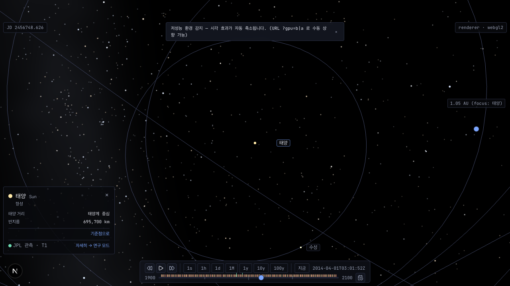 | 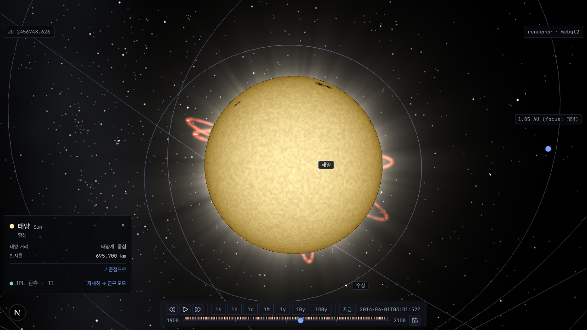 | 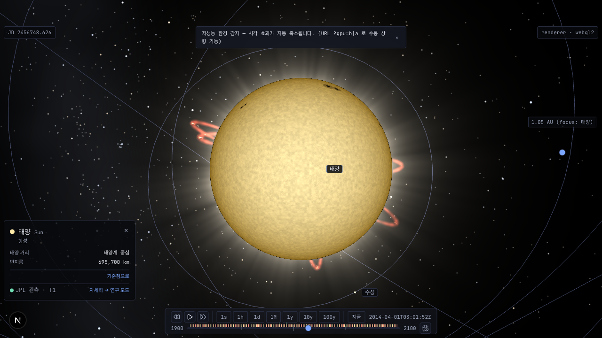 | 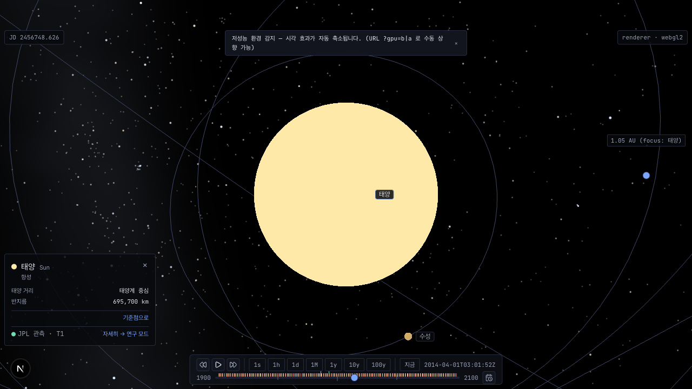 |

기본 화면 (`?t=…&speed=0`) · 하드웨어 WebGL2:

| develop (base) | A | B′ (태양 mid) | C |
| --- | --- | --- | --- |
| 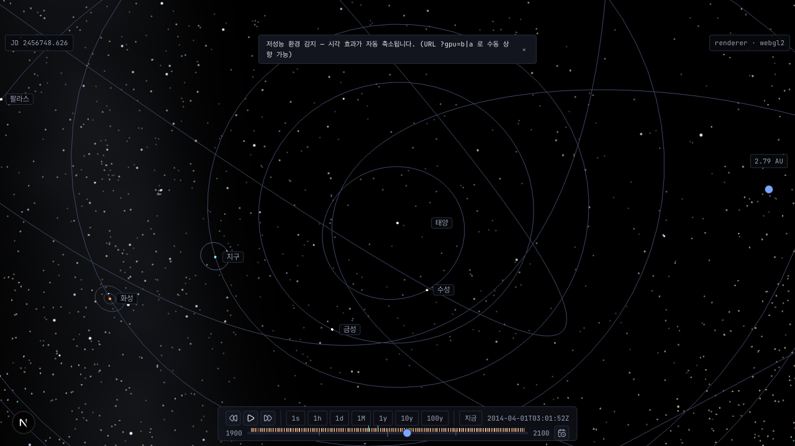 | 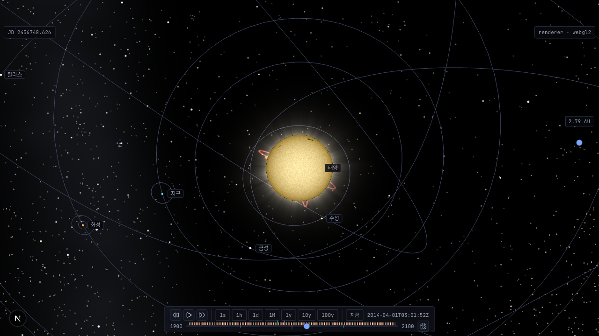 | 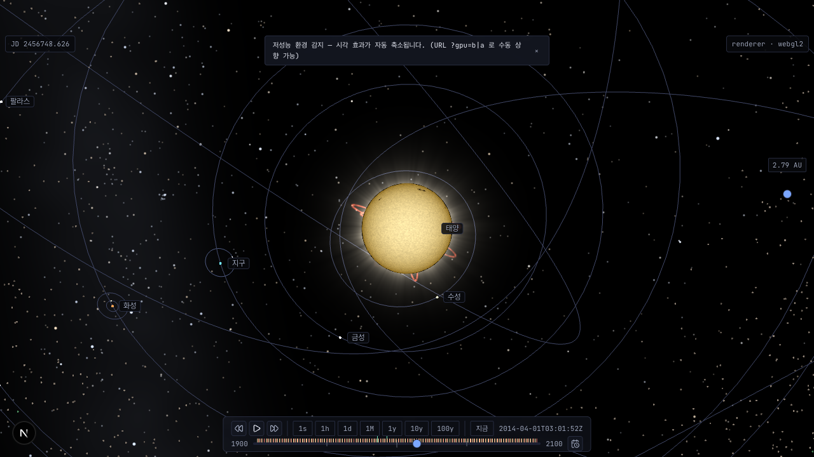 | 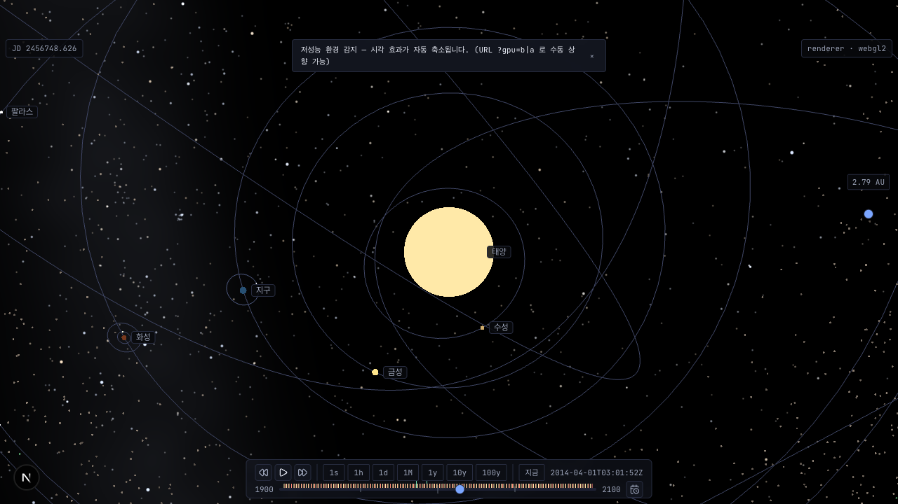 |

다른 body 근접 2.6 R · 하드웨어 WebGL2 (지구 / 목성) 와 WebGPU 기준 화면:

| | develop (base) | A | C |
| --- | --- | --- | --- |
| 지구 | 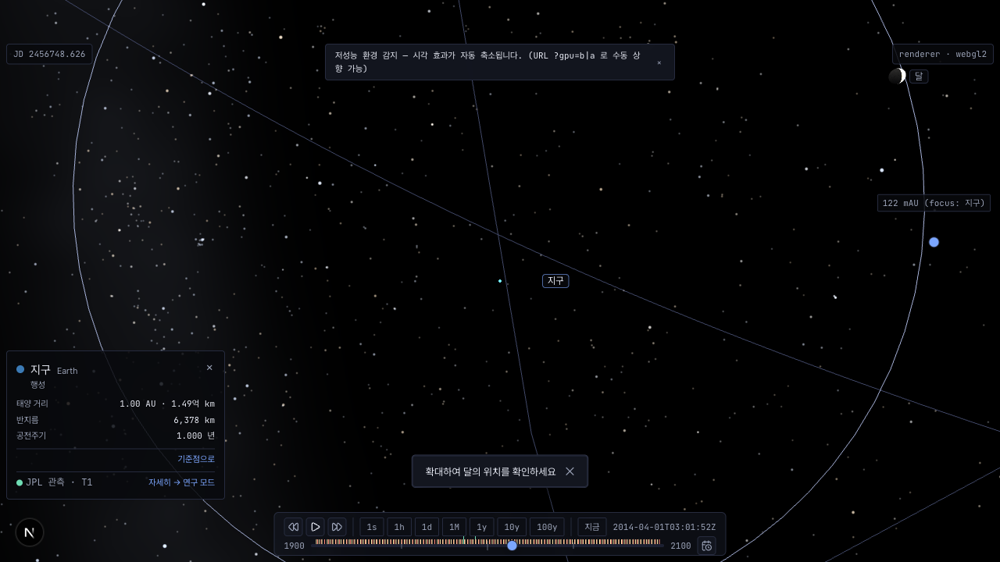 | 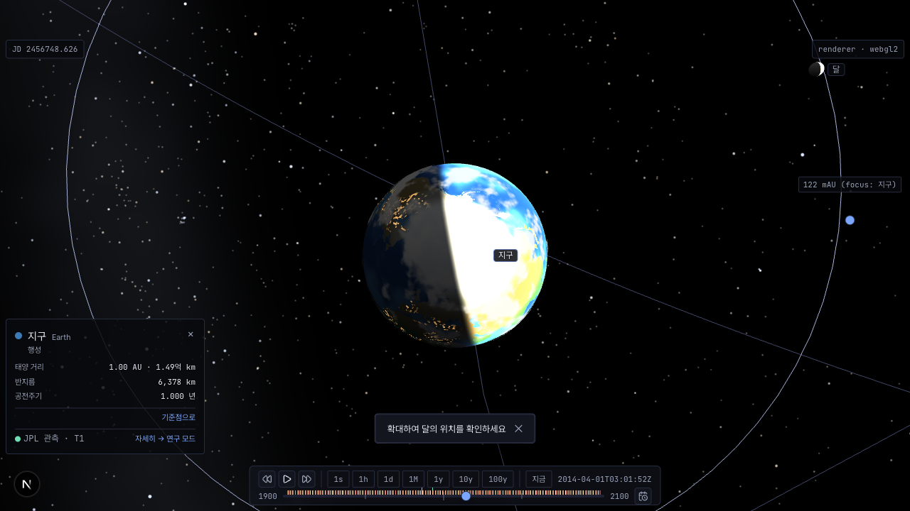 | 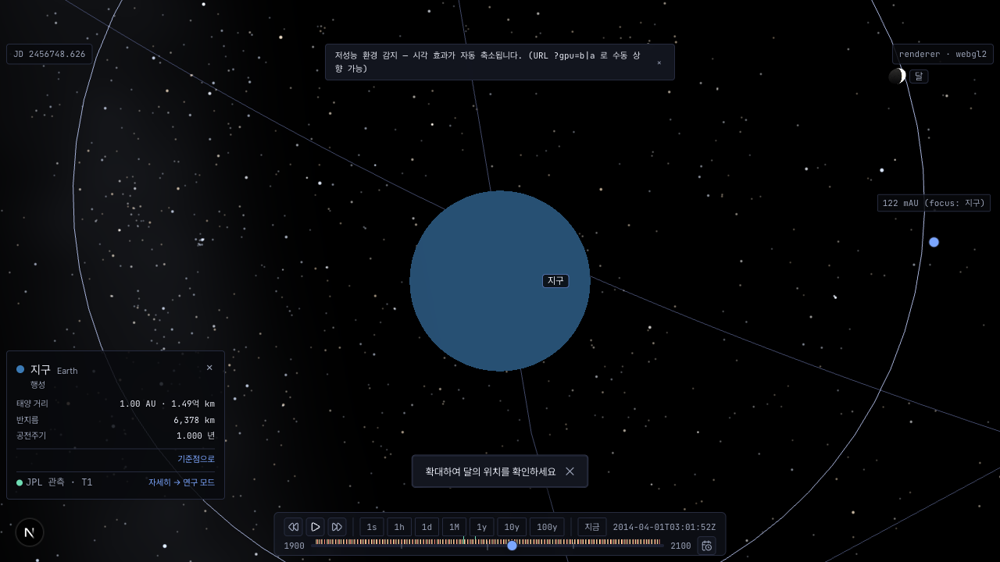 |
| 목성 | 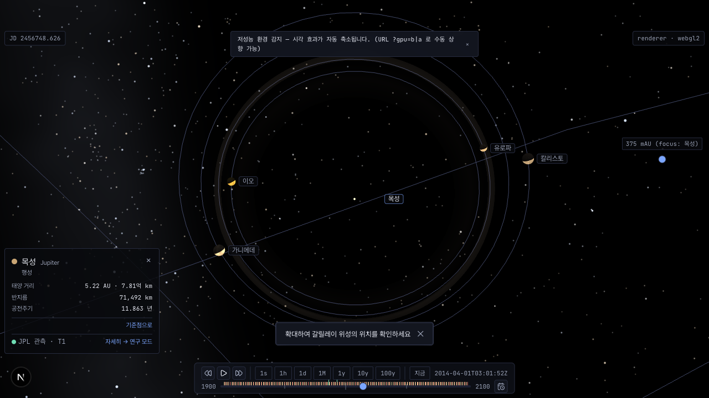 | 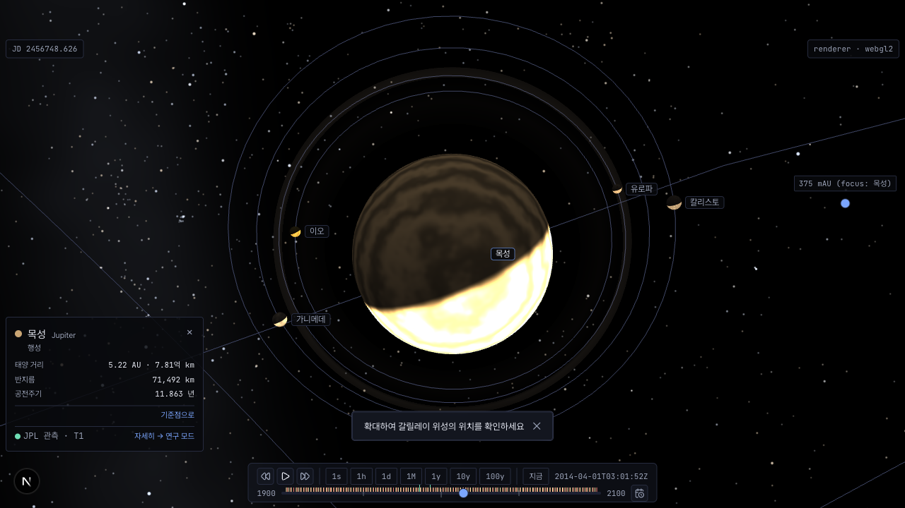 | 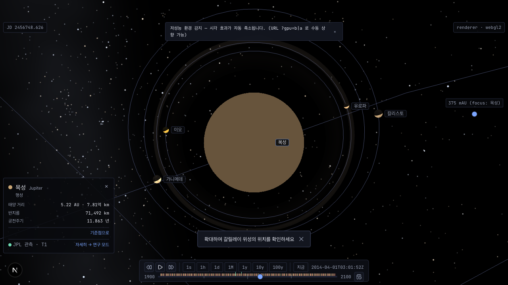 |

WebGPU 기준 (태양 근접, develop): 

#### 측정 1 — 태양 근접 2.6 R 원판 (하드웨어 WebGL2)

예상 원: 반경 189 px · 112,328 px. 잡음: base 재로드 0 px.

| 안 | `__gpuTier` | LOD override | 태양 LOD | 원판 px | 원 대비 | 코로나 · 홍염 메시 가시 | base 대비 차 (> 2) |
| --- | --- | --- | --- | ---: | ---: | --- | ---: |
| base | c | low | low | **352** | 0.3 % | 아니오 | — |
| A | b | auto | high | 111,883 | 99.6 % | 예 | 614,685 |
| B | c | auto | high | 111,883 | 99.6 % | 예 | 601,097 |
| B′ | c | auto (100/20) | high | 111,883 | 99.6 % | 예 | 601,097 |
| C | c | low | low | 90,592 | 80.6 % | **아니오** | 91,079 |
| (WebGPU develop) | b | auto | high | 111,883 | 99.6 % | 예 | — |

- **인과 확인 [실측]**: base 는 tier c → override low → 36 body 전부 low (h/m/l = 0/0/36) → 태양 high 메시 비가시 · billboard 가시. LOD 판정용 유효 직경 (bodyScale 포함) 은 378 px 인데, billboard 는 bodyScale (×50) 을 안 곱하므로 예상 지름이 378 / 50 ≈ 7.6 px 다. 원 안 밝은 픽셀 352 는 이 점과 원 안의 별 · 라벨을 합친 값이다. 이슈 본문의 「×75」 는 현행 `SUN_SCALE = 50` 과 다르다 (인과는 같음).
- A · B · B′ 의 원판 수는 WebGPU develop 과 **같은 값** (111,883) 이다. A ↔ B 의 픽셀 차이는 21,052 px 이고 전부 상단 알림 배너 영역 (x416–863, y56–102) 에 있다 — **화면상 차이는 「저성능 환경 감지」 배너 하나뿐**이다.
- C 는 원판이 생기지만 **평면 단색**이다 (명암 · 흑점 · 코로나 · 홍염 없음). 원 대비 80.6 % — 같은 지름의 평면이 근접 투시에서 구의 실루엣보다 작게 보인다.

#### 측정 2 — 다른 body 근접 2.6 R (하드웨어 WebGL2) · 기본 화면

| 시나리오 (예상 원 px) | base | A / B / B′ | C | WebGPU develop |
| --- | ---: | ---: | ---: | ---: |
| 지구 (51,804) | 975 (1.9 %) | 37,228 (71.9 %) | 41,680 (80.5 %) | 37,228 |
| 목성 (61,796) | 885 (1.4 %) | 45,621 (73.8 %) | 49,751 (80.5 %) | 45,621 |

- **결함은 태양만이 아니다 [실측]**: base 는 지구 · 목성도 2.6 R 에서 점이다. 하드웨어 WebGL2 의 모든 body 가 근접 시 점이다.
- A / B / B′ 는 WebGPU 와 원판 수가 같다 (지구 71.9 % 는 밤 반구가 어두워서 — WebGPU 도 같다). C 는 지구 · 목성을 **평면 단색 원판** (낮/밤 · 대기 · 띠 없음) 으로 그린다.
- **기본 화면 (파라미터 없음) 도 base 는 태양이 점이다** [실측 — 위 이미지]. 근접만의 문제가 아니라 첫 화면부터 보인다. C 는 기본 화면에서 태양 · 금성 · 수성 · 지구 · 화성이 과장 크기 평면 원판이 된다 (base 대비 13,066 px).

#### 측정 3 — fps (하드웨어 WebGL2 · 로컬)

| 조건 | base | A | B | B′ | C | WebGPU develop |
| --- | ---: | ---: | ---: | ---: | ---: | ---: |
| vsync (60 Hz) · 기본 화면 (파라미터 없음, 재생 중) | 60 / 60 | 60 / 60 | 60 / 60 | 60 / 60 | 60 / 60 | — |
| vsync · 태양 근접 | 60 | 60 | 60 | 60 | 60 | — |
| vsync 해제 · 1280×720 · 기본 화면 (3회 중앙값) | 659.9 | 656.3 | 680.1 | 678.9 | 679.3 | 633.6 |
| vsync 해제 · 1280×720 · 태양 근접 | 740.5 | 739.5 | 742.2 | 741.6 | 742.3 | 1,842.0 |
| vsync 해제 · 3840×2160 버퍼 (1920×1080 · DPR 2) · 기본 화면 | 358.4 | 338.6 | — | — | 367.3 | — |
| vsync 해제 · 3840×2160 버퍼 · 태양 근접 | 387.7 | **223.1** | — | — | 390.2 | — |

- **DoD 4 [실측]**: 하드웨어 WebGL2 기본 화면 fps 는 모든 안에서 60 (= 디스플레이 상한). vsync 해제 시 1280×720 에서는 안 사이 차이가 3회 반복 산포 (base 633~714) 안에 묻힌다 — 이 해상도에서 M1 Pro 는 GPU 가 병목이 아니다.
- 해상도를 9 배 (8.3 MP) 로 키우면 차이가 드러난다: A 태양 근접 프레임 시간 2.58 ms → 4.48 ms (**+1.9 ms**), 기본 화면 2.79 ms → 2.95 ms (+0.16 ms). 늘어난 것은 태양 셰이더 · 코로나 · 홍염의 fill-rate 다. C 는 base 와 같다 (평면 1장).
- **약한 integrated GPU 의 fps 는 측정하지 않았다 [가정]**: M1 Pro 보다 GPU 처리량이 10 배 낮고 1080p (2.1 MP, 위 측정의 1/4 화소) 라면 태양 근접 추가 비용은 약 1.9 ms × ¼ × 10 ≈ 4.8 ms 로 추정된다. 30 fps 예산 33 ms 안이지만 **실측이 아니다** — §6 위험 1. 이 외삽은 M1 Pro (타일 기반 렌더러) 의 fill-rate 특성을 즉시 모드 · 대역폭 병목 GPU 에 선형 비례로 옮긴 것이라 **낙관 쪽으로 치우쳐 있다** (cross-validate 이견 수용 3).

#### 측정 4 — WebGPU 경로 픽셀 (DoD 3)

`navigator.gpu` 유지 · `WebGPUEngine` · tier b. 잡음: base 재로드 4 시나리오 전부 0 px.

| 안 | 기본 화면 | 태양 근접 | 지구 근접 | 목성 근접 |
| --- | ---: | ---: | ---: | ---: |
| A | 0 | 0 | 0 | 0 |
| B | 0 | 0 | 0 | 0 |
| B′ | 0 | 0 | 0 | 0 |
| C | **210** (x173–689, y410–535) | **160** (x748–761, y616–629 — 수성) | 0 | 0 |

- 정적 근거: A 는 `!webgpu.supported` 분기 안에서만 동작 · B/B′ 는 tier c 분기 안에서만 동작 → WebGPU 데스크톱 (tier a/b) 은 도달하지 않는다. C 는 billboard 생성식 자체를 바꾸므로 **모든 tier 의 sub-pixel body** (수성 · 금성 · 지구 · 화성의 glow marker 자리) 가 바뀐다.
- 측정 주석: WebGPU 첫 페이지 로드 1회는 별 · 태양이 아직 그려지지 않은 프레임이 찍혀 868,919 px 로 튀었다 (셰이더 첫 컴파일 추정). 같은 세션에서 base 를 다시 측정해 재로드 0 px 를 확인한 뒤 위 표를 그 캡처 기준으로 산출했다.

#### 측정 5 — 소프트웨어 렌더 (swiftshader · `navigator.gpu` 제거) (DoD 2)

| 안 | `__isSoftwareRenderer` | `__gpuTier` | LOD override | base 대비 차 (기본 화면) | fps (vsync, 2회) |
| --- | --- | --- | --- | ---: | --- |
| base | true | c | low | — (재로드 0) | 18.0 / 18.1 |
| A | true | **c** | **low** | **0** | 18.4 / 18.1 |
| B | true | c | **auto** (태양 high) | 16,078 | 17.2 / 17.5 |
| B′ | true | c | **auto** (태양 mid) | 15,936 | 17.6 / 17.9 |
| C | true | c | low | 13,051 | 17.5 / 17.2 |

- A 는 소프트웨어 렌더에서 develop 과 **픽셀 · tier · override 모두 동일** [실측].
- B / B′ 는 소프트웨어 렌더에서도 강제 low 가 풀린다 → **DoD 2 「억제 불변」 위반** [실측]. 모바일 비-WebGPU (분기 1, 같은 tier c) 도 같은 코드 경로라 같이 풀린다 [정적].
- C 는 tier · override 는 불변이지만 소프트웨어 화면이 13,051 px 바뀐다 (CI swiftshader 의 픽셀 baseline 변화).

### 가설 검증 결론

- 이슈 본문의 인과 「WebGPU 미지원 → tier c → LOD low 전 body 강제 → billboard 가 bodyScale 미적용 → 근접 시 점」 은 **측정으로 확인됐다** (측정 1 base 행). 범위는 태양만이 아니라 **하드웨어 WebGL2 의 전 body · 기본 화면 포함**이다 (측정 2).
- B 와 A 는 하드웨어 WebGL2 에서 **배너 1개를 빼면 같은 화면**이다. B 의 고유 효과는 「tier c 라벨 유지」 뿐인데, tier c 의 다른 축 (particles / shadow / aa / postProc) 은 소비처가 0 이라 라벨 유지가 아무것도 억제하지 않는다. 그리고 B 를 그대로 구현하면 소프트웨어 · 모바일 보호가 함께 풀린다.

---

## §2 영향 모듈/파일

### 측정 결과 박제 (본 ADR 동반)

- `docs/reports/1435-webgl2-tier-poc/*.png` (15장) · `measurements.jsonl` · `measure.mjs.txt` · `poc-patch.diff.txt`
- `docs/decisions/20260424-tier-preset-design.md` — 헤더에 부분 개정 포인터 1줄

### 안별 구현 시 변경 대상

| 안 | 변경 파일 |
| --- | --- |
| A | `apps/web/src/core/detect-gpu-tier.ts` (입력에 렌더러 판정 추가 · 분기 2 · 주석 계약 2) · `detect-gpu-tier.test.ts` (fixture [10] 갱신 + 하드웨어/소프트웨어/판독 불가 3 fixture) · `sim-canvas.tsx` `resolveGpuTier` (렌더러 문자열 전달 — `extractWebglRendererString()` 은 컨텍스트를 하나 더 만드므로 **1회 memo** 해 scene 체인과 공유) · `browser-verify-glow-marker.mjs` 축 6 (아래) |
| B | `tier-profile.ts` (`c.lod.forceOverride` 제거) · `tier-profile.test.ts` · `sim-canvas.tsx` tier-c 분기 · #756/#774 주석 계약 · `verify-fps-baseline.mjs` #680 race 판정 · `browser-verify-756-surface.mjs` DoD 4 · glow-marker 축 6 |
| B′ | B + `solar-system-scene.ts` (`pixelThresholds` 주입 배선) + `SolarSystemSceneOptions` |
| C | `body-mesh-factory.ts` `createBodyBillboard` · `solar-system-scene.ts` glow 입력 (`bodyScaleVal`) · `glow-marker.ts` 산식 · `browser-verify-391-billboard.mjs` · glow-marker 가드 · r1 baseline 재생성 · ADR 20260425 §Phase 2 재개정 |

### 기존 가드 · 테스트 중 tier c 에 의존하는 것 (`git grep -E "__gpuTier\|tier-c\|gpu=[abc]\|__gpuTierForceLod\|graceful-degradation"` 결과에서 판정 경로만 추림)

| 가드 · 테스트 | 의존 내용 | A | B / B′ | C |
| --- | --- | --- | --- | --- |
| `scripts/verify-fps-baseline.mjs` (CI swiftshader) | #680 — tier c 면 override `low` 정착 대기 · `tier==='c' && override!=='low'` 를 race 패배로 집계 | 불변 (측정 5) | **깨짐** — 매 측정이 race 패배로 집계 + baseline fps 변동 | 픽셀만 변화 (fps 판정 영향 [가정] 작음) |
| `browser-verify-glow-marker.mjs` 축 6 (CI headless) | 가짜 `navigator.gpu` (adapter null) → `__gpuTier==='c' && override==='low'` 대기 | CI (소프트웨어) 불변 · **하드웨어 렌더 로컬 실행 시 tier b 가 되어 전제 불성립** → 축 6 에 렌더러 전제 검사 추가 필요 | **깨짐** (override 가 `low` 가 안 됨) | glow 산식 변경으로 다른 축 재검증 |
| `browser-verify-756-surface.mjs` DoD 4 (`?gpu=c`, shader-pixel-guard) | URL 강제 tier c → lodStats low | 불변 (URL `?gpu=c` 는 여전히 강제) | **깨짐** | 불변 [가정] |
| `scripts/browser-verify-mobile-p7d.mjs` 시나리오 3 (CI) | 모바일 UA + `navigator.gpu` 제거 → `tier-c-graceful-degradation` 알림 | 불변 (분기 1) | 알림은 유지 · 억제는 풀림 | 불변 |
| `apps/web/scripts/r1-ui-regression-guard.mjs` (CI, `?gpu=a`) | tier a 강제 — tier c 비의존 | 불변 | 불변 | **변화** (sub-pixel billboard — 측정 4 의 160~210 px 클래스) |
| `browser-verify-738-starfield.mjs` · `1265-display-panel.mjs` | `__isSoftwareRenderer` 게이트 | 불변 | 불변 | 불변 |
| `detect-gpu-tier.test.ts` [10] | 「구형 WebGL2-only 데스크톱 → c」 | **갱신** (렌더러 판정 입력 추가) | 불변 | 불변 |
| `tier-profile.test.ts` (`forceOverride` = `'low'`) | 프로파일 상수 | 불변 | **갱신** | 불변 |
| `?gpu=a` 를 쓰는 verify 스크립트 다수 (`379` · `lod` · `774` · `1215` …) | tier a 강제 | 불변 | 불변 | sub-pixel billboard 픽셀 영향 가능 |

---

## §3 옵션 비교

### 옵션 (A) 하드웨어 WebGL2 데스크톱 → tier b

`detectGpuTier` 분기 2 를 「WebGPU 미지원 **이고** 소프트웨어 렌더 (또는 판정 불가) → c」 로 좁힌다. 하드웨어로 판정된 WebGL2 데스크톱은 분기 3b 와 같은 `'b'`. 모바일 비-WebGPU 는 분기 1 이 먼저 `'c'` 로 끊는다 (불변).

### 옵션 (B) tier c 유지 · `forceOverride` 해제

모든 tier c (소프트웨어 · 모바일 포함) 가 거리별 LOD (기본 50/8) 를 쓴다. B′ 는 tier c 프로파일의 100/20 을 실제로 배선한다 (현행 소비처 0).

### 옵션 (C) low billboard 에 bodyScale 적용

#333 을 되돌린다. tier · LOD 판정은 그대로, low 변형의 크기만 과장 반경으로.

### 옵션 (C′) — C 의 범위 한정 변형

「LOD 가 **강제** low 일 때만 billboard 에 bodyScale 을 곱한다」. 거리 판정 low (모든 tier 의 sub-pixel body) 는 #333 그대로라 WebGPU 는 도달하지 않는다 [정적 — tier a/b 는 강제 low 가 없다]. 하드웨어 · 소프트웨어 tier c 의 화면은 측정한 C 와 같다 (측정 1·2·5 의 C 행 — 강제 low 상태에서는 C 와 C′ 의 식이 같다). 즉 DoD 3 은 통과하지만 **평면 단색 원판 · 효과 없음** 과 소프트웨어 화면 13,051 px 변화는 그대로다.

### 옵션 (B-hw) — 측정 중 도출한 변형

「하드웨어 WebGL2 에서만 forceOverride 를 건너뛰고 tier c 라벨 · 알림은 유지」. 측정상 A 와 **배너만 다른 화면**이다 (측정 1). tier c 라벨에 걸린 다른 동작이 없으므로 (§1 판독 2) A 보다 나은 점은 「저성능 알림이 계속 뜬다」 하나이고, 대가로 「tier c = 강제 low」 라는 현행 등식이 깨져 `__gpuTier==='c'` 로 판정하는 가드 (§2 표) 의 의미가 갈라진다.

### 축별 비교 매트릭스

| 축 | A | B / B′ | C | C′ | B-hw |
| --- | --- | --- | --- | --- | --- |
| DoD 1 — 태양 2.6 R 원판 [실측] | ✅ 99.6 % · 효과 전부 | ✅ 99.6 % · 효과 전부 | △ 80.6 % · **평면 · 효과 없음** | △ (= C) | ✅ (= A) |
| DoD 2 — 소프트웨어 · 모바일 보호 [실측 sw / 정적 모바일] | ✅ 픽셀 0 · tier c · low | ❌ 강제 low 해제 | △ tier · low 불변, 화면 13,051 px 변화 | △ (= C) | ✅ |
| DoD 3 — WebGPU 픽셀 0 [실측] | ✅ 0 | ✅ 0 | ❌ 160 / 210 px | ✅ [정적] | ✅ |
| DoD 4 — 기본 화면 fps [실측 M1 Pro] | 60 (해제 시 656) | 60 (680) | 60 (679) | (= C) | (= A) |
| 다른 body (지구 · 목성) | WebGPU 와 동일 | WebGPU 와 동일 | 평면 단색 | 평면 단색 | (= A) |
| 약한 iGPU 비용 [가정] | 태양 근접 +수 ms 추정 · 미실측 | 동일 + 소프트웨어 회귀 | 거의 0 | 거의 0 | (= A) |
| 깨지는 가드 | glow-marker 축 6 (로컬 하드웨어 실행) · 단위 fixture 1 | fps-baseline · 756 DoD 4 · 축 6 · 프로파일 테스트 | r1 baseline · 391 · glow-marker · ADR #333 | 소프트웨어 tier c 화면 13,051 px 변화 (r1 은 `?gpu=a` 라 불변) · ADR #333 | 축 6 · tier 라벨 의미 분기 |
| 개정 대상 ADR | 20260424 §축 1 분기 2 | 20260424 §축 5 · #756 §결정 3 · #774 §결정 6 | 20260425 §Phase 2 | 20260425 §Phase 2 (조건부 예외) | 20260424 §축 5 |

### 권장 안 (사전 선호) — **A**

1. DoD 1~4 를 **전부 실측으로** 충족하는 유일한 안이다 (B 는 DoD 2, C 는 DoD 3 실패). C′ 는 DoD 3 을 통과하지만 C 를 기각하는 주 근거는 DoD 3 이 아니라 **화면 품질**이다 — 하드웨어 GPU 가 충분한데도 태양 · 행성이 명암 · 흑점 · 코로나 · 홍염 · 낮밤 없는 **평면 단색 원판**이 된다 (측정 1·2). 이슈의 「홍염 · 흑점 등 효과 보임」 요구를 C/C′ 는 구조적으로 충족할 수 없다 (효과는 high/mid 메시에 묶인다 — §1 판독 5).
2. 결함의 위치와 고치는 위치가 일치한다 — 결함은 「tier c 판정이 소프트웨어와 하드웨어를 구분하지 않는다」 (#745 가 별 배경에 대해 같은 과잉 판정을 이미 한 번 정정했다 — 「Amendment 1 은 비활성 기준을 tier-c (…) 로 잡아 하드웨어 가속 PC 에서도 별이 사라지는 과잉 비활성 회귀」 (`sim-canvas.tsx` #745 주석)). A 는 같은 SSoT (`detectSoftwareRenderer`) 로 tier 판정의 같은 과잉을 정정한다.
3. 화면 결과가 WebGPU 와 원판 픽셀 수까지 같다 — 하드웨어 WebGL2 사용자가 「저성능 모드」 가 아니라 제품 그대로를 본다.
4. 남는 위험은 「WebGPU 없는 약한 하드웨어 GPU」 의 fps 이고 (§6 위험 1), 이것은 원 ADR §미해결 1 (런타임 tier 재감지) 의 영역이다.

---

## §4 Concrete Prediction (A 채택 시)

### 예측 1 — 프로덕션 코드 변경 파일

`detect-gpu-tier.ts` · `sim-canvas.tsx` 2개 (+ 테스트 · 가드). `packages/core/**` 변경 **0**. 확인: `git diff --stat develop...HEAD -- packages/core/src` = 0.

### 예측 2 — 수치 DoD

하드웨어 WebGL2 태양 2.6 R 원판 px = WebGPU develop 과 같은 값 (본 측정 환경 111,883). 소프트웨어 렌더 기본 화면 develop 대비 0 px. WebGPU 4 시나리오 0 px.

### 예측 3 — 인접 영역 무영향

CI 의 fps-baseline-guard · r1-ui-regression-guard · glow-marker 축 6 · mobile-p7d 3/4 · 756-surface DoD 4 가 **기존 판정 그대로** 통과한다 (CI 는 전부 소프트웨어 렌더 또는 URL 강제 tier).

---

## §5 결정 (사용자 선택 박제 후)

> **미결 — 아래 Q1~Q5 의 사용자 응답 후 확정한다.** 그 전까지 아래는 권고안이다.

### 사용자 결정 질문

| Q | 질문 | 선택지 | 권고 |
| --- | --- | --- | --- |
| Q1 | 어느 안으로 갈까 | (A) 하드웨어 WebGL2 → tier b / (B) 강제 low 해제 (소프트웨어 보호도 풀림) / (C) billboard 과장 (평면 원판, WebGPU 160~210 px 변화) / (C′) 강제 low 일 때만 billboard 과장 (평면 원판, WebGPU 0) / (B-hw) 하드웨어만 강제 해제 · 저성능 알림 유지 | **A** |
| Q2 | 렌더러 문자열을 못 읽는 경우. 현행 `extractWebglRendererString()` 은 `WEBGL_debug_renderer_info` 확장이 없으면 `null` 이다 | (a) `null` → tier c (보수) / (b) `null` → tier b / (c) tier 판정에 한해 확장이 없으면 `gl.getParameter(gl.RENDERER)` 로 한 번 더 읽고, 그래도 `null` 이면 c | **(c)** — `null` 은 대부분 「소프트웨어」 가 아니라 「확장 차단」 이라 (a) 는 프라이버시 설정을 쓴 하드웨어 사용자를 다시 점으로 만든다 (cross-validate 이견 수용 2). 반대로 (b) 는 판정 불가를 하드웨어로 취급해 소프트웨어 렌더가 새어 나간다. (c) 의 잔여 위험: 일반화된 문자열 (예: 브라우저가 돌려주는 범용 이름) 을 내는 소프트웨어 렌더는 하드웨어로 판정된다 (§6 위험 2). 별 배경 등 #745 게이트의 입력은 바꾸지 않는다 |
| Q3 | WebGPU 없는 약한 하드웨어 GPU 의 fps 위험 (미실측) | (a) 수용 — `?gpu=c` 로 수동 하향 가능 / (b) 수용 + 런타임 fps 하향 (원 ADR §미해결 1) 을 후속 이슈로 분리 / (c) 이번 범위에 런타임 하향 포함 | **(b)** — 실피해 관측 전이므로 `deferred:no-incident` 로 |
| Q4 | 하드웨어 WebGL2 에서 「저성능 환경 감지」 알림이 사라진다 | (a) 수용 / (b) 「WebGL2 로 렌더 중」 같은 별도 안내 신설 | **(a)** — 화면이 WebGPU 와 같으므로 「축소」 안내가 사실이 아니게 된다 |
| Q5 | 육안 확인 (D-T2) | POC 이미지 (§1 측정 시각 자료) 의 A 열이 기대와 맞는가 | 확인 요청 |

### 구현 절차 (A 채택 시 — Developer 인수인계)

1. `detectGpuTier` 입력에 `rendererIsSoftware: boolean | null` 추가 (`null` = 판독 불가). 분기 2 를 `if (!input.webgpu.supported) return input.rendererIsSoftware === false ? 'b' : 'c';` 로. 분기 1 (모바일) 은 그 **앞**에 그대로 둔다.
2. `sim-canvas.tsx` `resolveGpuTier` — **3상태로 변환해서** 넘긴다. ⚠️ `detectSoftwareRenderer()` 는 `null`/빈 문자열에 `false` (= 하드웨어) 를 돌려준다 (#745 의 별 배경 보수 방향). 그대로 넘기면 판독 불가가 `'b'` 가 된다 (cross-validate Critical — 합의 1):

   ```text
   const tierRendererString = <확장 UNMASKED 문자열> ?? <Q2 (c) 폴백: gl.getParameter(gl.RENDERER)>;
   const rendererIsSoftware = tierRendererString ? detectSoftwareRenderer(tierRendererString) : null;
   ```

   `extractWebglRendererString()` 은 호출마다 임시 WebGL 컨텍스트를 하나 만든다 (`loseContext` 호출 없음 — develop 현행). tier 체인 (`gpuCapPromise.then`) 과 scene 체인 중 어느 쪽이 먼저 도는지는 비결정적이므로 effect 범위의 lazy memo 로 **1회만** 만들어 공유한다 — develop 대비 컨텍스트 증가 0. Q2 (c) 폴백은 같은 임시 컨텍스트에서 읽는다. 2순위 (`adapterInfo.description`) 는 WebGPU 미지원 경로라 `null` 이다.
3. 주석 계약 갱신 — `detect-gpu-tier.ts` 계약 2 와 `detectGpuTier` JSDoc 분기 목록 · 같은 파일 계약 6 (「파티클 0 + shadow OFF + post-proc OFF + bloom OFF」 — 실소비는 LOD `forceOverride` 하나뿐이라는 #845 정정을 반영, cross-validate 합의 3) · `sim-canvas.tsx` 의 tier 감지 블록 주석 (「저성능 데스크톱(WebGL2-only)도 tier-c 경로에 포함된다」 서술 포함) · `detect-software-renderer.ts` 헤더 (「`detect-gpu-tier.ts` 는 무수정」 서술 — 본 변경으로 거짓이 된다, cross-validate 합의 2). 착수 시 `git grep -n "WebGL2\|무수정" -- apps/web/src/core/detect-gpu-tier.ts apps/web/src/core/detect-software-renderer.ts apps/web/src/components/sim-canvas.tsx` 로 전수 확인.
4. 테스트: fixture [10] 을 「하드웨어 WebGL2 → b」 로, 신규 「소프트웨어 WebGL2 → c」 · 「판독 불가 (`null`) WebGL2 → c」 · 「모바일 비-WebGPU + 하드웨어 렌더러 → c」 (분기 1 우선 확인). 3상태 변환 (절차 2) 은 순수 함수로 빼서 「`null` → `null`」 · 「`''` → `null`」 · 「SwiftShader 문자열 → `true`」 · 「ANGLE Metal 문자열 → `false`」 를 단언한다 — 절차 2 의 함정이 테스트로 잠긴다.
5. `browser-verify-glow-marker.mjs` 축 6 — 하드웨어 렌더러에서 돌면 tier b 가 되어 재현 전제가 사라진다. 전제 검사 (`__isSoftwareRenderer === true` 아니면 `exit 2` 전제 위반) 를 추가한다. CI 는 소프트웨어라 판정 불변.
6. qa: 실 Chrome headed 로 본 ADR 측정 1·4·5 재현 (하드웨어 WebGL2 원판 · WebGPU 0 px · swiftshader 0 px) + 하드웨어 WebGL2 3단계 브라우저 검증.

### 박제 대상 문구 (raw text — `detect-gpu-tier.ts` 주석 계약 2 교체안)

```text
 *   2. 감지 순서: hard reject (모바일+!WebGPU → c) → WebGPU 미지원 + 소프트웨어 렌더 또는 렌더러 판독 불가 (→ c)
 *      → WebGPU 미지원 + 하드웨어 렌더 (→ b, #1435) → adapter 분류 (discrete+8코어 → a, 그 외 → b)
```

### 명시적 비-범위

- tier 프로파일의 미배선 축 (particles / shadow / aa / postProc / `lod.high·mid`) 배선 — 소비처 0 상태 유지.
- 런타임 fps 기반 tier 재감지 (Q3 (b) 면 후속 이슈).
- billboard 크기 정책 (#333) 변경.
- 모바일 비-WebGPU 판정 변경.

---

## §6 위험 / 재검토 트리거

1. **약한 하드웨어 GPU 의 fps (미실측)** — WebGPU 가 기본 비활성인 환경 (Linux Chrome · Firefox · macOS 26 이전 Safari 등 [가정 — 브라우저별 WebGPU 기본값은 측정하지 않음]) 의 하드웨어 GPU 가 tier b 가 된다. 이 집단에는 develop 에서 이미 tier b 인 WebGPU integrated GPU 보다 약한 기기가 섞일 수 있다. 완화: `?gpu=c` 수동 하향 경로 유지 · Q3.
2. **렌더러 문자열 위장** — 브라우저가 렌더러 문자열을 일반화된 이름으로 바꿔 소프트웨어 렌더를 하드웨어처럼 보이게 하면 tier b 가 된다 (Q2 (c) 폴백이 이 경로를 넓힌다). `detectSoftwareRenderer` 키워드 (swiftshader / llvmpipe / swrast 등) 에 걸리지 않는 소프트웨어 렌더러는 측정하지 않았다 [가정].
3. **로컬 하드웨어에서 도는 가드의 전제 변화** — `navigator.gpu` 를 지워 tier c 를 만들던 로컬 재현 (glow-marker 축 6 · PR #1432 qa 방식) 이 하드웨어 렌더러에서는 더 이상 tier c 가 아니다. tier c 재현은 `?gpu=c` 또는 swiftshader 로 해야 한다.

### 재검토 트리거

- tier b 로 올라간 하드웨어 WebGL2 환경에서 idle fps < 30 실피해 보고 → 런타임 하향 (원 ADR §미해결 1) 착수.
- tier 프로파일의 미배선 축이 배선될 때 → tier b / c 경계를 다시 본다 (그때는 tier 라벨이 실제로 여러 축을 억제한다).

---

## §7 Amendment 라운드

(사용자 결정 · cross-validate 반영 시 추가)

---

## §8 후속 / 분리 이슈

- (Q3 (b) 채택 시) 런타임 fps 기반 tier 하향 — `deferred:no-incident`.
- 범위 밖 관찰 (기록만, cross-validate 고유 발견 1): WebGPU 가 **지원되는데** 어댑터가 소프트웨어인 환경은 분기 3 에서 미지 vendor → integrated → tier b 가 된다. 본 이슈 범위 (WebGPU 미지원) 밖이고 CI ubuntu 는 `requestAdapter()` 가 `null` 이라 해당하지 않는다. 실피해 0 이라 이슈화하지 않는다.
- 범위 밖 관찰 (기록만): `TIER_PROFILES.c.lod.{high, mid}` 와 `lod.ts` `pixelThresholds` 주입 경로는 소비처 0 이다 (§1 판독 3). `tier-profile.ts` 헤더는 「lod 축만 수동 소비」 라고 적지만 실제로는 lod 축 중 `forceOverride` 만 소비된다. 실피해 0 이라 이슈화하지 않는다.

---

## 교차검증 반영 사항

- 호출: 2026-11-18 · `cross_validate.sh architecture` (Antigravity `agy`) · 입력 = 본 ADR 초판 + 코드 발췌 4건 (`detect-gpu-tier.ts` 전체 · `sim-canvas.tsx` 361–475 / 1107–1145 · `detect-software-renderer.ts` 전체 — 구조 경계 발췌) · outcome `applied` · `plan_bypass=false`.
- **호출 전 Claude 편향 셀프 체크** ([cross-validate-protocol.md](../guides/cross-validate-protocol.md) §5): 낙관적 일정 — 해당 없음 (설계 단계) / **결합 간과 — 미확신** (`__gpuTier` 소비처를 grep 으로만 확인) → 명시 질문 Q-a / **폐기 프레이밍 — 미확신** (C 기각이 DoD 3 측정 설계에 기댐) → Q-b / **순수주의 — 미확신** (Q2 보수 권고) → Q-c. 측정 방법 자체 → Q-d.

### 합의 (본 판본에 반영)

1. **[Critical] 3상태 변환 누락** — `detectSoftwareRenderer(null) === false` 라 초판 절차 2 대로면 판독 불가가 tier b 가 된다. 코드로 확인 (`detect-software-renderer.ts` `if (!rendererString) return false`). → §5 절차 2 를 3상태 변환으로 고치고, 절차 4 에 변환 함수 단위 테스트를 추가했다. 이 결함은 측정 POC 에는 없었다 (POC 는 `rs !== null && !detectSoftwareRenderer(rs)` 로 따로 걸렀다) — **설계 문서로 옮기면서 생긴 결함**이다.
2. **[Medium] `detect-software-renderer.ts` 헤더의 「`detect-gpu-tier.ts` 는 무수정」** — A 가 이 서술을 거짓으로 만든다. → §5 절차 3 갱신 대상에 추가.
3. **[Low] `detect-gpu-tier.ts` 계약 6 의 「파티클 0 + shadow OFF + …」** — 실소비는 `forceOverride` 하나다 (§1 판독 2). → §5 절차 3 에 추가.
4. **[Medium] C 기각 프레이밍** — C 를 「강제 low 일 때만」 으로 한정하면 DoD 3 을 통과한다. → 옵션 C′ 로 비교표에 추가하고, C 기각의 주 근거를 화면 품질 (평면 단색 · 효과 없음) 로 옮겼다 (§3 권장 1). 결론 A 는 불변.

### 이견 수용

1. **Q2 권고 변경 (a) → (c)** — 원안: 판독 불가 → c (보수). 외부 모델: `null` 은 대부분 프라이버시 확장 차단이라 하드웨어 사용자를 다시 점으로 만들고, 같은 파일의 `classifyAdapterIsDiscrete` 는 빈 adapter info 를 integrated (→ b) 로 폴백해 철학이 어긋난다. 수용 근거: 현행 `extractWebglRendererString()` 이 확장 부재 시 곧바로 `null` 을 반환한다는 것을 코드로 확인했고, `gl.RENDERER` 폴백으로 `null` 의 대부분을 줄일 수 있다. 단 (b) (`null` → b) 까지는 가지 않는다 — 렌더러를 전혀 못 읽는 경우는 여전히 보수 판정.
2. **약한 GPU 외삽의 낙관 편향** — 타일 기반 (M1) → 즉시 모드 GPU 선형 외삽은 낙관적이라는 지적 수용. §1 측정 3 에 명시. 결론에는 영향 없음 — 그래서 Q3 (b) 후속 분리를 권고한다.

### Claude 재분석으로 기각한 외부 모델 제안

1. **`window.__gpuTierForceLod` 해제 대칭 로직 추가 (Medium)** — 기각. tier 판정은 마운트당 1회이고 `?gpu=` 변경은 전체 문서 로드다. A 는 세션 안의 c → b 전이를 새로 만들지 않는다 (판정 입력이 로드 시점 렌더러 문자열이라 불변). 측정 1 의 A 행도 `override=auto` 로 정착했다. 실피해 경로 0.
2. **임시 컨텍스트 `loseContext()` 보장 (High)** — 범위 밖으로 판정. develop 현행 동작이고, 절차 2 의 memo 로 A 가 늘리는 컨텍스트는 0 이다. 컨텍스트 상한 사고 관측 0.
3. **「렌더러가 소프트웨어면 WebGPU 지원 여부와 무관하게 c」 로 분기 일반화 (Medium)** — 기각. WebGPU 경로 판정을 바꾸면 DoD 3 (WebGPU 픽셀 0) 의 정적 근거 (A 는 `!webgpu.supported` 안에서만 동작) 가 깨진다. 범위 밖 관찰로만 기록 (§8).

### 고유 발견 (후속 분리)

- WebGPU 지원 + 소프트웨어 어댑터 → tier b (§8 기록). 실피해 0 → 이슈 미생성 (CLAUDE.md §검증 강도 게이트 — 범위 밖 발견 기본 처분은 기록).
