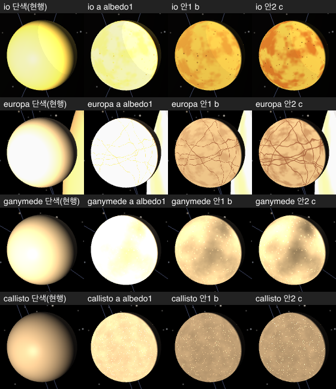
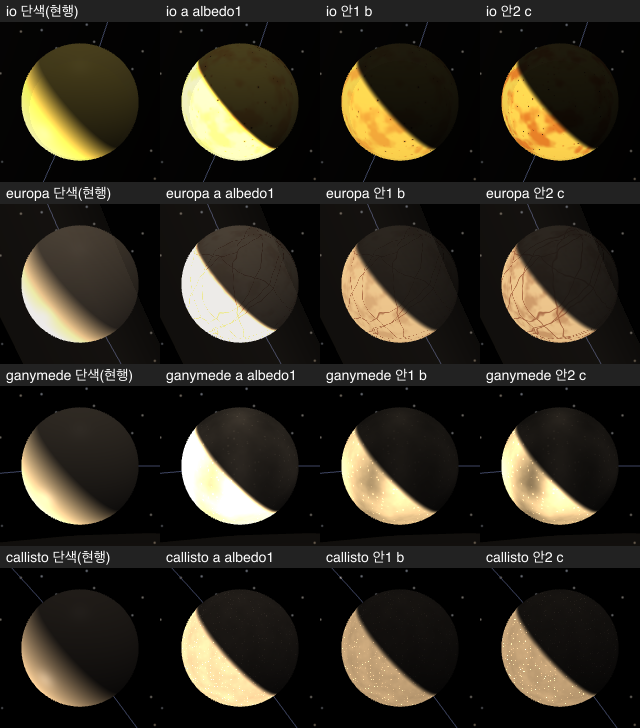
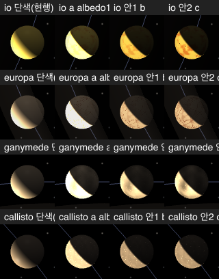
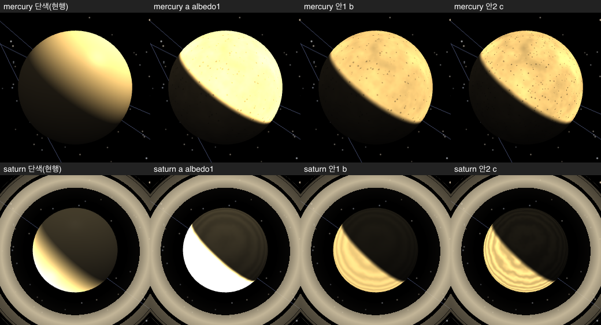
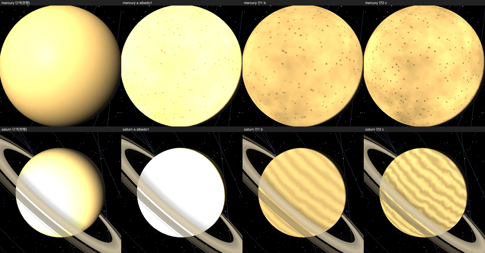
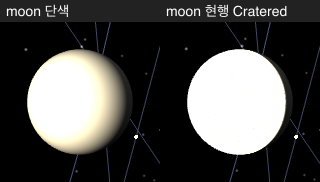
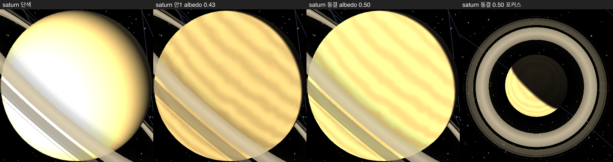

# #1419 설계 시안 — 지구 밖 천체 표면 (육안 결정용)

이슈 [#1419](https://github.com/coseo12/astro-simulator/issues/1419) 의 설계 단계 시안이다. **결정 (사용자 2026-10-30): 안 1 (b) 전 body 일괄.** 동결 수치의 정본은 ADR §5-A 이고, saturn albedo 만 안 1 의 `0.43` 이 아니라 `0.50` 이다 (아래 「saturn albedo 보정」). 결정 근거와 Q 표는 ADR [`20261030-1419-body-surface-catalog.md`](../../../decisions/20261030-1419-body-surface-catalog.md) 에 있다.

- 시안 코드는 scratch worktree 에서만 만들었고 커밋하지 않았다 (volt #67). 앱 코드 변경 `0`.
- 아래 수치는 **판정이 아니라 정보**다. 갭이나 휘도로 후보를 거르지 않는다.

## 시안 구성

| 열          | 의미                                                                                                    |
| ----------- | ------------------------------------------------------------------------------------------------------- |
| 단색 (현행) | `?surface=off` — 미등록 body 의 현행 렌더 (`StandardMaterial` 단색). 대상 6 body 는 오늘 모두 이 경로다 |
| a           | 안 1 의 패턴 + albedo `1` — 현행 광원식 그대로 두면 어떻게 되는지 보이는 **참고 열** (채택 후보 아님)   |
| 안 1 (b)    | 절제 — 패턴 기본 진폭 + albedo 규칙값                                                                   |
| 안 2 (c)    | 강조 — 패턴 진폭 · 밀도를 키움, albedo 는 안 1 과 같음                                                  |

## 시트

갈릴레이 위성 — 태양 쪽 근접 시점 (낮면 판독용):

갈릴레이 위성 — 포커스 진입 직후 근접 (`radius × 0.42`, 위상은 고정 JD 그대로):

갈릴레이 위성 — 포커스 1280 화면 (disk 반경 `24.6 px`):

수성 · 토성 — 포커스 1280 화면 (disk 반경 수성 `98.3 px` · 토성 `73.2 px`):

수성 · 토성 — 태양 쪽 근접 시점:

참고 — 달 (현행 `Cratered`, 이번 범위 밖) 의 태양측 근접:

## 후보 파라미터

albedo 규칙 (안 1 · 안 2 공통): `min(낮면 직하점 3채널 비포화 배율, 단색 경로 평균 휘도 이하 배율)`. 앞쪽은 `DEFAULT_PLANET_LIGHTING` 낮면 계수 `(2.6725, 2.5475, 2.1770)` × `colorHint` 의 채널 최댓값의 역수, 뒤쪽은 아래 「lit 수치」 의 단색 열과 비교해 맞췄다.

| body     | 타입            | `colorHint` | 안 1 (b)                                                             | 안 2 (c)                                          | albedo |
| -------- | --------------- | ----------- | -------------------------------------------------------------------- | ------------------------------------------------- | -----: |
| mercury  | Cratered        | `#8C7853`   | 밀도 `14` · 깊이 `0.4` · 결 `0.15` · 지역 `0.12` (주파수 `2.0`)      | 밀도 `18` · 깊이 `0.5` · 결 `0.2` · 지역 `0.18`   | `0.68` |
| callisto | Cratered        | `#6B5D50`   | 밀도 `22` · 깊이 `−0.7` (밝은 크레이터) · 결 `0.12` · 지역 `0`       | 밀도 `28` · 깊이 `−1.0`                           | `0.69` |
| ganymede | Cratered        | `#9C8A74`   | 밀도 `12` · 깊이 `−0.4` · 결 `0.12` · 지역 `0.3` (주파수 `2.0`)      | 깊이 `−0.5` · 지역 `0.45`                         | `0.61` |
| io       | Volcanic (신규) | `#F2D35C`   | 패치 주파수 `3.0` · 패치 `0.45` · 칼데라 주파수 `9.0` · 칼데라 `0.9` | 패치 `0.85` · 칼데라 주파수 `12.0` · 칼데라 `1.0` | `0.40` |
| europa   | Icy (신규)      | `#D4B896`   | 얼룩 주파수 `2.5` · 얼룩 `0.35` · 선 폭 `0.010` · 선 `10` 개         | 얼룩 `0.55` · 선 폭 `0.018` · 선 `12` 개          | `0.45` |
| saturn   | IceGiant 재사용 | `#E0C78E`   | 밴드 `(0.08, 10, 0.05)`                                              | 밴드 `(0.14, 12, 0.08)`                           | `0.43` |

- 크레이터 깊이가 **음수**면 크레이터가 밝아진다 (callisto — NASA 「darker surface 위의 bright scars」). GLSL 식 `(1 − crater × depth)` 그대로이고 새 uniform 은 없다.
- 보조색 (rendering-only 상수 — 데이터 SSoT 아님): io 패치 · 후광 `(0.85, 0.45, 0.15)` · 칼데라 `(0.12, 0.08, 0.05)` / europa 얼룩 `(0.62, 0.42, 0.30)` · lineae `(0.55, 0.32, 0.22)`.
- 달 행은 모든 열에서 기존 상수 그대로다 (밀도 `14` · 깊이 `0.4` · 결 `0.15` · 지역 `0` · albedo `1`).

## lit 수치 (태양측 근접, disk `0.95R` 표본, 실 Chrome · WebGPU)

| body                 | 열                     |                        3채널 포화 % |                         1채널+ 포화 % |                             평균 휘도 |                            휘도 σ |
| -------------------- | ---------------------- | ----------------------------------: | ------------------------------------: | ------------------------------------: | --------------------------------: |
| io                   | 단색 / a / 안 1 / 안 2 |   `0.00` / `0.00` / `0.00` / `0.00` |  `22.53` / `34.95` / `11.36` / `9.54` | `214.6` / `232.8` / `184.5` / `175.3` | `46.8` / `31.8` / `32.0` / `35.1` |
| europa               | 〃                     |   `0.00` / `0.00` / `0.00` / `0.00` |     `0.00` / `0.00` / `0.00` / `0.00` | `220.8` / `243.3` / `189.1` / `180.6` | `54.7` / `34.0` / `34.8` / `37.0` |
| ganymede             | 〃                     |  `1.85` / `40.73` / `0.01` / `0.09` | `62.54` / `96.65` / `44.27` / `48.24` | `205.9` / `246.7` / `207.3` / `205.4` | `63.4` / `35.4` / `39.5` / `44.4` |
| callisto             | 〃                     |   `0.00` / `0.38` / `0.00` / `0.00` |   `19.12` / `95.67` / `1.31` / `1.76` | `159.2` / `224.9` / `160.9` / `161.2` | `59.2` / `35.8` / `27.5` / `28.1` |
| mercury              | 〃                     |   `0.00` / `0.00` / `0.00` / `0.00` | `68.79` / `99.86` / `74.63` / `71.24` | `214.4` / `247.2` / `216.2` / `216.3` |  `45.1` / `2.8` / `11.5` / `15.6` |
| saturn               | 〃                     | `16.49` / `72.24` / `0.00` / `0.00` | `59.43` / `72.64` / `31.72` / `34.78` | `224.3` / `241.0` / `204.5` / `203.6` | `38.7` / `25.3` / `19.5` / `23.9` |
| moon (현행 Cratered) | 단색 / 현행            |           `44.33` / `95.01 ~ 95.03` |             `64.49` / `96.11 ~ 96.13` |                     `216.4` / `247.7` |            `63.0` / `38.0 ~ 38.1` |

- 휘도는 Rec.601 `0.299R + 0.587G + 0.114B`. lit 시점 = 근접 반경에서 태양 방향을 기준으로 약 30° 비켜 본 카메라.
- 달 현행 열의 범위는 같은 빌드 4회 캡처 사이의 값이다 (lit 시점은 `speed=0` · `rotate=off` 결정적 프레임이 아니다).

## `verify:756` 갭 (swiftshader, `HF_ENTROPY_MARGIN 0.15` 무변경)

| body     | 안 1 (b) | 안 2 (c) |
| -------- | -------: | -------: |
| mercury  |  `1.470` |  `1.655` |
| callisto |  `1.806` |  `1.827` |
| ganymede |  `1.739` |  `1.770` |
| io       |  `1.414` |  `1.641` |
| europa   |  `1.741` |  `1.949` |
| saturn   |  `0.949` |  `1.669` |

기존 6 body 의 갭은 두 빌드 모두 그대로 통과했다 (earth `2.676 ~ 2.677` · mars `1.098 ~ 1.100` · jupiter `1.199 ~ 1.200` · moon `0.962 ~ 0.965` · uranus `0.683 ~ 0.686` · neptune `0.166 ~ 0.168`).

## saturn albedo 보정 (결정 후 실측)

안 1 의 saturn albedo `0.43` 은 기존 로컬 가드 `verify:790-focus-zoom` S3 (토성 최대 줌인 중앙 crop 평균 휘도, 임계 `20`) 를 FAIL 했다. 그 화면은 토성 밤면이고, 밤면 휘도는 albedo 에 비례한다.

|     saturn albedo | 790 S3 휘도                     | 태양측 근접 평균 휘도 (단색 `224.3`) | 3채널 포화 |
| ----------------: | ------------------------------- | -----------------------------------: | ---------: |
|    단색 (develop) | `42.4` · `42.4`                 |                              `224.3` |   `16.49%` |
|     `0.43` (안 1) | `19.6` · `19.4` · `18.6` — FAIL |                              `204.5` |    `0.00%` |
| **`0.50` (동결)** | `22.5` · `21.5` — PASS          |                              `224.8` |    `0.00%` |
|            `0.55` | `24.3` — PASS                   |                              `231.4` |    `0.00%` |

## `verify:773` — io · europa (안 1, swiftshader)

| body   | 낮면 평균 | 밤면 평균 | 대비 낙차 | 보라 % | 판정 |
| ------ | --------: | --------: | --------: | -----: | ---- |
| io     |   `149.6` |    `18.3` |  `62.18%` |    `0` | PASS |
| europa |   `147.6` |    `28.7` |  `40.66%` |    `0` | PASS |

## 캡처 조건

- 실 Chrome GUI (`headless:false`, `channel:'chrome'`) · WebGPU (`engine.isWebGPU === true` 전 캡처) · 1280×720 · `deviceScaleFactor 1` · 브라우저 인스턴스 1개 (`withBrowser`, try/finally close).
- 쿼리 `?gpu=a&focus=<id>&lod=auto` (+ `&surface=off` / 후보 플래그) · `jumpToJulianDate(2451626.0)` + `pause` (#1274 D13 과 같은 JD) · `waitForLodSettle` · `hideDomOverlays`.
- 근접 = 포커스 카메라 `radius × 0.42`. lit = 근접 반경에서 태양 방향 쪽으로 카메라 이동.
- 콘솔 에러: 28 page load (4 열 × 7 body) 전부 `0`.
- 측정 · 시트 스크립트와 POC diff 는 커밋하지 않았다 (volt #67).
